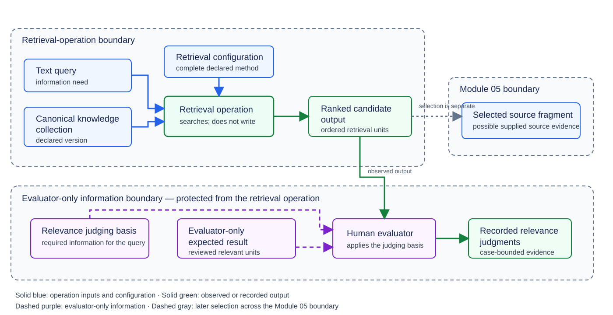
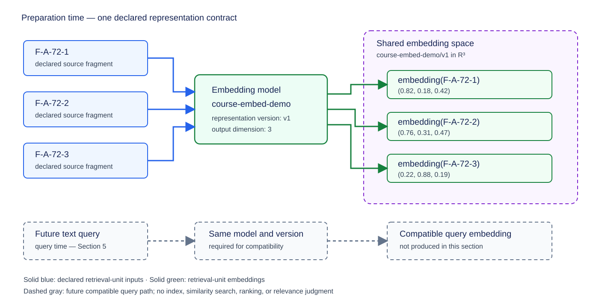
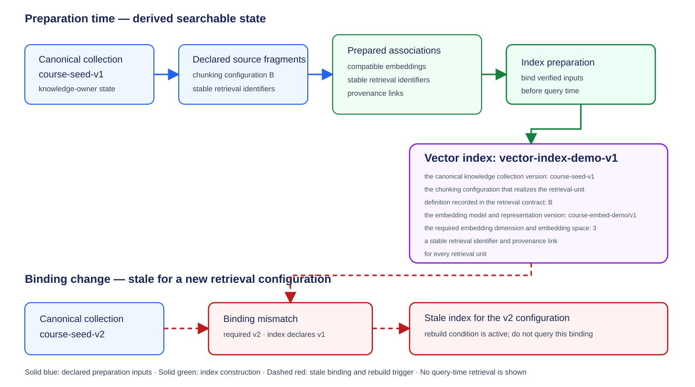
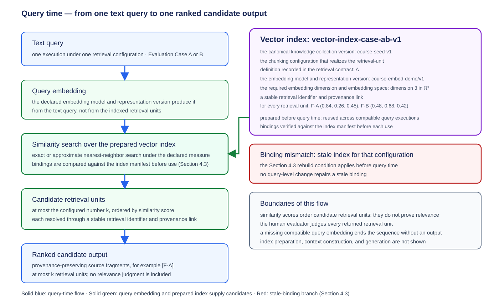

# Module 04: Embeddings and Vector Retrieval — Theory

> **Status:** Ready for Students — English theory and Ukrainian translation approved by the instructor on 2026-10-10

## Engineering problem: where does supplied source evidence come from?

Module 03 compared **Variant A** and **Variant B** as two complete configurations of the **model-backed concept-proposal operation** under one shared experiment protocol. Every **evaluation case** supplied both configurations with the same task and the same **supplied source evidence**, and each configuration produced a **candidate concept definition** that was assessed under the same protocol. Module 03 treated the supplied source evidence as already given and fixed. It did not explain where that evidence came from.

This module fills that gap: it explains how to locate the needed material inside a larger store before it can serve as supplied source evidence. The step that performs this search is the **retrieval operation**, and its result is the **ranked candidate output**.

### Key concepts for this opening

- **Canonical knowledge collection:** a named, versioned store of **canonical knowledge records** that the retrieval operation searches. It is a store of material, not Module 03's evaluation set of test cases.
- **Retrieval operation:** receives a text query (the task input stating the information need), searches a declared collection version, and returns an ordered set of entries derived from that collection version; the entries need not themselves be members of the collection. The retrieval operation neither produces a candidate concept definition nor changes the collection.
- **Ranked candidate output:** the ordered entries returned by one execution of the retrieval operation. It is a search result, not a **candidate concept definition** and not Module 03's single **candidate output**.

### Where the retrieval operation fits

The two information paths below show the gap directly. Arrows describe information flow, not authority to change anything.

**Module 03 path:**

```text
Evaluation case
  → task + supplied source evidence
  → Variant A and Variant B, two complete configurations of the model-backed concept-proposal operation (each performs context construction)
  → one candidate concept definition from each
  → both assessed under the shared experiment protocol
  → bounded configuration decision
```

**Extended path:**

```text
text query ──┐
             ├→ retrieval operation → ranked candidate output
collection ──┘
  → selection into supplied source evidence (Module 05)
  → context construction
  → model-backed concept-proposal operation
  → candidate concept definition
```

Module 04 designs and evaluates the retrieval operation and stops at the ranked candidate output. Module 05 decides how a selected part of that output becomes supplied source evidence. Module 03's closing bridge named a **vector-retrieval operation** for this position in the path; this module treats lexical, embedding-based, and hybrid retrieval as three mechanisms of one **retrieval operation** and therefore keeps the broader label. The full retrieval contract, the relevance judging basis, the collection-population path, and the two contrasting evaluation cases follow in Section 1.

## 1. Retrieval operation and observation boundary

The opening identified the retrieval operation as the missing step between a canonical knowledge collection and supplied source evidence. Before selecting a retrieval mechanism, the engineering team must define what the retrieval operation receives, what the retrieval operation returns, and which evaluator-only information remains outside the retrieval operation. This section establishes the retrieval contract so that later sections can change retrieval mechanisms while the declared kind of result the retrieval operation returns and the observation boundary at which that result is judged remain fixed.

### 1.1 Key concepts for this section

The following concepts define the retrieval contract and the evidence used to evaluate one execution of the retrieval operation:

- **Retrieval contract:** the versioned specification that binds the retrieval operation's exact inputs and ranked candidate output to the relevance judging basis, the evaluator-only expected result, and the observation boundary required for execution and evaluation.
- **Retrieval operation:** the operation that receives a text query, searches one declared canonical knowledge collection version through one retrieval configuration, and returns a ranked candidate output. The retrieval operation is not a synonym for vector retrieval or for the downstream model-backed concept-proposal operation.
- **Text query:** the task input that states the information need presented to the retrieval operation. A text query does not contain the evaluator-only expected result.
- **Canonical knowledge record:** an accepted, versioned knowledge entry with a stable identity and provenance. Acceptance permits use of that record version under the knowledge owner's declared scope; acceptance does not establish that every claim is universally correct.
- **Canonical knowledge collection:** the named, versioned set of canonical knowledge records available to the retrieval operation. The knowledge owner declares the collection version; the retrieval operation neither creates nor modifies its records.
- **Source fragment:** bounded text derived from a canonical knowledge record or its supporting source. Its provenance identifies the originating record or source, version, and exact location.
- **Retrieval unit:** the kind of item eligible to appear in both the ranked candidate output and the evaluator-only expected result. An evaluation case declares whether a retrieval unit is a complete canonical knowledge record or a source fragment and, for a source fragment, which boundary rule determines its extent. For one execution, the evaluation case and the retrieval configuration must declare the same retrieval-unit definition — the same kind and boundary rule — and the retrieval contract records that single declaration in the field that names the retrieval unit and its boundary rule; a ranked candidate output is compared with an evaluator-only expected result only when both were built under the same declaration.
- **Retrieval configuration:** one complete way to perform the retrieval operation. It declares the retrieval-unit definition, retrieval mechanism, configured result count, and any combination or reranking rule; later sections add mechanism-specific index and representation settings.
- **Ranked candidate output:** the ordered retrieval units returned by one execution of the retrieval operation under one retrieval configuration. The ranked candidate output is neither accepted knowledge nor the candidate concept definition produced by the downstream model-backed concept-proposal operation.
- **Relevance judging basis:** the case-specific evaluator-only criterion stating which information a retrieval unit must contain or directly support to satisfy the information need expressed by one text query.
- **Relevance:** a case-bounded relationship between one text query and one retrieval unit. The relationship holds when the designated human evaluator applies the relevance judging basis and judges that the retrieval unit contains or directly supports the required information under the declared collection version and retrieval-unit boundary.
- **Relevance judgment:** the human evaluator's recorded application of the relevance judging basis to one retrieval unit in relation to one text query. A positive relevance judgment identifies a **relevant retrieval unit** for those declared conditions.
- **Evaluator-only expected result:** the reviewed set of retrieval units that the designated human evaluator has judged relevant to one text query under the declared collection version, retrieval-unit boundary, and relevance judging basis. The retrieval operation does not receive this set.
- **Human evaluator:** the designated person who applies the relevance judging basis to retrieval units and records relevance judgments for one evaluation case. The human evaluator supplies evaluation evidence but does not gain authority to modify the canonical knowledge collection.
- **Observation boundary:** the exact result described by an evidence statement. This module separates evidence about the ranked candidate output, evidence about the downstream candidate concept definition, and evidence about the complete user workflow.

For Section 1, a complete retrieval contract contains the following nine declared fields:

1. the text query;
2. the canonical knowledge collection version;
3. the retrieval unit and its boundary rule;
4. the retrieval configuration;
5. the ranked candidate output;
6. the evaluator-only expected result;
7. the relevance judging basis;
8. the designated human evaluator; and
9. the observation boundary.

### 1.2 One retrieval operation, two information paths

An evaluation case must keep operation inputs separate from material used only to judge the result. For the retrieval operation, the case record contains three groups of information:

- **Operation input:** the text query and declared canonical knowledge collection version.
- **Evaluator-only information:** the relevance judging basis and evaluator-only expected result approved by the designated human evaluator.
- **Case metadata:** the stable case identity and version, retrieval-unit definition, intended risk group, development-or-held-out membership, provenance, and identity of the designated human evaluator who approved the evaluator-only expected result.

The ranked candidate output is not stored in advance as the evaluator-only expected result. One execution of one retrieval configuration produces the ranked candidate output as an observed result associated with the evaluation case. A constructed teaching example may stipulate a ranked candidate output, but that stipulated output is not evidence from a live execution.

An evaluation case for the model-backed concept-proposal operation in Module 03 supplied a task and an already selected source fragment as supplied source evidence. An evaluation case for the retrieval operation instead supplies a text query and a canonical knowledge collection version, while the evaluator-only expected result remains hidden from the retrieval operation.

Figure 1.1 shows both information paths, their separation, and the point at which Module 04 stops.



**Figure 1.1 - Retrieval contract and evaluator-only path.** Illustrative, not exhaustive. Solid blue arrows carry the text query, declared collection version, and retrieval configuration into the retrieval operation. Solid green arrows carry observed or recorded outputs. Dashed purple arrows carry evaluator-only information to the human evaluator and never enter the retrieval operation. The dashed gray arrow marks a later selection across the Module 05 boundary; the complete ranked candidate output does not automatically become supplied source evidence.

### 1.3 The canonical knowledge collection exists before retrieval

The retrieval operation searches accepted material; the retrieval operation does not decide which material becomes accepted. The collection-population path is therefore a prerequisite with seven chronological stages. Each stage consumes the preceding stage's recorded output, and the path stops if its required validation or authorization is absent:

1. The knowledge owner submits a source, and source registration records the source identity, version, and provenance.
2. The engineering team applies a declared boundary rule to the registered source and records version-bound source fragments with provenance.
3. The model-backed concept-proposal operation receives one source fragment as supplied source evidence and produces a candidate concept definition.
4. Structural validation checks the candidate concept definition's structure and declared machine-checkable conditions without changing a canonical knowledge record.
5. The authorized human reviewer compares the exact candidate concept definition with its supplied source evidence and approves or rejects that exact candidate.
6. Only a matching approval permits the authorized writer to create or update the corresponding canonical knowledge record.
7. The knowledge owner declares which accepted record versions belong to a named canonical knowledge collection version available to retrieval configurations.

Module 04 does not require execution of this population path. Its reproducible running example begins with instructor-reviewed seed records whose identities, versions, source fragments, and provenance are supplied as fixed starting data so that different course participants evaluate the same retrieval units. The supplied seed records are not represented as records created or approved by a course participant.

### 1.4 Running example: two failures of lexical retrieval

The running example uses canonical knowledge collection `course-seed-v1`. The retrieval configuration of this running example declares source fragments as retrieval units and ranks those retrieval units by the count of exact content words — the words that carry meaning rather than grammatical function — that each retrieval unit shares with the text query, from the highest count to the lowest. The configuration returns at most one retrieval unit: the highest-ranked retrieval unit and, when two retrieval units share the same count, the retrieval unit derived from the record with the lower identifier. When no retrieval unit shares a content word with the text query, the configuration returns an empty ranked candidate output.

The collection version contains two stipulated records, `R-A` and `R-B`. The retrieval configuration's chunking rule derives one source fragment from each record, listed below. Section 2 examines how that rule was chosen. The records' wording and the retrieval outcomes form a constructed teaching example, not observations from a live system:

- **F-A — record R-A, version 1, sentences 1–2:** “A provenance link binds each evidence passage to its originating record identifier, record version, and exact sentence span. The link lets a reviewer locate the passage used to justify a proposed concept definition.”
- **F-B — record R-B, version 1, sentence 1:** “A proposal-run receipt records the source and version of the model used to produce a concept proposal; it does not locate the evidence passage.”

For the two evaluation cases below, the relevance judging basis requires a retrieval unit to explain which data identify the originating record, its version, and the exact location of the supporting passage. The designated human evaluator has approved `{F-A}` as the evaluator-only expected result for each text query.

**Evaluation Case A — lexical miss**

- **Text query:** “How can an auditor trace an excerpt to its origin and revision?”
- **Evaluator-only expected result:** `{F-A}`.
- **Ranked candidate output (stipulated):** `[]`.
- **Interpretation:** F-A expresses the required provenance relationship with different words. The stipulated lexical retrieval configuration finds no content word shared between the text query and F-A and therefore omits the relevant retrieval unit.

**Evaluation Case B — lexical false positive**

- **Text query:** “Which source and version identify the supporting passage for a concept proposal?”
- **Evaluator-only expected result:** `{F-A}`.
- **Ranked candidate output (stipulated):** `[F-B]`.
- **Interpretation:** F-B shares the exact content words *source*, *version*, *passage*, *concept*, and *proposal* with the text query, while F-A shares only *version*, *passage*, and *concept*. F-B therefore has the higher count of shared content words, and the configuration returns the single highest-ranked retrieval unit, `[F-B]`. F-B identifies the model rather than the supporting passage, so the human evaluator records a negative relevance judgment for F-B under this evaluation case.

The two cases expose different risks. Evaluation Case A shows that shared meaning can exist without shared wording. Evaluation Case B shows that shared wording can exist without the required meaning. Neither case proves that every lexical retrieval configuration has the stipulated failure, and neither evaluator-only expected result proves that F-A's claims are true or authoritative.

### 1.5 What evidence at the declared observation boundaries can support

The central engineering question for this module is: **How should an engineering team design and evaluate complete lexical, embedding-based, and hybrid retrieval configurations so that their ranked candidate outputs contain source fragments judged relevant to the text queries in the declared evaluation cases, without treating rank as a relevance judgment, a relevance judgment as proof of truth, or a bounded configuration decision as authority to change the canonical knowledge collection?**

The module develops five capabilities needed to answer that question:

1. Specify the retrieval contract and its observation boundary.
2. Define provenance-preserving retrieval units, including the downstream context-construction constraint that limits how large one retrieval unit may be.
3. Explain how compatible embeddings and a versioned vector index prepare source fragments for embedding-based retrieval.
4. Compare lexical, embedding-based, and hybrid retrieval configurations, together with a bounded reranking stage, against the retrieval risks represented by the declared evaluation cases, named relevance metrics, latency constraints, and resource constraints.
5. Evaluate ranked candidate outputs with transparent retrieval metrics and operational evidence.

Evidence at one observation boundary cannot replace evidence at another observation boundary. The three observation boundaries support different statements:

- **Retrieval-operation boundary:** whether a named retrieval configuration returned retrieval units judged relevant to declared text queries.
- **Downstream-operation boundary:** the candidate concept definition produced after selected source fragments become supplied source evidence.
- **End-to-end boundary:** whether the complete user workflow achieved its intended result.

Evidence at none of these observation boundaries grants authority to modify the canonical knowledge collection.

**Section conclusion.** The nine declared fields specified in Section 1.1 form a complete retrieval contract. The retrieval contract makes a ranked candidate output evaluable without confusing rank with relevance, relevance with truth, or evaluation with write authority. The next section must define how larger governed sources become provenance-preserving source fragments before any source fragment receives an embedding or enters an index.

> **Further reading.** Chip Huyen's *AI Engineering*, Chapter 6, “RAG Architecture” and “Comparing Retrieval Algorithms” (working-copy PDF pages 494–500 and 512–518), develops the retriever–generator boundary and retrieval evaluation. Tomaž Bratanič and Oskar Hane's *Essential GraphRAG*, Sections 1.3.2 and 2.1–2.1.2 (printed pages 10–20; working-copy PDF pages 31–41), presents the two-stage retrieval-and-generation pipeline. These readings provide additional architecture examples; they are optional and are not required for Laboratory 04 or Module 04 assessment.

## 2. Chunking and the retrieval unit

Section 1 established that a retrieval contract must declare one kind and boundary of retrieval unit. The canonical knowledge collection itself supplies records, not that boundary: an engineering team derives source fragments from the collection's records and their supporting sources. Different chunking configurations can produce different sets of searchable retrieval units from the same collection version. The engineering team must therefore define and version the source-fragment construction rules before computing embeddings or preparing an index. After this section, the reader should be able to justify a retrieval-unit boundary from the declared evaluation cases, preserve the provenance of every resulting source fragment, and explain how that boundary constrains later retrieval and evaluation.

### 2.1 Key concepts for this section

The following concepts define how the engineering team derives searchable retrieval units from larger governed sources:

- **Chunking:** the transformation that applies a declared boundary rule to a canonical knowledge record or its supporting source and produces source fragments as retrieval units. Chunking is part of a retrieval configuration; it does not execute a text query or produce a ranked candidate output, and chunking does not create or modify canonical knowledge records. When an evaluation case declares a complete canonical knowledge record as the retrieval unit, the record is searched without fragmentation; chunking applies only when the retrieval unit is a source fragment.
- **Source fragment:** a provenance-preserving retrieval unit derived from a bounded location in a larger governed source. Retrieval literature also commonly calls such an item a *chunk*, but this module uses *source fragment* as the canonical label because the label keeps the relationship to the source explicit.
- **Chunk size:** the configured maximum or target extent of one source fragment, measured in a declared unit such as characters, words, sentences, or paragraphs. Chunk size limits extent but does not by itself determine where a boundary may occur.
- **Boundary rule:** the rule that determines the permitted start and end locations of each source fragment, such as sentence or paragraph boundaries or the nearest preceding whitespace before a character limit. The boundary rule is distinct from chunk size because two rules can use the same size limit and still preserve different relationships in the source text.
- **Overlap:** source material deliberately repeated in adjacent source fragments. Overlap can preserve meaning that crosses a boundary, but it also duplicates indexed material and can cause several returned retrieval units to represent the same passage.
- **Provenance link:** the recorded association that connects one source fragment to the stable identity, version, and exact location of the source material from which the source fragment was derived. A provenance link enables traceability; it does not prove that the source claims are correct or authorize a change to the canonical knowledge collection.
- **Chunking configuration:** the versioned set of source-fragment construction rules within a retrieval configuration, including the source kind, chunk-size unit and value, boundary rule, overlap rule, and provenance fields recorded for every source fragment. The engineering team versions and accepts a chunking configuration as an ordinary configuration decision; acceptance of a chunking configuration does not modify the canonical knowledge collection and requires no collection-population stage.

Chunking in this section is a retrieval-side derivation performed by the engineering team when a retrieval configuration prepares its searchable units. Chunking is distinct from stage 2 of the collection-population path in Section 1.3, where the engineering team applies a boundary rule to a registered source so that the governed workflow can propose canonical knowledge records. Both operations apply boundary rules, but they produce artifacts with different homes: population-path source fragments are working artifacts of the record-proposal workflow and never collection members — only accepted canonical knowledge records enter the declared collection version — whereas retrieval-side source fragments become the retrieval units of a chunking configuration and are regenerated whenever the engineering team changes the configuration.

Retrieval-side source fragments are derived artifacts, like the indexes Module 01 classified as derived and rebuildable. The canonical knowledge collection remains the set of accepted records; retrieval-side source fragments can be rebuilt from the same collection version, and the fragments are not themselves members of the collection.

### 2.2 Why the source-fragment boundary precedes representation and indexing

An embedding — the numerical representation that Section 3 develops fully — represents the text inside one declared retrieval unit, and a vector index later stores one entry for each such unit. Changing a source-fragment boundary therefore changes the represented inputs, the number of future index entries, and the items that can appear in both a ranked candidate output and an evaluator-only expected result. Embeddings produced for one chunking configuration cannot silently stand for source fragments produced by another chunking configuration.

The engineering team evaluates a proposed chunking configuration against five decision dimensions:

- **Meaning preservation:** each source fragment should retain the relationships needed to interpret the source passage without reconstructing missing clauses from an adjacent fragment.
- **Query-relevant concentration:** a source fragment should contain enough material to satisfy the relevance judging basis for a declared text query without surrounding the required material with so much unrelated text that the retrieval signal becomes diffuse.
- **Duplication:** overlap should preserve necessary boundary context without creating avoidable copies of the same source material across many retrieval units.
- **Future index size:** smaller or overlapping source fragments create more retrieval units, which increases the number of embeddings that the engineering team must compute, store, and search.
- **Downstream context fit:** a source fragment should be small enough to remain usable within the later context-construction budget — the bounded amount of source material that fits into the model request Module 05 assembles — although Module 05 decides which retrieved source fragments become supplied source evidence.

These dimensions create trade-offs rather than one universally best size. A smaller source fragment can concentrate material related to one text query but remove the context needed to interpret that material. A larger source fragment can preserve more context but combine several topics, enlarge the material passed downstream, and reduce the concentration of text related to a particular query. Overlap can repair a meaning-bearing boundary while increasing duplication and future index size.

### 2.3 Failure modes created by source-fragment boundaries

The engineering team must inspect four boundary-related failure modes before accepting a chunking configuration:

- **Insufficient context:** a source fragment is too small to preserve the relationship required by the relevance judging basis for the declared text query.
- **Diffuse content:** a source fragment is so large that material related to the text query is surrounded by unrelated material from the same source.
- **Meaning-bearing split:** the boundary separates a subject, relation, qualifier, or other required part of one proposition from the remaining proposition.
- **Overlap distortion:** repeated material causes several retrieval units to represent substantially the same passage, which can occupy several positions in a later ranked candidate output. For example, a rule that starts each source fragment with the final sentence of the preceding source fragment keeps a boundary-spanning proposition readable but indexes that sentence once per source fragment.

A positive relevance judgment for one source fragment remains bounded to the declared text query, collection version, source-fragment boundary, and relevance judging basis. The positive relevance judgment does not establish that the source fragment contains enough surrounding evidence for a downstream model-backed operation. Relevance of one retrieval unit and sufficiency of selected supplied source evidence are different judgments at different observation boundaries.

### 2.4 Running example: two chunking configurations for record R-A

The constructed record `R-A`, version 1, contains the following 215-character source passage:

> A provenance link binds each evidence passage to its originating record identifier, record version, and exact sentence span. The link lets a reviewer locate the passage used to justify a proposed concept definition.

The two chunking configurations below derive different retrieval units from the same passage. Character spans are one-based and exclude delimiter spaces that occur between adjacent source fragments. The 72-character limit of the second configuration is chosen to force boundaries inside the passage's phrases.

**Chunking configuration A — sentence-pair boundary**

- **Boundary rule:** split the passage at sentence boundaries only, group adjacent sentences into pairs starting from the first sentence, and place a final unpaired sentence in its own source fragment.
- **Chunk size:** at most two sentences.
- **Overlap:** none.
- **Result:** `F-A`, provenance link `{record: R-A, version: 1, sentences: 1–2, characters: 1–215}`.

`F-A` preserves the complete relationship among the evidence passage, originating record identifier, record version, exact sentence span, and reviewer action. Under the relevance judging basis from Section 1, the human evaluator can judge `F-A` relevant to Evaluation Case A because the retrieval unit explains which data identify the passage's origin, revision, and exact location.

**Chunking configuration B — fixed 72-character limit with whitespace boundaries**

- **Boundary rule:** end each source fragment immediately before the last whitespace at or before the 72-character limit, skip the delimiter space, and continue from the next character; if the text remaining from the current start position is no longer than the 72-character limit, that remaining text forms the final source fragment; if no whitespace lies within the limit, extend the source fragment to the first whitespace after the limit even if this exceeds the target size; if no further whitespace follows at all, the final source fragment ends at the end of the source.
- **Chunk size:** at most 72 characters.
- **Overlap:** none.
- **Resulting source fragments and provenance links:**
  - `F-A-72-1`, `{record: R-A, version: 1, characters: 1–71}`: “A provenance link binds each evidence passage to its originating record”
  - `F-A-72-2`, `{record: R-A, version: 1, characters: 73–140}`: “identifier, record version, and exact sentence span. The link lets a”
  - `F-A-72-3`, `{record: R-A, version: 1, characters: 142–203}`: “reviewer locate the passage used to justify a proposed concept”
  - `F-A-72-4`, `{record: R-A, version: 1, characters: 205–215}`: “definition.”

Chunking configuration B separates the originating-record relationship from part of its identifying data and separates the reviewer action from its object. Under the declared relevance judging basis, the human evaluator cannot record a positive relevance judgment for any one of the four retrieval units without reconstructing omitted meaning from another retrieval unit. A later retrieval mechanism might still rank one of these fragments for Evaluation Case A, but rank would not repair the boundary or replace the human relevance judgment.

The example does not compute embeddings or produce a ranked candidate output. The example establishes that chunking configuration A and chunking configuration B define different sets of searchable retrieval units and different possible items for the evaluator-only expected result while the canonical knowledge collection remains `course-seed-v1`. Later retrieval metrics must therefore name the chunking configuration under which both expected and observed retrieval units were constructed.

### 2.5 Section conclusion

Chunking defines the searchable retrieval units before representation and indexing begin. The engineering team can now assess whether a chunking configuration preserves the meaning required by declared evaluation cases, records a provenance link for every source fragment, controls duplication and future index size, and respects downstream context constraints. This assessment does not show that any source fragment will receive a favorable similarity score, be returned by a retrieval mechanism, or be sufficient supplied source evidence. The next section explains how the declared source fragments become numerical representations that can later be compared with a compatible representation of a text query.

> **Further reading.** Chip Huyen's *AI Engineering*, Chapter 6, “Chunking strategy” (working-copy PDF pages 520–523), presents fixed-length, recursive, language-specific, token-based, and overlapping chunking strategies together with their size and indexing trade-offs. The same chapter's “Contextual retrieval” section (working-copy PDF pages 526–529, including Figure 6-5) discusses metadata, hypothetical questions, and generated context attached to fragments. Tomaž Bratanič and Oskar Hane's *Essential GraphRAG*, Section 2.2.3, “Text chunking” (printed pages 21–22; working-copy PDF pages 42–43), gives a fixed-window example with overlap, while Chapter 3, “Advanced vector retrieval strategies” (printed pages 30–41; working-copy PDF pages 51–62, especially Figures 3.2 and 3.4), introduces hypothetical-question embeddings, parent-document retrieval, and metadata-based filtering. These strategies become useful when basic boundaries lose context or fail to align text queries with retrievable units. They are optional enrichment and are not required for Laboratory 04 or Module 04 assessment.

## 3. Embeddings and vector similarity

Section 2 defined the text boundaries of the retrieval units. An embedding model can now transform each declared retrieval unit into a numerical representation, but the numbers become comparable only under a shared representation contract. The engineering team must therefore declare the embedding model, representation version, dimension, embedding space, and vector-similarity measure before preparing a vector index or processing a text query. After this section, the reader should be able to explain how compatible embeddings represent retrieval units, interpret cosine similarity as ranking evidence, and state why a similarity score is not a human relevance judgment.

### 3.1 Key concepts for this section

The following concepts define the representation contract used by embedding-based retrieval:

- **Embedding:** a numerical vector representation produced by one declared embedding model for one supported input. The vector as a whole represents properties learned by the model; an individual coordinate is not a human-readable topic, word, or fact unless the model documentation explicitly establishes such an interpretation.
- **Embedding model:** the configured transformation that receives supported input data and produces embeddings in one embedding space. An embedding model is not the retrieval operation: it represents an input but does not search a collection, select retrieval units, or make a relevance judgment.
- **Representation version:** the identifier of the exact encoding behavior accepted by the engineering team, including any versioned model behavior that affects the output coordinates. It is not the embedding model name, not a model revision, and not one embedding.
- **Representation contract:** the declared set of embedding-model identity, representation version, embedding dimension, embedding space, and vector-similarity measure that makes query and retrieval-unit embeddings comparable. This local expression names the representation part of a retrieval configuration; it is not the retrieval contract defined in Section 1.
- **Embedding vector:** the ordered list of numerical coordinates produced as one embedding. The order is part of the representation; rearranging coordinates produces a different vector.
- **Embedding dimension:** the fixed number of coordinates in every embedding produced under one declared model and representation version. Equal dimension is necessary for coordinate-wise comparison, but equal dimension alone does not make embeddings from different models compatible.
- **Embedding space:** the coordinate space defined by one embedding model and representation version. Embeddings are mutually comparable only when their coordinates have the same learned meaning within that declared space.
- **Query embedding:** the embedding produced from one text query at query time. A query embedding represents the query under the declared embedding model and representation version; it is not the text query itself.
- **Retrieval-unit embedding:** the embedding produced from one declared retrieval unit during preparation. A retrieval-unit embedding represents the retrieval unit but does not contain the retrieval unit's stable identifier or provenance link unless the surrounding system stores those associations separately.
- **Vector-similarity measure:** the declared calculation that receives a compatible query embedding and retrieval-unit embedding and produces one similarity score for that pair. This module uses cosine similarity as the required conceptual example.
- **Cosine similarity:** a vector-similarity measure based on the angle between two nonzero vectors. Cosine similarity compares vector direction rather than treating vector length as the primary evidence.
- **Semantic similarity:** the case-bounded relationship estimated between one text query and one retrieval unit through the declared embedding model, representation version, and vector-similarity measure. This section's query–retrieval-unit relationship differs from Module 03's answer–reference semantic-similarity measurement because the compared objects and observation boundary differ.
- **Similarity score:** the numerical result produced by the vector-similarity measure for one compatible query-embedding–retrieval-unit-embedding pair. A similarity score is ranking evidence under one retrieval configuration; it is not a probability and does not prove relevance, truth, source support, completeness, or authorization.

The embedding model produces vectors, the vector-similarity measure produces a score, and the human evaluator applies the evaluation case's relevance judging basis to a retrieval unit. None of these three operations transfers the authority of another.

### 3.2 One representation contract creates comparable embeddings

A retrieval configuration must identify the embedding model and representation version that produced every embedding it compares. If the engineering team changes the embedding model or the representation version, the resulting embeddings belong to another embedding space even when both outputs have the same dimension.

Figure 3.1 shows the shared representation contract for retrieval-unit embeddings and the compatible query embedding that a later query-time operation may produce.



**Figure 3.1 - Compatible embedding production under one representation contract.** Illustrative, not exhaustive. Solid blue arrows show three declared source fragments entering the same embedding model and representation version; solid green arrows show their retrieval-unit embeddings in one three-dimensional embedding space. The dashed gray path reserves the same transformation for a future text query in Section 5. No vector index, similarity search, ranked candidate output, or relevance judgment is shown.

Compatibility depends on shared representation semantics, not only on data shape. Two vectors with three real-valued coordinates — elements of $\mathbb{R}^3$ — cannot be compared meaningfully merely because both have that shape. If model A learned one coordinate system and model B learned another, coordinate 1 in model A has no declared correspondence to coordinate 1 in model B. The engineering team must treat a model or representation-version change as a retrieval-configuration change and must regenerate affected retrieval-unit embeddings before a future compatible query embedding is compared with them.

An embedding also does not replace the represented text or its provenance. The surrounding system must preserve the stable retrieval identifier and provenance link that connect each retrieval-unit embedding back to its source fragment. Section 4 binds those associations into derived searchable state; this section establishes only the representation contract.

### 3.3 Cosine similarity and the meaning of a similarity score

For a nonzero query embedding $q$ and a nonzero retrieval-unit embedding $r$ of the same dimension, cosine similarity is defined as:

$$
\operatorname{cosine\_similarity}(q,r)=\frac{q \cdot r}{\lVert q\rVert_2\lVert r\rVert_2}
$$

The dot product $q \cdot r$ multiplies corresponding coordinates and sums the products. The Euclidean norm $\lVert q\rVert_2$ is the vector's length. Dividing by both lengths makes the result depend on direction rather than raw magnitude. The mathematical result lies from $-1$ to $1$: vectors in the same direction score $1$, perpendicular vectors score $0$, and vectors in opposite directions score $-1$.

A system may instead expose a transformed score or a cosine distance, commonly $1-\operatorname{cosine\_similarity}$ with range $[0,2]$ for general real vectors. The retrieval configuration must therefore name both the calculation and the reported-score convention.

For one compatible query embedding, a higher cosine-similarity score places a retrieval-unit embedding closer by this declared measure than an alternative with a lower score. The ordering is limited to the vectors, model, representation version, and score convention used in that comparison. Cosine similarity does not explain which words or propositions caused the ordering, and a high score does not establish that the retrieval unit satisfies the evaluation case's relevance judging basis.

Embedding-based semantic similarity is therefore an estimate mediated by a model. Two texts with similar meaning can receive a low similarity score when the model represents the required distinction poorly. Two texts can also receive a high score because they share a broad topic while differing on the exact relationship required by the text query. The human evaluator's relevance judgment remains the criterion-bound evidence about the retrieval unit; the similarity score remains evidence used to order candidates.

### 3.4 Running example: three retrieval-unit embeddings

The constructed example uses the first three source fragments produced from record `R-A` by chunking configuration B in Section 2.4. These fragments deliberately contain poor meaning-bearing boundaries. Reusing them demonstrates that numerical representation does not repair information already separated by chunking.

The engineering team stipulates the following representation contract for the example:

- **Embedding model:** `course-embed-demo` — a fictional model used only to illustrate the contract; no live inference result is claimed.
- **Representation version:** `v1`.
- **Supported input for this example:** English text of one declared source fragment.
- **Embedding dimension:** three coordinates.
- **Embedding space:** `course-embed-demo/v1` in $\mathbb{R}^3$, meaning vectors with three real-valued coordinates.
- **Future vector-similarity measure:** cosine similarity with the untransformed $[-1,1]$ score convention.

Table 3.1 records the stipulated retrieval-unit embeddings and the association that must remain available outside each vector.

**Table 3.1 - Stipulated retrieval-unit embeddings under `course-embed-demo/v1`**

| Retrieval unit | Source-fragment text | Retrieval-unit embedding | Association retained by the surrounding system |
|---|---|---|---|
| `F-A-72-1` | “A provenance link binds each evidence passage to its originating record” | $(0.82, 0.18, 0.42)$ | `R-A`, version 1, characters 1–71 |
| `F-A-72-2` | “identifier, record version, and exact sentence span. The link lets a” | $(0.76, 0.31, 0.47)$ | `R-A`, version 1, characters 73–140 |
| `F-A-72-3` | “reviewer locate the passage used to justify a proposed concept” | $(0.22, 0.88, 0.19)$ | `R-A`, version 1, characters 142–203 |

The three vectors have the same dimension and belong to the same declared embedding space because one model and representation version produced them. The coordinate values are stipulated teaching data, not observations from a real model, and individual coordinates receive no semantic labels. The example samples three source fragments to expose the representation contract; a complete preparation operation would have to represent every retrieval unit included by its declared chunking configuration, including `F-A-72-4`.

A future text query can be compared with these retrieval-unit embeddings only after `course-embed-demo/v1` produces a nonzero, three-dimensional query embedding in the same embedding space. The future retrieval configuration can then calculate one cosine-similarity score per query–retrieval-unit pair. This section does not produce that query embedding, calculate those scores, prepare an index, execute a similarity search, or produce a ranked candidate output.

Even a favorable future score for one of these vectors cannot restore the complete relationship split across the source-fragment boundaries. The similarity score may help a retrieval mechanism select a candidate, but the human evaluator must still judge the corresponding source fragment against the declared relevance judging basis. The example therefore preserves the Section 2 conclusion: representation quality cannot compensate for a retrieval-unit boundary that omits required meaning.

### 3.5 Section conclusion

An embedding is a model-produced numerical representation of one declared input. Comparable query and retrieval-unit embeddings require the same embedding model, representation version, dimension, and embedding space, while stable retrieval identifiers and provenance remain separate associations. Cosine similarity converts one compatible vector pair into ranking evidence, not a probability or relevance judgment. Section 4 uses the retrieval-unit embeddings and their associations to prepare a versioned, rebuildable vector index before any particular text query is received.

> **Further reading.** Chip Huyen's *AI Engineering*, Chapter 3, “Semantic similarity” and “Introduction to Embedding” (working-copy PDF pages 265–270), gives the cosine-similarity formula, a compact embedding introduction, and examples of task-based embedding evaluation. The same pages introduce the models trained specifically to produce embeddings and the Massive Text Embedding Benchmark, which measures embedding quality across several tasks. Chapter 3 treats embedding-model training objectives only briefly, through the joint-space training goal of a multimodal model, and it gives no selection guidance beyond naming benchmark tasks. Training or benchmarking a representation therefore becomes necessary only for an engineer who cannot use a supplied embedding model and representation version, and this module requires neither such work nor a derivation of similarity or distance measures. Table 3-2 lists model-specific dimensions and Figure 3-6 shows a multimodal CLIP architecture; both are optional because model sizes change and multimodal joint spaces are outside the required text-retrieval depth. Tomaž Bratanič and Oskar Hane's *Essential GraphRAG*, Section 2.1.1, “The retriever” (printed pages 18–19; working-copy PDF pages 39–40), relates embedding models, dimension, cosine similarity, and model consistency to vector retrieval. Figure 2.1 on printed page 20 (working-copy PDF page 41) is deferred to Section 5 because it depicts the complete query-time retrieval-and-generation flow rather than the representation contract alone. These readings are optional and are not required for Laboratory 04 or Module 04 assessment.

## 4. Vector-index preparation as derived searchable state

Section 3 established compatible retrieval-unit embeddings and the separate associations that connect each embedding to a stable retrieval identifier and provenance link. A stable retrieval identifier is the permanent label, such as `F-A-72-1`, assigned to one declared retrieval unit when the chunking configuration derives it; the identifier remains unchanged across representations and index versions, while the provenance link locates the represented source fragment.

Recreating those representations for each text query would repeat preparation work, while leaving the identifiers and provenance unbound would make a selected vector insufficient to resolve its represented retrieval unit. The engineering team can instead bind the representations and associations into a reusable vector index before any particular text query is received. After this section, the reader should be able to explain the preparation sequence and the index-preparation operation, distinguish a vector index from the canonical knowledge collection, and determine when a changed binding makes an index stale and activates a rebuild condition.

### 4.1 Key concepts for this section

The following concepts define the preparation and lifecycle of the vector index used by the running example:

- **Index preparation:** the operation that receives one declared canonical knowledge collection version, its retrieval units under one chunking configuration, compatible retrieval-unit embeddings, stable retrieval identifiers, and provenance links, and produces one versioned vector index bound to those inputs. Index preparation occurs before query time; it does not receive a text query or produce a ranked candidate output.
- **Vector index:** a derived, versioned, and rebuildable data structure that organizes retrieval-unit embeddings for vector search and retains or resolves the stable retrieval identifiers and provenance needed to recover the represented retrieval units. A vector index supports a retrieval operation but is neither a canonical knowledge record nor the canonical knowledge collection.
- **Index version:** the stable identity of one prepared vector-index state. An index version is distinct from the canonical knowledge collection version; the index manifest, introduced below, records the declared bindings of the prepared state.
- **Stale index:** a vector index whose declared bindings no longer match the bindings required by a retrieval configuration. Staleness is relative to the required configuration: the index bytes can remain readable while the index is no longer an admissible input for retrieval over the required canonical knowledge collection version.
- **Rebuild condition:** a declared change or failed binding check that requires the engineering team to replace the affected vector-index state before that state is used by the corresponding retrieval configuration. In this module's example, a declared change to the canonical knowledge collection version, to the chunking configuration that realizes the retrieval-unit definition recorded in the retrieval contract, to the embedding model and representation version, or to the required embedding dimension and embedding space is a rebuild condition, and so is a binding check that fails to confirm a stable retrieval identifier and provenance link for every retrieval unit.

An **index manifest** is the local record of an index version and its bindings. The phrase **derived searchable state** classifies the vector index by lifecycle: the engineering team can recreate the index from controlled source records, chunking rules, representation settings, and associations. **Metadata binding** connects each indexed embedding to its stable retrieval identifier and provenance link, while a **collection-version binding** states which version of the canonical knowledge collection supplied the represented records. These local expressions describe parts of the five concepts above rather than additional glossary concepts.

### 4.2 The preparation sequence produces a reusable vector index before query time

A conventional database index provides a useful lifecycle analogy. A database prepares selected values and references to source rows so that a later lookup does not scan every row. A vector index similarly prepares embeddings and references to represented retrieval units so that a later vector-search mechanism can locate candidate embeddings without recomputing every retrieval-unit embedding for each text query. The analogy does not equate the mechanisms: an exact-value or range index serves different comparisons, while a vector index supports nearest-vector search whose results remain candidates rather than proven-relevant retrieval units.

Two preparation effects should be distinguished. The materialized embeddings spare each later query execution from re-encoding retrieval units, while an additional organizing structure can spare it from comparing the query embedding with every stored embedding. Some sources use `vector index` narrowly for such accelerating structures; *Essential GraphRAG*, Section 2.1.1, notes that a specialized vector index is not strictly required for vector similarity search because the stored embeddings can be compared directly. This module uses `vector index` for the complete derived store of embeddings, stable retrieval identifiers, and provenance, whether a later search over that store scans it directly or uses an accelerating organization; the choice between exact and approximate search is deferred to Section 5.

The engineering team prepares one vector index through the following chronological sequence. Stages one and two assemble the inputs that Sections 2 and 3 established, stage three verifies those inputs, and the fourth stage is the index-preparation operation defined above. Each stage continues to the next only when its inputs match the declared retrieval configuration, and the sequence produces one versioned vector index only after every verification passes:

1. The engineering team selects one canonical knowledge collection version and applies the declared chunking configuration to determine the complete set of retrieval units included by that configuration.
2. The declared embedding model and representation version produce a compatible retrieval-unit embedding for every included retrieval unit.
3. The engineering team verifies the assembled inputs against the declared retrieval configuration — the canonical knowledge collection version, the chunking configuration that realizes the retrieval-unit definition recorded in the retrieval contract, the embedding model and representation version, and the required embedding dimension and embedding space, together with a stable retrieval identifier and provenance link for every retrieval unit — and stops the sequence without an index version when any comparison fails.
4. The index-preparation operation binds the verified inputs: it associates every retrieval-unit embedding with the stable retrieval identifier and provenance link of the represented retrieval unit, organizes the complete set of embeddings and associations into one vector-index state, and records the state's identity and bindings in the index manifest.

The resulting vector index can be reused by multiple compatible query executions because none of the four stages depends on a particular text query. Query time begins only when the retrieval operation receives a text query and uses searchable state whose bindings match the retrieval configuration. Section 5 explains that use; this section does not claim that one index organization or search algorithm is suitable for every scale or retrieval objective.

Figure 4.1 shows both the successful preparation path and the separate stale-binding path that begins after a collection-version change.



**Figure 4.1 - Preparation and stale-binding lifecycle of a versioned vector index.** Illustrative, not exhaustive. Solid blue arrows carry declared preparation inputs, solid green arrows show index construction, and dashed red arrows show the mismatch created when the later `course-seed-v2` (Section 4.4) is required while the existing index remains bound to `course-seed-v1`. The figure shows no text query, similarity search, ranked candidate output, or relevance judgment.

### 4.3 Version bindings determine whether a vector index is admissible

An index version and a canonical knowledge collection version answer different questions. The collection version identifies accepted knowledge state controlled by the knowledge owner. The index version identifies one derived realization prepared by the engineering team from declared inputs. Creating or replacing a vector index does not authorize a change to the canonical knowledge collection, and changing the canonical knowledge collection does not silently update an existing vector index.

Before a retrieval configuration uses an index version, the engineering team must compare the required bindings with the bindings recorded in the index manifest of that index version. This pre-use check repeats the stage 3 verification of the preparation sequence in Section 4.2, now against the recorded manifest, and covers the following inputs because each input can change the represented retrieval units, their associations, or the coordinate space in which they are organized:

- the canonical knowledge collection version;
- the chunking configuration that realizes the retrieval-unit definition recorded in the retrieval contract;
- the embedding model and representation version;
- the required embedding dimension and embedding space;
- a stable retrieval identifier and provenance link for every retrieval unit.

A mismatch makes the index stale for that retrieval configuration. The stale-index classification does not prove that every indexed entry is factually wrong or unreadable. It establishes that the engineering team can no longer claim that the index represents the declared preparation inputs required for the retrieval operation. The corresponding rebuild condition therefore prevents use of the stale index until the engineering team prepares and identifies a replacement index version. A production system may support a validated incremental update instead of recreating every entry, but the update must still produce a complete index version with the required bindings; incremental-update mechanisms are optional implementation depth in this module.

### 4.4 Running example: an illustrative index-manifest excerpt

The running example continues with `course-seed-v1`, chunking configuration B, and `course-embed-demo/v1`. Section 3 stipulated only three retrieval-unit embeddings to expose the representation contract. Therefore, the following manifest and entries are an illustrative excerpt rather than a claim that the complete collection has already been indexed.

Table 4.1 records the bindings stored in the index manifest of the illustrative index version and makes the excerpt's incompleteness explicit.

**Table 4.1 - Illustrative manifest for `vector-index-demo-v1`**

| Manifest field | Declared value | Lifecycle meaning |
|---|---|---|
| Index version | `vector-index-demo-v1` | Stable identity of this derived state; not a binding field |
| The canonical knowledge collection version | `course-seed-v1` | Collection state represented by the vector index |
| The chunking configuration that realizes the retrieval-unit definition recorded in the retrieval contract | B (source fragments) | Rule set that determines the included retrieval units |
| The embedding model and representation version | `course-embed-demo/v1` | Representation settings of every indexed embedding |
| The required embedding dimension and embedding space | Dimension 3 in $\mathbb{R}^{3}$ | Declared shape and coordinate space of every indexed embedding |
| A stable retrieval identifier and provenance link for every retrieval unit | One metadata binding per indexed retrieval unit | Path from an indexed embedding to its source fragment |
| Demonstrated entries | `F-A-72-1`, `F-A-72-2`, `F-A-72-3` | Teaching excerpt using the three stipulated vectors from Section 3 |
| Completeness status | Incomplete teaching excerpt | Not admissible as the complete vector index for `course-seed-v1` |

The three demonstrated entries retain the vectors and provenance associations shown in Table 3.1. Index preparation does not convert those stipulated vectors into observations from a live embedding model, and organizing the vectors does not repair their poor source-fragment boundaries. A complete preparation sequence for `course-seed-v1` under chunking configuration B must process every retrieval unit selected by the configuration, including `F-A-72-4` and the retrieval units derived from record `R-B`, before its manifest can declare the vector index complete.

The knowledge owner later stipulates `course-seed-v2` as the collection version required by a new retrieval configuration. `vector-index-demo-v1` remains bound to `course-seed-v1`; the collection-version check therefore classifies that index as stale for the new configuration and activates its rebuild condition. The engineering team must prepare a replacement index version bound to `course-seed-v2` before query-time retrieval under the new configuration. This result does not imply that `course-seed-v1` or its index was defective when used under the earlier matching configuration.

### 4.5 Section conclusion

The preparation sequence verifies its inputs, and the index-preparation operation converts compatible retrieval-unit embeddings, stable retrieval identifiers, and provenance links into reusable vector-index state before any particular text query is received. The index manifest keeps the derived state bound to the canonical knowledge collection version, the chunking configuration that realizes the retrieval-unit definition recorded in the retrieval contract, the embedding model and representation version, the required embedding dimension and embedding space, and a stable retrieval identifier and provenance link for every retrieval unit. A vector index with mismatched bindings is stale for the configuration that requires different inputs and must be replaced under the declared rebuild condition.

These lifecycle claims do not determine how a query searches the vector index, how candidates are ranked, or whether any returned retrieval unit is relevant; Section 5 addresses those query-time decisions.

> **Further reading.** Chip Huyen's *AI Engineering*, Chapter 6, distinguishes indexing from querying (working-copy PDF pages 499–500) and explains that embedding-based indexing converts data chunks to embeddings that must be organized for efficient vector search (working-copy PDF pages 507–510). Figure 6-3 is deferred to Section 5 because it combines query embedding with query-time retrieval. Tomaž Bratanič and Oskar Hane's *Essential GraphRAG*, Sections 2.1.1 and 2.2.1 (printed pages 18–21; working-copy PDF pages 39–42), introduce the vector index and separate application data setup from query time. Figure 2.1 is deferred to Section 5 because it depicts the complete query-time retrieval-and-generation flow; Figure 2.2 supplies the source pipeline idea, but Figure 4.1 uses an original course composition that adds version, provenance, derived-state, and stale-binding boundaries required here. Locality-sensitive hashing, hierarchical navigable small world graphs, inverted-file indexes, product quantization, vector quantization, index-tuning parameters, and approximate-nearest-neighbor benchmark methodology (working-copy PDF pages 507–512 and 517) become useful when an engineering team must select or tune a large-scale nearest-neighbor implementation, because those mechanisms determine the latency, memory, cost, and recall that a vector index trades at production scale; vendor-specific vector-database APIs raise the same questions. Those implementation mechanisms are optional and are not required for Laboratory 04 or Module 04 assessment.

## 5. Query-time retrieval alternatives and reranking

Section 4 established a vector index that is prepared before query time, reused across compatible query executions, and replaced when a binding check fails. That prepared state answers where the indexed retrieval-unit embeddings are, but it does not answer how one text query produces a ranking, or why two configurations over the same canonical knowledge collection version can return different retrieval units for one text query. The unresolved problem is therefore the query-time mechanism: a text query can be matched through textual term evidence, through embeddings compared under the declared vector-similarity measure, or through a declared combination of both, and each choice changes which retrieval units the ranked candidate output can contain and in which order they appear.

Resolving this problem matters because the ranked candidate output is the only product of the retrieval operation that later evaluation can inspect. The retrieval mechanism, the configured result count, any combination rule, and any later ranking stage determine which expected retrieval units can appear, which irrelevant retrieval units compete with them, and what the human evaluator must judge under the declared evaluator-only expected result.

After this section, the reader should be able to trace one text query through the prepared state to a ranked candidate output, distinguish lexical, embedding-based, and hybrid retrieval as three mechanisms of one retrieval operation, explain reranking as a later ranking stage over a bounded candidate set, and justify a choice against the declared evaluation cases together with the cost that choice accepts.

### 5.1 Key concepts for this section

The following concepts define how one text query produces a ranked candidate output and how the compared retrieval mechanisms differ:

- **Querying:** one execution of the retrieval operation for one text query under one retrieval configuration. Querying consumes prepared searchable state and produces one ranked candidate output; it does not rebuild the vector index, modify the canonical knowledge collection, or create canonical knowledge records.
- **Query embedding:** the numerical representation that the declared embedding model and representation version produce from one text query. A query embedding is comparable only with retrieval-unit embeddings of the same embedding model, representation version, dimension, and embedding space; it is an input to embedding-based retrieval rather than a retrieval result.
- **Similarity search:** the operation that compares one query embedding with the retrieval-unit embeddings organized in the declared vector index and identifies the candidates whose embeddings lie closest under the declared vector-similarity measure. Similarity search produces an initial order of candidate retrieval units; it does not establish relevance, truth, or authority.
- **Approximate nearest-neighbor search:** a similarity-search mechanism that examines a bounded subset of the indexed embeddings, selected by a declared organizing structure, instead of comparing the query embedding with every indexed embedding. Approximate nearest-neighbor search trades measured search precision for lower query latency and lower resource consumption, so the fraction of exact nearest-neighbor results that it recovers must be measured rather than assumed.
- **Top-k retrieval:** returning at most the configured number `k` of highest-ranked candidate retrieval units for one text query. The configured result count `k` is part of the retrieval configuration, and a change to `k` changes what a later evaluation can observe about the same retrieval mechanism.
- **Retrieval mechanism:** the configured procedure by which the retrieval operation produces candidate retrieval units and their initial order for one text query over the declared canonical knowledge collection version. The retrieval mechanism states which evidence the configuration scores; it is not the retrieval operation itself, whose input-output contract remains stable across retrieval mechanisms.
- **Lexical retrieval:** a retrieval mechanism that scores textual term evidence between the text query and each candidate retrieval unit and that is commonly implemented over a sparse, term-oriented structure such as an inverted index. Lexical retrieval ranks by term evidence, does not compare embeddings, and does not query the vector index. Retrieval literature also calls this mechanism term-based retrieval; both labels name the same mechanism in this module.
- **Embedding-based retrieval:** a retrieval mechanism that ranks candidate retrieval units by comparing the query embedding with the indexed retrieval-unit embeddings under the declared vector-similarity measure. Embedding-based retrieval depends on the representation contract and on the prepared vector index, and it is also called vector retrieval.
- **Hybrid retrieval:** a retrieval mechanism that combines two independently produced rankings — a lexical ranking and an embedding-based ranking, both computed for the same text query over the same declared retrieval units — under one declared combination rule. The two rankings need not contain the same retrieval units, because each ranking selects its own candidates; the combination rule therefore states how the merged result treats a retrieval unit that appears in both rankings and a retrieval unit that appears in only one. Hybrid retrieval widens the ranking evidence; it does not convert that evidence into a relevance judgment.
- **Reranking:** a later ranking stage that receives the bounded candidate set of one retrieval mechanism and applies a second declared ranking rule to the retrieval units inside that set. Reranking searches only the bounded candidate set, cannot return a retrieval unit that the preceding mechanism did not return, and is not a fourth retrieval mechanism.

Four local expressions name parts of the concepts above rather than additional glossary concepts. **Exact nearest-neighbor search** is the alternative to approximate nearest-neighbor search and compares the query embedding with every indexed retrieval-unit embedding. **Score normalization** makes lexical scores and similarity scores comparable before combination. A **combination rule** states how the normalized evidence of one retrieval unit is merged and how the merged ranking is truncated. The **bounded candidate set** is the ordered set of retrieval units that one retrieval mechanism passes to a later ranking stage.

### 5.2 One query execution over the prepared searchable state

The retrieval operation executes one text query against searchable state prepared before query time. For an embedding-based configuration, that execution is a chronological sequence in which each step consumes the preceding step's output and the sequence stops without a ranked candidate output when no compatible query embedding can be produced:

1. The retrieval operation receives one text query and the declared canonical knowledge collection version.
2. The declared embedding model and representation version produce one query embedding from the text query.
3. Similarity search compares the query embedding with the retrieval-unit embeddings of the vector index whose recorded bindings match the retrieval configuration.
4. The retrieval mechanism orders the candidate retrieval units by their similarity scores and retains at most the configured number `k` of them.
5. Each retained candidate is resolved through its stable retrieval identifier and provenance link to the source fragment that the candidate represents.
6. The retrieval operation returns the ordered retrieval units as the ranked candidate output, or returns an empty ranked candidate output when no candidate retrieval unit is retained.

This execution uses the vector index that Section 4 prepared, so it neither rebuilds that index nor replaces the canonical knowledge collection. Because the vector index already contains the retrieval-unit embeddings, one query execution does not repeat the preparation sequence for each text query. A query execution proceeds only after the pre-use binding check of Section 4.3 has confirmed that the recorded bindings still match the retrieval configuration; a failed check leaves the index stale for that configuration and activates the declared rebuild condition instead of allowing the query to run against mismatched state.

Similarity search can be performed as exact nearest-neighbor search or as approximate nearest-neighbor search, and the two alternatives differ in the query cost and in the completeness of the candidate set they produce. Exact nearest-neighbor search compares the query embedding with every indexed retrieval-unit embedding and therefore returns the exact ordering under the declared vector-similarity measure, at a query cost that grows with the number of indexed retrieval units. Approximate nearest-neighbor search examines a bounded subset of the indexed embeddings selected by a declared organizing structure; it reduces query latency and resource consumption while possibly omitting a retrieval unit that exact search would have returned.

The measurable property of an approximate mechanism is its recall relative to exact search, that is, the fraction of the exact nearest neighbors that the approximate mechanism recovers. The engineering team therefore declares approximate nearest-neighbor search as a bounded trade-off with a stated accepted failure condition, rather than as acceleration without consequences. Both alternatives still produce candidates, and an exact ordering under the declared vector-similarity measure remains the ranking evidence of one retrieval mechanism rather than a relevance judgment.

Top-k retrieval bounds the size of the ranked candidate output. The configured result count `k` belongs to the retrieval configuration because it determines how many retrieval units a later evaluation can observe and how much material the output offers to a downstream consumer. A configuration that returns one retrieval unit and the same configuration with a larger `k` are different retrieval configurations, even when both rank candidate retrieval units in the same order.

Figure 5.1 shows the query-time flow that produces a ranked candidate output from one text query over the prepared vector index.



**Figure 5.1 - Query-time flow from one text query to one ranked candidate output.** Illustrative, not exhaustive; the figure shows one embedding-based execution. The solid blue arrows trace the query-time sequence from the text query through the query embedding and similarity search to the ranked candidate output, the solid green arrow shows the prepared vector index supplying candidates to similarity search, and the red box states the stale-binding branch covered by the rebuild condition of Section 4.3. The figure shows no index preparation, no context construction, no generation, and no relevance judgment.

### 5.3 Three retrieval mechanisms for one retrieval operation

The retrieval operation keeps one input-output contract while a retrieval configuration selects the retrieval mechanism that produces the initial order of candidate retrieval units. Section 1.4 used a lexical configuration to expose two expected failures; this section compares the mechanisms that a retrieval configuration can declare.

Lexical retrieval scores textual term evidence between the text query and each candidate retrieval unit. A lexical mechanism commonly works over a sparse, term-oriented index, such as an inverted index that maps each term to the retrieval units containing it. Such an index keeps statistics such as the number of occurrences of a term and the number of retrieval units that contain that term.

Those statistics support term-weighting schemes that combine term frequency with inverse document frequency; Okapi BM25 is a widely used weighting scheme of this family, and a naive TF-IDF score is a simpler member of it. Lexical retrieval depends on the same declared retrieval units as every other mechanism, but a lexical mechanism does not use embeddings and does not query the vector index: it queries its own term-oriented structure. The derivations of these weighting schemes are optional depth.

Embedding-based retrieval ranks candidate retrieval units by the declared vector-similarity measure over the prepared vector index. Its ranking evidence therefore depends on two ingredients that must agree: the representation contract that produced the indexed retrieval-unit embeddings and the query embedding produced from the text query. A query embedding produced by a different embedding model or representation version is not comparable with the indexed retrieval-unit embeddings, and that configuration cannot produce a ranked candidate output until a compatible query embedding exists. The rebuild conditions of Section 4 cover the same dependency from the prepared-state side, because a changed embedding model or representation version invalidates the recorded binding.

Hybrid retrieval combines two rankings that are produced independently for the same text query: the lexical ranking and the embedding-based ranking over the same declared retrieval units. The two rankings need not return the same retrieval units, because each ranking selects its own candidates, and a retrieval unit can appear in both rankings, in one of them, or in neither. Because a lexical score and a similarity score are produced by different calculations and are not directly comparable, a hybrid configuration must declare how the two score families become comparable before the two rankings are merged. Score normalization divides each score by a declared reference, such as the highest score in the same ranking.

The combination rule then states how the normalized scores of one retrieval unit are merged, how duplicated retrieval units are handled, and how the merged ranking is truncated to the configured result count. That rule belongs to the retrieval configuration, so the same lexical evidence and the same embedding-based evidence produce different ranked candidate outputs under different combination rules. Hybrid retrieval is not automatically superior to either mechanism that it combines, because a combination rule can rank a lexically strong but irrelevant retrieval unit above the retrieval unit that the evaluator-only expected result contains.

Retrieval literature sometimes divides retrieval algorithms into sparse and dense rather than into lexical and embedding-based. Sparse and dense describe how the scored data is represented, whereas lexical and embedding-based describe the retrieval mechanism that produces the ranking; the two divisions usually agree, but they are not the same division. Term-based retrieval is commonly sparse because one term can be represented by a vector that holds zero in almost every position, and embedding-based retrieval is commonly dense because embeddings fill most coordinates.

The agreement has exceptions: a learned sparse representation such as SPLADE produces sparse embeddings whose operations and weaknesses resemble dense embedding retrieval more closely than term-based retrieval. This module keeps the mechanism axis — lexical, embedding-based, or hybrid — as the classification axis for retrieval configurations and treats the representation axis as an implementation property of the scored data.

The engineering team compares candidate retrieval configurations under eight declared decision criteria:

- exact identifiers and rare technical terms;
- paraphrases and conceptually related wording;
- ambiguous terms;
- indexing and query latency;
- resource and storage cost;
- inspectability of ranking evidence;
- dependence on an embedding model; and
- the failure behaviour when a retrieval mechanism omits a retrieval unit that the human evaluator has identified as relevant to a declared text query under the evaluator-only expected result.

Table 5.1 compares the three retrieval mechanisms and one reranked configuration under three declared comparison criteria — the ranking evidence each configuration uses, the preparation it depends on, and the failure mode it exposes in this module's evaluation cases — because those three criteria separate the configurations that this section's running example executes.

**Table 5.1 - Retrieval mechanisms compared under three declared comparison criteria**

| Configuration | Ranking evidence it uses | Preparation it depends on | Failure mode observed in this module's evaluation cases |
|---|---|---|---|
| Lexical retrieval | Textual term evidence between the text query and each candidate retrieval unit | A term-oriented index over the declared retrieval units | A retrieval unit that shares meaning but not wording with the text query is omitted (Evaluation Case A) |
| Embedding-based retrieval | The declared vector-similarity measure applied to the query embedding and to each indexed retrieval-unit embedding | The representation contract and the prepared vector index | A retrieval unit whose embedding lies close to the query embedding without containing the required information is ranked highly |
| Hybrid retrieval | Two independently produced rankings, lexical and embedding-based, merged by the declared combination rule after score normalization | Both a term-oriented index and the prepared vector index | The declared combination rule ranks a lexically strong but irrelevant retrieval unit above the expected retrieval unit (Evaluation Case B) |
| Lexical retrieval followed by embedding-based reranking | The declared reranking rule applied only to the bounded candidate set that the lexical retrieval mechanism returned | The term-oriented index, the prepared vector index, and a declared candidate-set size | A retrieval unit that the lexical retrieval mechanism never returned cannot be restored by reranking (Evaluation Case A) |

### 5.4 Reranking reorders only a bounded candidate set

Reranking is a later ranking stage rather than a fourth retrieval mechanism. A retrieval mechanism produces a bounded candidate set — the retrieval units that it retains under the configured candidate-set size — and the reranking stage applies a second declared ranking rule to the retrieval units inside that set. Two consequences follow for every reranked configuration. First, the reranking stage cannot return a retrieval unit that the preceding retrieval mechanism did not return, so reranking does not repair an omission made by that mechanism. Second, the reranking stage scores only the retrieval units of the bounded candidate set, so it searches neither the complete canonical knowledge collection nor the complete vector index.

A reranked configuration may therefore return fewer retrieval units than the preceding retrieval mechanism produced, which matters when a later stage must respect a bounded context budget, and the reranked configuration may reorder the retrieval units that it retains. Neither effect establishes that the changed order is more relevant under the evaluator-only expected result: the human evaluator still applies the declared relevance judging basis to each returned retrieval unit, and a favorable order remains ranking evidence rather than a relevance judgment. Reranking also adds computation for each retrieval unit in the bounded candidate set, so the candidate-set size that the first mechanism passes to the reranking stage is a configuration decision with its own cost.

### 5.5 Running example: one query per evaluation case across four configurations

Sections 3.4 and 4.4 illustrated the representation contract and the index lifecycle with chunking configuration B, whose four source fragments separate the meaning that Evaluation Cases A and B require. Those illustrations remain teaching excerpts about representation and about index lifecycle. The retrieval alternatives are compared here over the retrieval units that the declared evaluation cases actually use, namely the chunking configuration A retrieval units `F-A` and `F-B` from Section 1.4, under the same canonical knowledge collection version `course-seed-v1` and the same representation contract `course-embed-demo/v1`.

The engineering team prepares a second illustrative index version for this comparison. Its manifest declares the canonical knowledge collection version `course-seed-v1`, the chunking configuration that realizes the retrieval-unit definition recorded in the retrieval contract, the embedding model and representation version `course-embed-demo/v1`, the required embedding dimension and embedding space, and a stable retrieval identifier and provenance link for every retrieval unit.

The index version is named `vector-index-case-ab-v1`. It holds every retrieval unit that the two-record collection yields under chunking configuration A, so it satisfies the completeness requirement of Section 4.3 for that scope; its bindings and embeddings are stipulated teaching values rather than observations from a live embedding model. For this comparison the required embedding dimension and embedding space are dimension 3 in $\mathbb{R}^{3}$, so both retrieval-unit embeddings and both query embeddings are three-dimensional vectors in the same embedding space. Table 5.2 records the stipulated entries of that index version together with the stipulated query embeddings and the cosine-similarity scores calculated from those stipulated vectors.

**Table 5.2 - Stipulated entries, query embeddings, and cosine-similarity scores for `vector-index-case-ab-v1`**

| Item | Stipulated embedding | Provenance link | Cosine similarity with the Evaluation Case A query embedding | Cosine similarity with the Evaluation Case B query embedding |
|---|---|---|---|---|
| `F-A` (retrieval unit) | (0.84, 0.26, 0.45) | record `R-A`, version 1, sentences 1–2 | 0.9793 | 0.9693 |
| `F-B` (retrieval unit) | (0.48, 0.68, 0.42) | record `R-B`, version 1, sentence 1 | 0.9058 | 0.9381 |
| Evaluation Case A query embedding | (0.86, 0.44, 0.68) | text query “How can an auditor trace an excerpt to its origin and revision?” | — | — |
| Evaluation Case B query embedding | (0.82, 0.52, 0.62) | text query “Which source and version identify the supporting passage for a concept proposal?” | — | — |

The stipulated vectors are teaching data rather than observations from a live embedding model, and every cosine-similarity score in Table 5.2 is calculated from those stipulated vectors under the declared vector-similarity measure. Each similarity score belongs to one query–retrieval-unit pair, so the table reports four scored pairs, and only the two retrieval-unit rows carry provenance links.

Each of the four configurations compared below is executed over the same collection version, the same two retrieval units, and the same two evaluation cases. The lexical configuration scores the count of exact content words shared with the text query, as Section 1.4 declares. The comparison holds the returned size at most one retrieval unit for every configuration, and the reranked configuration passes a bounded candidate set of at most two retrieval units to its reranking stage.

Two further declarations complete the compared configurations. The hybrid configuration uses one combination rule: each ranking is divided by its own highest score, the normalized scores of the same retrieval unit are added, and the merged ranking is truncated to the configured result count. When one of the two rankings returns no candidate, that ranking contributes nothing and the merged ranking contains the candidates of the other ranking. The reranked configuration uses one reranking rule: the declared vector-similarity measure is applied to the bounded candidate set, and those candidates are ordered by descending cosine similarity with the query embedding.

Table 5.3 records the ranked candidate output that each of the four configurations produces for the two evaluation cases.

**Table 5.3 - Ranked candidate outputs for the two evaluation cases under four configurations**

| Retrieval configuration | Ranked candidate output, Evaluation Case A | Ranked candidate output, Evaluation Case B |
|---|---|---|
| Lexical retrieval | `[]` | `[F-B]` |
| Embedding-based retrieval | `[F-A]` | `[F-A]` |
| Hybrid retrieval | `[F-A]` | `[F-B]` |
| Lexical retrieval followed by embedding-based reranking | `[]` | `[F-A]` |

In Evaluation Case A, whose evaluator-only expected result is `{F-A}`, the lexical configuration shares no content word between the text query and either retrieval unit, so its ranked candidate output is empty and omits the expected retrieval unit. The embedding-based configuration ranks `F-A` first because the cosine similarity of `F-A` with the Evaluation Case A query embedding is 0.9793 while the cosine similarity of `F-B` is 0.9058, and the configuration returns `F-A` at the configured result count.

The hybrid configuration returns `F-A` as well: its embedding-based ranking contributes `F-A` first and `F-B` second, while its lexical ranking contributes no candidate. The reranked configuration returns an empty output, because the lexical first stage produced an empty bounded candidate set and reranking reorders only the retrieval units inside that set.

In Evaluation Case B, whose evaluator-only expected result is again `{F-A}`, the lexical configuration ranks `F-B` first, because `F-B` shares five exact content words with the text query while `F-A` shares three. The embedding-based configuration still ranks `F-A` first, because the cosine similarity of `F-A` with the Evaluation Case B query embedding is 0.9693 while the cosine similarity of `F-B` is 0.9381.

The hybrid configuration ranks `F-B` first. Its normalized lexical scores are 1.00 for `F-B` and 0.60 for `F-A`, its normalized similarity scores are 1.00 for `F-A` and 0.97 for `F-B`, and the resulting sums are 1.97 for `F-B` and 1.60 for `F-A`. At the configured result count of one retrieval unit, this hybrid configuration therefore returns the lexically strong but irrelevant retrieval unit and omits the expected retrieval unit.

The reranked configuration returns `F-A`, because its lexical first stage passes both retrieval units as a bounded candidate set and the declared reranking rule orders `F-A` first inside that set.

Two bounded conclusions follow from the four configurations, and neither conclusion is a claim about lexical, embedding-based, or hybrid retrieval in general. First, a ranked candidate output depends on the evidence that the declared retrieval mechanism scores and, for hybrid retrieval, on the declared combination rule; combining two evidence types does not by itself place the expected retrieval unit first, because the combination rule of this example places `F-B` first in Evaluation Case B. Second, reranking changes only the retrieval units that the preceding mechanism returned, so the reranked configuration repairs the ordering of Evaluation Case B while leaving the omission of Evaluation Case A unchanged.

Every ranked candidate output in Table 5.3 still requires the human evaluator's judgment under the declared relevance judging basis. The embedding-based configuration returned the expected retrieval unit in both evaluation cases, the lexical configuration returned the expected retrieval unit in neither case at the configured result count, and the hybrid and reranked configurations each returned the expected retrieval unit in one case. Those observations are bounded to the two declared evaluation cases, the two stipulated retrieval units, the stipulated vectors, and the declared combination rule. They do not establish that any retrieval mechanism is generally more capable, and they do not establish that a returned retrieval unit is sufficient supplied source evidence for a later model-backed operation.

### 5.6 Section conclusion

Query-time retrieval consumes the searchable state prepared before query time and produces a ranked candidate output whose size the configured result count bounds. Lexical, embedding-based, and hybrid retrieval are three mechanisms that produce that ranking from different evidence, and reranking is a later ranking stage that reorders a bounded candidate set without searching the complete canonical knowledge collection and without restoring an omitted retrieval unit. The running example shows the same two evaluation cases producing different ranked candidate outputs under the compared configurations, including a hybrid combination rule that ranks the lexically strong but irrelevant retrieval unit first and a reranked configuration that repairs one case's ordering while leaving the other case's omission unchanged.

These results concern the order of candidate retrieval units rather than their relevance. Under every compared configuration, the human evaluator must still apply the declared relevance judging basis, and a bounded configuration decision remains a decision about the retrieval configuration rather than authority to change the canonical knowledge collection. The next section evaluates the accumulated ranked candidate outputs with transparent retrieval metrics and separates that evidence from operational evidence about the compared retrieval configurations.

> **Further reading.** Chip Huyen's *AI Engineering*, Chapter 6, develops the depth deliberately removed from this section. “Term-based retrieval” (working-copy PDF pages 503–507) derives term frequency, inverse document frequency, and the TF-IDF score, describes BM25 and inverted-index contents, and discusses tokenization; “Embedding-based retrieval” (working-copy PDF pages 507–512) contains Figure 6-3, which shows the two steps of an embedding-based retriever; “Combining retrieval algorithms” (working-copy PDF pages 518–520) gives the hybrid-search definition, the reciprocal-rank-fusion formula, parallel ensemble combination, and the sequential pattern in which a cheap retriever fetches candidates that a more precise mechanism then reranks; and “Reranking” (working-copy PDF pages 523–524) discusses that sequential pattern, recency-based reranking, and context reranking, where the exact position of an included document matters less than the rank of a search result. Tomaž Bratanič and Oskar Hane's *Essential GraphRAG*, Sections 2.3–2.3.2 (printed pages 27–29; working-copy PDF pages 48–50), shows a full-text index and a hybrid query that normalizes and merges vector and keyword evidence inside a database query language, and Figure 2.1 on printed page 20 (working-copy PDF page 41) shows the complete data flow from question through retrieval and the generator to a generated answer, which is why generation remains outside Module 04. Chapter 3, “Advanced vector retrieval strategies” (printed pages 30–41; working-copy PDF pages 51–62), adds hypothetical-question embeddings, parent-document retrieval, and metadata filtering. These mechanisms become useful when an engineering team must implement, tune, or benchmark one retrieval mechanism rather than compare the behaviour of complete retrieval configurations. They are optional enrichment and are not required for Laboratory 04 or Module 04 assessment.

## 6. Evaluating the retrieval operation

Section 5 produced ranked candidate outputs for the same two evaluation cases under four retrieval configurations, and it stated that a ranking is not a relevance judgment. That statement leaves the evaluation work undone, because a configuration decision requires evidence that one configuration served the declared text queries better than another, and that evidence must be built from the human evaluator's judgments rather than from similarity scores. The unresolved problem is therefore measurement: which object a retrieval metric treats as positive, how the metric behaves when a configuration returns nothing, and which claims a comparison of two retrieval configurations can support.

Resolving this problem matters because the retrieval operation is one component of a longer workflow. Evidence about a ranked candidate output is evidence about that component only: it does not establish the quality of the candidate concept definition that a later model-backed operation produces from selected source fragments, and it does not establish that the complete user workflow achieved its intended result.

After this section, the reader should be able to record an evaluation case for the retrieval operation, calculate precision at `k` and recall at `k` from explicit numerators and denominators, interpret those metrics together with operational evidence, and state a bounded configuration decision without treating a similarity score as relevance or a metric as authority to change the canonical knowledge collection.

### 6.1 Key concepts for this section

The following concepts define how the retrieval operation is evaluated; the last four items repeat concepts established in earlier sections, in the roles those concepts take at evaluation time:

- **Evaluation case for the retrieval operation:** the versioned record that supplies one text query and the declared canonical knowledge collection version to the retrieval operation, keeps the evaluator-only expected result outside the operation input, and records the risk group, development or held-out membership, provenance, and reviewer metadata required to interpret the result. Section 6.2 lists its fields.
- **Precision at k (`precision@k`):** the number of the first `k` returned retrieval units that the human evaluator judged relevant, divided by the number of returned retrieval units included in those first `k` positions. The metric counts judged returned retrieval units, so its denominator comes from the returned set, and the metric is undefined when the ranked candidate output contains no retrieval unit because no returned retrieval unit is then available for a relevance judgment.
- **Recall at k (`recall@k`):** the number of reviewed relevant retrieval units that appear among the first `k` returned retrieval units, divided by the total number of reviewed relevant retrieval units recorded in the evaluator-only expected result. Its denominator comes from the expected set, so the metric measures how much of the reviewed relevant material the configuration returned, and the metric remains defined when the ranked candidate output is empty.
- **Operational evidence:** the measured cost and failure behaviour of one retrieval configuration, comprising the prepared-index build or update cost, the query latency, the query cost, the resource consumption, and the execution failures, each reported with its own measurement boundary. Operational evidence is not a relevance measure, and no measurement from it enters the numerator or denominator of a semantic-relevance metric.
- **Relevance judgment (reminder):** the human evaluator's recorded application of the declared relevance judging basis to one retrieval unit in relation to one text query. At evaluation time, the relevance judgment supplies the label that `precision@k` and `recall@k` count.
- **Experiment-baseline retrieval configuration (reminder):** the complete retrieval configuration that the engineering team assigns the experiment-baseline role introduced in Module 03. Its ranked candidate output is the reference against which a candidate retrieval configuration is compared under the shared experiment protocol.
- **Candidate retrieval configuration (reminder):** the complete retrieval configuration that the engineering team assigns the candidate-configuration role introduced in Module 03 and proposes for adoption instead of the experiment-baseline retrieval configuration.
- **Observation boundary (reminder):** the declared boundary that states which operation's output the evidence describes. Retrieval evidence describes the ranked candidate output of the retrieval operation; it does not describe the candidate concept definition produced by the downstream model-backed operation or the complete user workflow.

Three local expressions name parts of the calculation rather than additional glossary concepts. The **positive object** is the reviewed object that a metric counts. The **empty ranked candidate output** is an output that contains no retrieval unit for the prescribed `k`. A **rank-sensitive metric** is a metric whose value depends on the position of a relevant retrieval unit within the returned range.

### 6.2 The evaluation case for the retrieval operation

An evaluation case for the retrieval operation carries the material that makes one comparison reproducible without exposing the expected result to the operation. The case contains the following fields:

1. a stable case identifier and version;
2. the text query supplied to the retrieval operation;
3. the declared canonical knowledge collection version that the operation may search;
4. the declared retrieval unit and, when the retrieval unit is a source fragment, the boundary rule that determines its extent;
5. the evaluator-only expected result approved by the designated human evaluator;
6. the intended risk group used for grouped reporting;
7. development or held-out membership;
8. provenance for the text query, the collection version, the retrieval-unit definition, and the evaluator-only material; and
9. reviewer metadata identifying the human evaluator who approved the evaluator-only expected result.

These fields separate operation input from evaluation input. The retrieval operation receives the text query and the declared collection version, while the evaluator-only expected result stays outside that input, so a configuration cannot optimize against the answer by which it will be judged. The declared retrieval unit ties the case to one construction rule, because a case whose expected result uses source fragments from one boundary rule cannot evaluate a configuration that returns retrieval units defined by a different boundary rule.

### 6.3 Precision at k and recall at k count reviewed retrieval units

Module 03 introduced the general precision and recall relationships while evaluating a screening decision, where the positive object — the positive class in Module 03's terms — was an output that the source-checked human reference labelled unsupported. Section 6 applies the same relationships to a different positive object and a different observation boundary: under a declared evaluation case, the positive object is a reviewed relevant retrieval unit for one text query, and the counted event is whether the retrieval operation returns that retrieval unit among the first `k` positions of its ranked candidate output. Table 6.1 states the two metrics with that counted object.

**Table 6.1 - Definitions of `precision@k` and `recall@k` for the retrieval operation**

| Metric | Positive object it counts | Numerator | Denominator | Treatment of an empty ranked candidate output |
|---|---|---|---|---|
| `precision@k` | a retrieval unit that the human evaluator judged relevant under the declared evaluation case | the number of the first `k` returned retrieval units that the human evaluator judged relevant | the number of returned retrieval units included in those first `k` positions | undefined, because no returned retrieval unit was available for a relevance judgment |
| `recall@k` | a reviewed relevant retrieval unit recorded in the evaluator-only expected result | the number of reviewed relevant retrieval units present among the first `k` returned retrieval units | the total number of reviewed relevant retrieval units in the evaluator-only expected result | 0.00, because no reviewed relevant retrieval unit was returned |

Two conventions follow from Table 6.1 and must be stated whenever these metrics are reported. First, `precision@k` is undefined rather than zero when the ranked candidate output contains no retrieval unit, because the configuration returned nothing to judge, and reporting zero would describe that output as though the human evaluator had judged a returned retrieval unit irrelevant. Second, `recall@k` remains defined whenever the evaluator-only expected result contains at least one reviewed relevant retrieval unit, even when the configuration returned nothing, because its denominator comes from the expected set.

The configured result count `k` bounds both metrics. At one value of `k`, `precision@k` and `recall@k` count judged retrieval units inside the first `k` positions but do not distinguish whether a relevant retrieval unit appears first or last within that range. Rank-sensitive metrics can represent position, and their calculation remains optional depth in this module.

Every interpretation of these metrics is bounded by the evaluator-only expected result. `recall@k` requires that result to contain a sufficiently reviewed set of relevant retrieval units for the declared collection version, text query, and retrieval-unit boundary; if the expected result omits relevant retrieval units, then `recall@k` becomes unreliable rather than merely optimistic: an omitted retrieval unit leaves the denominator incomplete and is never counted even when the configuration returned it, so the reported value can lie either above or below the share of the relevant material the configuration actually returned. A high `precision@k` does not show that the ranked candidate output contains every retrieval unit the downstream task needs, and a high `recall@k` does not show that the returned source fragments are concise or sufficient supplied source evidence for a later model-backed operation.

### 6.4 A comparison supports a bounded configuration decision

The engineering team compares complete retrieval configurations under one shared experiment protocol that fixes the collection version, the retrieval units, the evaluation cases, the configured result count, and the reviewing procedure. The experiment-baseline retrieval configuration supplies the reference, and the candidate retrieval configuration is compared with that reference on the same cases rather than on cases chosen after both ranked candidate outputs are known.

Relevance metrics alone do not describe the cost of a configuration, so operational evidence is reported for each compared configuration as a separate list of measurements:

- the prepared-index build or update cost;
- the query latency;
- the query cost;
- the resource consumption; and
- the execution failures.

Each item of operational evidence keeps its own measurement boundary, and no measurement from this list enters the numerator or denominator of `precision@k` or `recall@k`. A configuration can therefore return a judged-relevant retrieval unit and still be rejected, because its query latency, resource consumption, or failure behaviour exceeds the constraints declared for the retrieval operation.

A favorable comparison result supports one bounded decision: whether the evidence from the named evaluation cases, the relevance metrics, the operational measurements, and the declared blocking failure conditions justifies adopting the candidate retrieval configuration in place of the experiment-baseline retrieval configuration. The same result does not establish the quality of the candidate concept definition produced by the downstream model-backed concept-proposal operation, does not establish that the complete user workflow achieves its intended result, and does not authorize any change to the canonical knowledge collection.

### 6.5 Running example: metrics for the four configurations

The running example applies the reviewed relevance judgments of Evaluation Cases A and B to the ranked candidate outputs recorded in Table 5.3. Section 1.4 declared the text query and the evaluator-only expected result of each case, and Section 5.5 executed the four configurations against those cases. For this comparison, the engineering team records the following field values; the numbering repeats the field order of Section 6.2 and denotes fields rather than steps:

1. case identifier and version: Evaluation Case A, version 1, and Evaluation Case B, version 1;
2. text query: the text query declared for that case in Section 1.4;
3. declared canonical knowledge collection version: `course-seed-v1` for both cases;
4. declared retrieval unit: the chunking configuration A source fragment under the sentence-pair boundary rule of Section 2.4;
5. evaluator-only expected result: `{F-A}`, approved by the designated human evaluator under the judging basis that Section 1.4 declares;
6. intended risk group: the stipulated group `provenance-traceability`;
7. development or held-out membership: the stipulated membership value *development*, for both cases;
8. provenance: the text query, the collection version, the retrieval-unit definition, and the evaluator-only expected result named in the preceding items; and
9. reviewer metadata: the designated human evaluator who approved the evaluator-only expected result.

The experiment-baseline role is assigned to the lexical configuration, because Section 1.4 introduced that configuration first and it is the simplest of the four, and the embedding-based configuration takes the candidate-configuration role. Every compared configuration returns at most one retrieval unit, so the comparison reports `precision@1` and `recall@1`.

Table 6.2 records the returned retrieval units, the reviewed relevance judgments, and the explicit numerators and denominators behind each metric value.

**Table 6.2 - Retrieved retrieval units, relevance judgments, and metric values at k = 1**

| Retrieval configuration | Evaluation case | Ranked candidate output | Reviewed relevance judgment | `precision@1` | `recall@1` |
|---|---|---|---|---|---|
| Lexical retrieval (experiment baseline) | A | `[]` | no returned retrieval unit to judge | undefined, no returned retrieval unit | 0 of 1 reviewed relevant retrieval unit = 0.00 |
| Lexical retrieval (experiment baseline) | B | `[F-B]` | `F-B` judged not relevant | 0 relevant of 1 returned = 0.00 | 0 of 1 reviewed relevant retrieval unit = 0.00 |
| Embedding-based retrieval (candidate) | A | `[F-A]` | `F-A` judged relevant | 1 relevant of 1 returned = 1.00 | 1 of 1 reviewed relevant retrieval unit = 1.00 |
| Embedding-based retrieval (candidate) | B | `[F-A]` | `F-A` judged relevant | 1 relevant of 1 returned = 1.00 | 1 of 1 reviewed relevant retrieval unit = 1.00 |
| Hybrid retrieval | A | `[F-A]` | `F-A` judged relevant | 1 relevant of 1 returned = 1.00 | 1 of 1 reviewed relevant retrieval unit = 1.00 |
| Hybrid retrieval | B | `[F-B]` | `F-B` judged not relevant | 0 relevant of 1 returned = 0.00 | 0 of 1 reviewed relevant retrieval unit = 0.00 |
| Lexical retrieval followed by embedding-based reranking | A | `[]` | no returned retrieval unit to judge | undefined, no returned retrieval unit | 0 of 1 reviewed relevant retrieval unit = 0.00 |
| Lexical retrieval followed by embedding-based reranking | B | `[F-A]` | `F-A` judged relevant | 1 relevant of 1 returned = 1.00 | 1 of 1 reviewed relevant retrieval unit = 1.00 |

One aggregation rule makes the two cases comparable. The aggregate counts judged returned retrieval units across both cases, so a case whose ranked candidate output was empty contributes no judged returned retrieval unit to a precision denominator, while its reviewed relevant retrieval unit still enters the recall denominator.

Aggregating the two development cases therefore gives each configuration one pair of values. Lexical retrieval reports `precision@1` 0 relevant of 1 judged returned retrieval unit = 0.00 and `recall@1` 0 of 2 reviewed relevant retrieval units = 0.00. Embedding-based retrieval reports 2 relevant of 2 judged returned retrieval units = 1.00 and 2 of 2 reviewed relevant retrieval units = 1.00. Hybrid retrieval reports 1 relevant of 2 judged returned retrieval units = 0.50 and 1 of 2 reviewed relevant retrieval units = 0.50. Lexical retrieval followed by embedding-based reranking reports 1 relevant of 1 judged returned retrieval unit = 1.00 and 1 of 2 reviewed relevant retrieval units = 0.50.

One failure in these values is visible through one metric only. The reranked configuration reports `precision@1` 1.00 while reporting `recall@1` 0.50, because it returned the judged-relevant retrieval unit in Evaluation Case B and returned no retrieval unit at all in Evaluation Case A; a report that showed only `precision@1` would describe the reranked configuration as returning only relevant retrieval units and would hide that omission. The lexical configuration shows the opposite asymmetry: its empty output in Evaluation Case A leaves `precision@1` undefined, so that omission appears only in `recall@1`.

The comparison supports one bounded decision. Under the two declared development cases, the candidate retrieval configuration returned a judged-relevant retrieval unit in both cases while the experiment-baseline lexical retrieval configuration returned no judged-relevant retrieval unit in either case, so the evidence supports adopting the embedding-based configuration in place of the lexical baseline for these declared cases. The same evidence does not support that statement for hybrid retrieval, which returned the judged-irrelevant retrieval unit in Evaluation Case B, and it does not establish how any configuration behaves on text queries outside the two declared cases.

This decision remains bounded to the declared evidence in four ways. It rests on development cases only, so the comparison provides no held-out evidence about performance on text queries that were not used. It rests on two stipulated retrieval units and on stipulated embeddings, not on observations from a live embedding model. It reports no operational measurements, so a configuration that returns the judged-relevant retrieval unit may still be rejected when latency, resource consumption, or failure behaviour exceeds the declared constraints. It concerns the retrieval configuration only, and it authorizes no change to the canonical knowledge collection.

### 6.6 Section conclusion

The retrieval operation is evaluated by comparing the ranked candidate outputs of complete retrieval configurations under one shared experiment protocol. An evaluation case for the retrieval operation records the text query, the collection version, the declared retrieval unit, the evaluator-only expected result, and the review metadata that make the comparison reproducible. `Precision@k` counts judged returned retrieval units and is undefined when a configuration returns nothing, while `recall@k` counts reviewed relevant retrieval units from the expected set; together the two metrics expose omissions that either metric alone would hide, and operational evidence reports the cost and failure behaviour that relevance metrics do not describe.

These results remain component evidence. A favorable comparison supports a bounded decision about which complete retrieval configuration the engineering team adopts for the declared cases; it does not establish the quality of the candidate concept definition produced downstream, the outcome of the complete user workflow, or any authority to change the canonical knowledge collection. The module's closing material assembles the accumulated failure modes, connects this evaluation discipline to Laboratory 04, and states the boundary that Module 05 crosses when selected source fragments become supplied source evidence for a model-backed operation.

> **Further reading.** Chip Huyen's *AI Engineering*, Chapter 6, discusses retrieval evaluation beyond the metrics required here: “Comparing retrieval algorithms” (working-copy PDF pages 512–518) introduces context precision and context recall, then names NDCG, MAP, and MRR as rank-sensitive alternatives, and reports the ANN-Benchmarks measurements of recall, queries per second, build time, and index size together with the BEIR harness; “Evaluating retrieval solutions” (working-copy PDF page 530) lists the questions an engineering team asks about a retrieval system's supported mechanisms, scalability, indexing time, query latency, and pricing. Chapter 3 (working-copy PDF pages 265–270) presents MTEB as a task-based embedding benchmark. Tomaž Bratanič and Oskar Hane's *Essential GraphRAG*, Chapter 8, evaluates a complete RAG application: Section 8.1 (printed pages 118–121; working-copy PDF pages 139–142) designs a benchmark dataset with expected answers, and Section 8.2.1 (printed pages 121–122; working-copy PDF pages 142–143) measures context recall through answer sentences attributed to retrieved context. The same chapter's Section 8.2.2 on faithfulness and Section 8.2.3 on answer correctness evaluate the generated response rather than the retrieval operation, and those measurements belong to the downstream generation evaluation addressed in Module 05. These frameworks become useful when an engineering team must run a production evaluation harness, compare many configurations, or measure rank position and infrastructure performance beyond the transparent counts required here. They are optional enrichment and are not required for Laboratory 04 or Module 04 assessment.

## 7. Failure modes to check before a retrieval configuration is accepted

The sections of this module exposed ten failure modes that recur when retrieval configurations are designed and evaluated. Each item below states the failure, the element that causes it, and the check that exposes it, so the list works as a review checklist over the compared retrieval configurations rather than as a second catalogue of retrieval algorithms:

1. **Unbounded relevance claim:** a retrieval unit is called relevant without naming the text query, the canonical knowledge collection version, the retrieval-unit boundary, and the relevance judging basis under which the human evaluator recorded the judgment. The retrieval contract of Sections 1.1–1.2 declares the relevance judging basis that accompanies such a claim, and Section 1.4 shows why a ranked candidate output cannot supply these qualifiers.
2. **Incomparable embeddings:** the query embedding and the indexed retrieval-unit embeddings were produced by different embedding models or representation versions, so the declared vector-similarity measure compares vectors from different embedding spaces. The representation contract of Section 3 and the pre-use binding check of Section 4.3 expose the mismatch.
3. **Stale vector index:** a vector index remains bound to an earlier canonical knowledge collection version, so it no longer represents the retrieval units that the declared retrieval configuration requires. The pre-use binding check of Section 4.3 classifies the index as stale and activates its rebuild condition.
4. **Lost provenance:** a returned retrieval unit can no longer be traced to its canonical knowledge record or supporting source. The provenance link that Section 2.1 declares for every source fragment and that Section 4.2 binds into the index exposes the loss.
5. **Unusable retrieval-unit boundary:** a source fragment boundary does not preserve the meaning that the declared evaluation case requires, so the human evaluator cannot judge the source fragment under the declared relevance judging basis. The boundary failure modes and decision dimensions of Sections 2.2–2.3 expose the defect before any embedding is computed.
6. **Lexical omission:** a lexical retrieval mechanism shares no term evidence with the text query and therefore omits a retrieval unit that the human evaluator judged relevant, as Evaluation Case A of Section 1.4 demonstrates. `Recall@k` from Section 6.3 exposes the omission.
7. **Semantically close but irrelevant candidate:** an embedding-based retrieval mechanism ranks a retrieval unit highly whose embedding lies close to the query embedding although the retrieval unit does not contain the required information. Only the human evaluator's relevance judgment exposes this failure, because the similarity score of Section 3.3 is ranking evidence rather than a relevance judgment.
8. **Unnormalized score combination:** lexical scores and similarity scores are merged without a declared normalization rule or combination rule, so the merged ranking depends on two incomparable score families. Section 5.3 requires the normalization and the combination rule to be declared as part of the retrieval configuration.
9. **Reranking that loses an expected retrieval unit:** a reranking stage returns fewer retrieval units than the ranked candidate output needs, or the preceding retrieval mechanism never returned the expected retrieval unit at all. Section 5.4 establishes that reranking cannot restore a retrieval unit that the preceding mechanism omitted, and Section 5.5 shows the empty bounded candidate set that no reranking rule can repair.
10. **Metric read beyond its boundary:** a retrieval metric is interpreted beyond its declared numerator, denominator, evaluation cases, and observation boundary, for example as evidence about the candidate concept definition produced downstream. Sections 6.3–6.4 bound the interpretation of `precision@k`, `recall@k`, and operational evidence.

## 8. Discussion questions

The questions require retrieval-engineering reasoning rather than product preference, and each answer should name the operation, the artifact, and the observation boundary it uses. The questions are grouped under the five capabilities that Section 1.5 declares, with two questions for each capability and a third question under the fourth capability, which adds stipulated operational measurements to the comparison.

**Specifying the retrieval contract and its observation boundary.** Questions 1 and 2 address the declared inputs and the boundary that separates operation input from evaluator-only material.

1. An engineering team states that a source fragment is relevant to a text query. Which declared elements must accompany that statement before the claim is interpretable, and which observation boundary does the claim describe?
2. Two human evaluators disagree about whether one returned source fragment is relevant. Which declared parts of the evaluation case decide the question, and which of those parts must the retrieval operation never receive?

**Defining provenance-preserving retrieval units.** Questions 3 and 4 address the boundary rule and the provenance record that make retrieval units comparable and traceable.

3. The same canonical knowledge collection version can be chunked into sentence pairs or into source fragments limited to 72 characters. Why can a retrieval metric computed under one chunking configuration not be compared with a metric computed under the other?
4. A source fragment records the identity of its originating record but not that record's version. Which later claim about that source fragment becomes unsupportable, and which provenance fields must be recorded to keep the claim supportable?

**Preparing compatible embeddings and a versioned vector index.** Questions 5 and 6 address the representation contract and the lifecycle of the derived searchable state.

5. Why does changing the embedding model or representation version invalidate a prepared vector index, while receiving a new text query does not?
6. A team proposes to compare every indexed retrieval-unit embedding with the query embedding for each text query instead of maintaining an organized vector index. Under which conditions does that remain admissible, and what does the vector index contribute as the number of retrieval units grows?

**Comparing retrieval mechanisms and a bounded reranking stage.** Questions 7, 8, and 9 address the evidence each retrieval mechanism produces, the limit of a later ranking stage, and the selection that declared operational constraints force.

7. Under one declared combination rule, hybrid retrieval returns the expected retrieval unit in Evaluation Case A and the judged-irrelevant retrieval unit in Evaluation Case B. What does that result show about the declared combination rule, and what does it not show about hybrid retrieval in general?
8. A reranked configuration returns an empty ranked candidate output for a case whose expected retrieval unit the embedding-based configuration returned. Which stage caused the empty output, and why can no reranking rule repair it?

9. Suppose the evidence package for the two declared development cases also recorded operational measurements, and the retrieval contract declared that a configuration may be adopted only if its query latency stays at or below 60 milliseconds, its prepared-index build cost stays at or below 2 minutes, and at least one of its two ranked candidate outputs contains a judged-relevant retrieval unit. Lexical retrieval measured 20 milliseconds and 30 seconds, embedding-based retrieval 80 milliseconds and 3 minutes, hybrid retrieval 45 milliseconds and 1 minute, and lexical retrieval followed by embedding-based reranking 120 milliseconds and 2.5 minutes. Which configuration should the team adopt, and which parts of the recorded evidence does that decision have to cite?

**Evaluating ranked candidate outputs.** Questions 10 and 11 address the metrics, their conventions, and the decision that a comparison supports.

10. One retrieval configuration reports `precision@1` of 1.00 while returning no retrieval unit at all for one of the two declared cases. Which metric exposes that omission, and why is `precision@1` undefined rather than 0.00 for that empty output?
11. Evidence from two declared development cases favors the candidate retrieval configuration over the experiment-baseline retrieval configuration. Which bounds must accompany the resulting configuration decision, and what does that decision still not authorize?

## 9. Connection to Laboratory 04 and Module 05

Laboratory 04 applies Sections 1–7 as one complete retrieval engineering task. It begins from the supplied retrieval contract, the declared retrieval unit, and the manifest of a fixed course-supplied canonical knowledge collection version, and it requires the student to verify that the manifest identifies every supplied canonical knowledge record and source fragment together with its provenance, without representing the supplied seed records as student-generated or student-approved. From that starting point the laboratory compares a declared experiment-baseline retrieval configuration with a declared candidate retrieval configuration on course-controlled evaluation cases, using an explicitly named embedding model, representation version, and versioned vector index.

The laboratory therefore owns the operational execution of the comparison, the evidence package it produces, and the defended configuration decision, while this theory supplies the concepts those steps use: the retrieval contract, the retrieval-unit boundary, the representation and binding contracts, the mechanism comparison, and the metric definitions. Exact commands, schemas, evaluation-case counts, configuration alternatives, and submission files belong to the laboratory design and are not fixed here.

Module 05 continues across the boundary at which this module stops. The ranked candidate output is a set of candidate retrieval units, and only a selected and reviewed part of it can later occupy the supplied-source-evidence position. Module 05 explains how context construction combines that selected source evidence with the task instruction and the output contract into a bounded model request, and how the model-backed concept-proposal operation produces a candidate concept definition from that request.

Three results therefore remain distinct:

- the ranked candidate output of the retrieval operation;
- the candidate concept definition produced by the downstream model-backed operation; and
- the end-to-end outcome of the complete user workflow.

A favorable bounded configuration decision in Module 04 neither establishes the quality of the candidate concept definition nor authorizes a change to the canonical knowledge collection.

## 10. Section-to-source map

Table 10.1 identifies the source basis of each structural element and separates the literature-supported explanations from the course-authored synthesis that applies them to the running example. The map is a provenance record rather than required reading, and the required explanations remain in the sections above.

**Table 10.1 - Section-to-source basis and course-authored contributions**

| Structural element | Primary source basis | Course-authored contribution |
|---|---|---|
| Opening | *AI Engineering*, Chapter 6, “RAG Architecture” and “Comparing Retrieval Algorithms” (working-copy PDF pages 494–500 and 512–518); *Essential GraphRAG*, Section 1.3.2 and Sections 2.1–2.1.2 (printed pages 10–20; working-copy PDF pages 31–41) | The two information paths that place the retrieval operation between the canonical knowledge collection and supplied source evidence, and the three observation boundaries of the module |
| 1 | *AI Engineering*, Chapter 6 (working-copy PDF pages 494–500 and 512–518); *Essential GraphRAG*, Sections 1.3.2 and 2.1–2.1.2 (printed pages 10–20; working-copy PDF pages 31–41) | The nine-field retrieval contract, the seven-stage collection-population path, and Evaluation Cases A and B |
| 2 | *AI Engineering*, Chapter 6, “Chunking strategy” and “Contextual retrieval” (working-copy PDF pages 520–523 and 526–529); *Essential GraphRAG*, Section 2.2.3 (printed pages 21–22; working-copy PDF pages 42–43) and Chapter 3 (printed pages 30–41; working-copy PDF pages 51–62) | The retrieval-unit decision dimensions and boundary failure modes, the separation of retrieval-side source fragments from population-path fragments, and the two chunking configurations for record `R-A` |
| 3 | *AI Engineering*, Chapter 3, “Semantic similarity” and “Introduction to Embedding” (working-copy PDF pages 265–270); *Essential GraphRAG*, Section 2.1.1 (printed pages 18–19; working-copy PDF pages 39–40) | The representation contract, the ranking-evidence distinction for a similarity score, and the stipulated embeddings of three configuration B source fragments |
| 4 | *AI Engineering*, Chapter 6 (working-copy PDF pages 499–500 and 507–510); *Essential GraphRAG*, Sections 2.1.1 and 2.2.1 (printed pages 18–21; working-copy PDF pages 39–42) | The preparation sequence, the five-field binding set, the index-version and index-manifest split, and the stale-binding and rebuild path |
| 5 | *AI Engineering*, Chapter 6, “Term-based retrieval,” “Embedding-based retrieval,” “Comparing retrieval algorithms,” “Combining retrieval algorithms,” and “Reranking” (working-copy PDF pages 503–507, 507–512, 512–518, 518–520, and 523–524); *Essential GraphRAG*, Sections 2.3–2.3.2 (printed pages 27–29; working-copy PDF pages 48–50) | The three-mechanism classification, the query-time sequence and its stopping rules, the declared combination rule, and the four-configuration comparison |
| 6 | *AI Engineering*, Chapter 6 evaluation material (working-copy PDF pages 512–518 and page 530) and Chapter 3 (working-copy PDF pages 265–270); *Essential GraphRAG*, Sections 8.1 and 8.2.1 (printed pages 118–122; working-copy PDF pages 139–143) | The nine-field evaluation-case contract, the `precision@k` and `recall@k` definitions with their empty-output convention, the aggregation rule, and the bounded decision of the running example |
| 7–11 | Course-authored synthesis of the accepted Sections 1–6 | The failure-mode checklist, the discussion questions, both bridges, this map, and the provenance record |

## 11. Sources and illustration provenance

The following sources provide the module's source basis and optional avenues for deeper study; the required reasoning is presented in the sections above.

1. Chip Huyen. *AI Engineering: Building Applications with Foundation Models*. First edition. O'Reilly Media, 2025. Print ISBN `9781098166304`. Selected sections from Chapter 3 and Chapter 6. [Legal access options and official companion](../../references/READING_LIST.md).
2. Tomaž Bratanič and Oskar Hane. *Essential GraphRAG: Knowledge Graph-Enhanced RAG*. Manning, 2025. ISBN `9781633436268`. Selected sections from Chapters 2, 3, and 8. [Legal access options and official companion](../../references/READING_LIST.md).

The module contains no copied source figure or table. Figures 1.1, 3.1, 4.1, and 5.1 are original course compositions created for this module:

- `images/retrieval-contract-boundary.svg` — original explanation of the retrieval contract, its declared inputs, and the evaluator-only path that never enters the retrieval operation (Figure 1.1);
- `images/embedding-compatibility-contract.svg` — original explanation of compatible embedding production under one representation contract (Figure 3.1);
- `images/vector-index-lifecycle.svg` — original explanation of index preparation and of the stale-binding and rebuild path (Figure 4.1);
- `images/query-time-retrieval-flow.svg` — original explanation of the query-time flow from one text query to one ranked candidate output (Figure 5.1).

The source figures and tables that this module discusses were not reproduced. The `Further reading` blocks record the locations of *AI Engineering* Figure 6-3, Figure 6-5, Table 3-2 and Figure 3-6, and of *Essential GraphRAG* Figure 2.1, Figure 2.2, and Figures 3.2 and 3.4; those items remain optional-reading references. Every table in this module is a course-authored composition that states its own columns and values.
