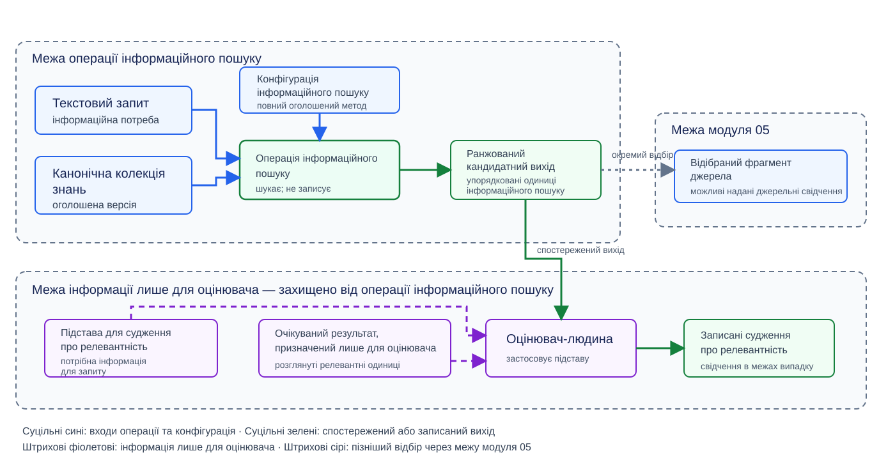
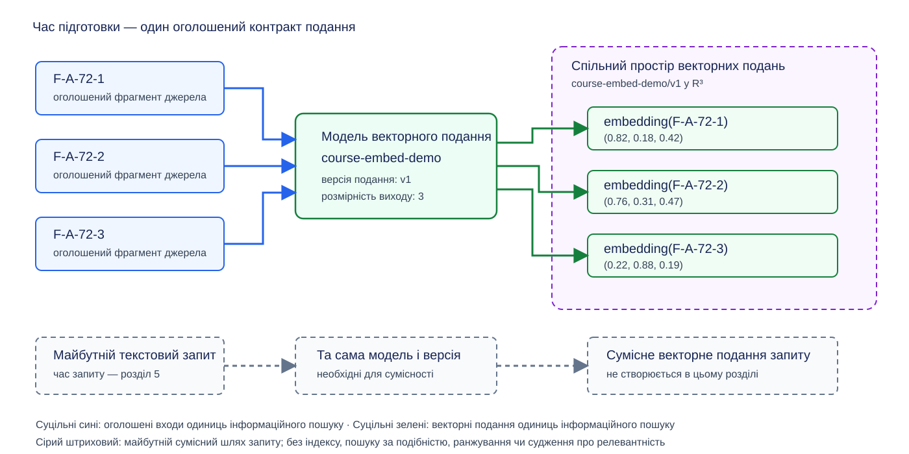
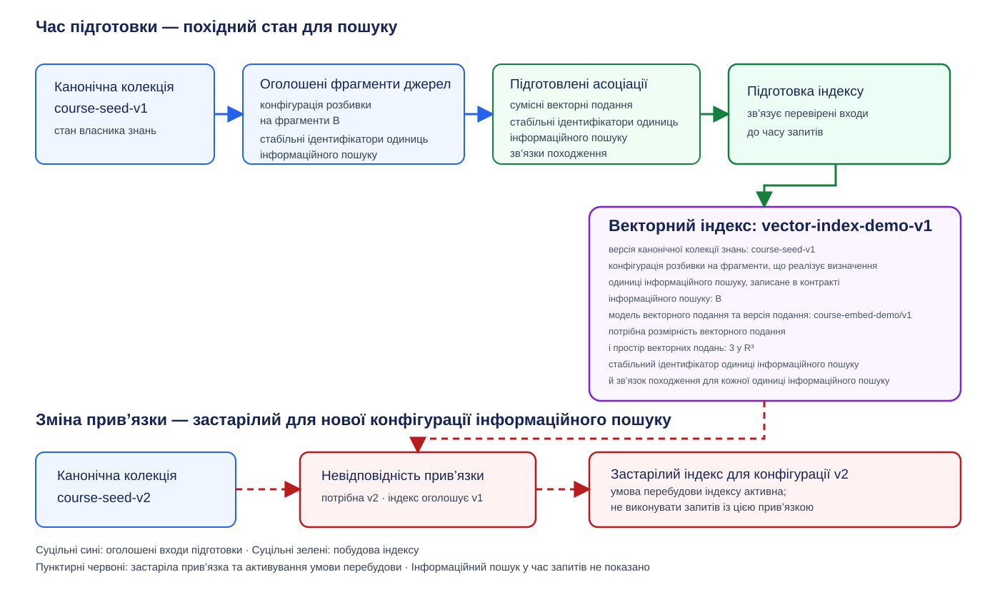
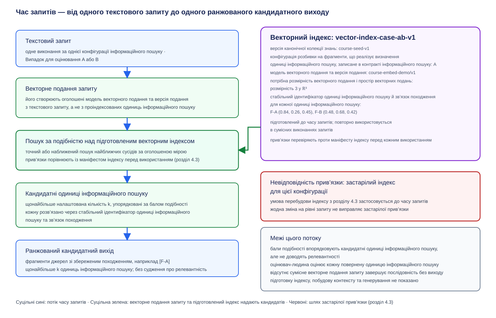

# Модуль 04: Ембединги та векторний пошук — Теорія

> **Статус:** Ready for Students — англомовну теорію та український переклад затверджено викладачем 2026-10-10

## Інженерна проблема: звідки походять надані джерельні свідчення?

Модуль 03 порівнював **варіант A** і **варіант B** як дві повні конфігурації **операції пропозиції поняття з використанням моделі** за одним спільним протоколом експерименту. Кожен **випадок для оцінювання** надавав обом конфігураціям те саме завдання й ті самі **надані джерельні свідчення**, а кожна конфігурація формувала **кандидатне визначення поняття**, яке оцінювали за тим самим протоколом. Модуль 03 розглядав надані джерельні свідчення як уже задані й зафіксовані. Модуль 03 не пояснював, звідки походили ці свідчення.

Цей модуль заповнює зазначену прогалину: він пояснює, як знайти потрібний матеріал у більшому сховищі, перш ніж цей матеріал зможе стати наданими джерельними свідченнями. Цей пошук виконує **операція інформаційного пошуку**, а її результатом є **ранжований кандидатний вихід**.

### Ключові поняття вступу

- **Канонічна колекція знань** (**Canonical knowledge collection**): іменоване версійоване сховище **канонічних записів знань**, у якому виконує пошук операція інформаційного пошуку. Це сховище матеріалу, а не сформований із тестових випадків набір даних для оцінювання, який використовував модуль 03.
- **Операція інформаційного пошуку** (**Retrieval operation**): отримує текстовий запит (вхід завдання, що формулює інформаційну потребу), виконує пошук в оголошеній версії колекції та повертає впорядковану множину елементів, утворених із цієї версії колекції; самі елементи не обов’язково є членами колекції. Ця операція не формує кандидатного визначення поняття й не змінює колекцію.
- **Ранжований кандидатний вихід** (**Ranked candidate output**): упорядковані елементи, повернуті одним виконанням операції інформаційного пошуку. Це результат пошуку, а не **кандидатне визначення поняття** і не один **кандидатний вихід** з модуля 03.

### Місце операції інформаційного пошуку

Два наведені нижче інформаційні шляхи безпосередньо показують прогалину. Стрілки позначають потік інформації, а не повноваження щось змінювати.

**Шлях у модулі 03:**

```text
Evaluation case
  → task + supplied source evidence
  → Variant A and Variant B, two complete configurations of the model-backed concept-proposal operation (each performs context construction)
  → one candidate concept definition from each
  → both assessed under the shared experiment protocol
  → bounded configuration decision
```

**Розширений шлях:**

```text
text query ──┐
             ├→ retrieval operation → ranked candidate output
collection ──┘
  → selection into supplied source evidence (Module 05)
  → context construction
  → model-backed concept-proposal operation
  → candidate concept definition
```

Модуль 04 проєктує й оцінює операцію інформаційного пошуку та зупиняється на ранжованому кандидатному виході. Модуль 05 вирішує, як відібрана частина цього виходу стає наданими джерельними свідченнями. Завершальний міст модуля 03 назвав **операцію векторного пошуку** для цієї позиції в шляху; цей модуль розглядає лексичний пошук, пошук на основі ембедингів і гібридний пошук як три механізми однієї **операції інформаційного пошуку** й тому зберігає ширшу назву. Повний контракт інформаційного пошуку, підстава для судження про релевантність, шлях наповнення колекції та два контрастні випадки для оцінювання наведено в розділі 1.

## 1. Операція інформаційного пошуку та межа спостереження

У вступі операцію інформаційного пошуку визначено як відсутній крок між канонічною колекцією знань і наданими джерельними свідченнями. Перш ніж обрати механізм інформаційного пошуку, команда інженерів має визначити, що отримує операція інформаційного пошуку, що вона повертає і яка інформація, призначена лише для оцінювача, залишається поза цією операцією. Цей розділ установлює контракт інформаційного пошуку, щоб у наступних розділах можна було змінювати механізми інформаційного пошуку, тоді як оголошений вид результату, який повертає операція інформаційного пошуку, і межа спостереження, на якій цей результат оцінюють, залишаються незмінними.

### 1.1 Ключові поняття розділу

Наведені далі поняття визначають контракт інформаційного пошуку та свідчення, що використовують для оцінювання одного виконання операції інформаційного пошуку:

- **Контракт інформаційного пошуку** (**Retrieval contract**): версійована специфікація, яка пов’язує точні входи операції інформаційного пошуку та її ранжований кандидатний вихід із підставою для судження про релевантність, очікуваним результатом, призначеним лише для оцінювача, і межею спостереження, потрібними для виконання та оцінювання.
- **Операція інформаційного пошуку** (**Retrieval operation**): операція, що отримує текстовий запит, виконує пошук в одній оголошеній версії канонічної колекції знань за однією конфігурацією інформаційного пошуку та повертає ранжований кандидатний вихід. Операція інформаційного пошуку не є синонімом векторного пошуку або подальшої операції пропозиції поняття з використанням моделі.
- **Текстовий запит** (**Text query**): вхід завдання, що формулює інформаційну потребу, подану операції інформаційного пошуку. Текстовий запит не містить очікуваного результату, призначеного лише для оцінювача.
- **Канонічний запис знань** (**Canonical knowledge record**): прийнятий версійований запис знань зі стабільною ідентичністю та походженням. Прийняття дозволяє використовувати цю версію запису в межах, оголошених власником знань; прийняття не встановлює, що кожне твердження є універсально правильним.
- **Канонічна колекція знань** (**Canonical knowledge collection**): іменована версійована множина канонічних записів знань, доступних операції інформаційного пошуку. Власник знань оголошує версію колекції; операція інформаційного пошуку не створює й не змінює її записів.
- **Фрагмент джерела** (**Source fragment**): обмежений фрагмент тексту, отриманий із канонічного запису знань або джерела, що його підтверджує. Походження фрагмента ідентифікує первинний запис або джерело, версію і точне місце.
- **Одиниця інформаційного пошуку** (**Retrieval unit**): вид елемента, що може входити як до ранжованого кандидатного виходу, так і до очікуваного результату, призначеного лише для оцінювача. Випадок для оцінювання оголошує, чи є одиниця інформаційного пошуку повним канонічним записом знань або фрагментом джерела, а для фрагмента джерела — яке правило межі визначає його обсяг. Для одного виконання випадок для оцінювання та конфігурація інформаційного пошуку мають оголошувати те саме визначення одиниці інформаційного пошуку — той самий вид і те саме правило межі, — а контракт інформаційного пошуку записує це єдине оголошення в полі, яке називає одиницю інформаційного пошуку та правило її межі; ранжований кандидатний вихід порівнюють із очікуваним результатом, призначеним лише для оцінювача, лише коли обидва побудовано за тим самим оголошенням.
- **Конфігурація інформаційного пошуку** (**Retrieval configuration**): один повний спосіб виконання операції інформаційного пошуку. Вона оголошує визначення одиниці інформаційного пошуку, механізм інформаційного пошуку, налаштовану кількість результатів і будь-яке правило поєднання або переранжування; у наступних розділах буде додано специфічні для механізму налаштування індексу й представлення.
- **Ранжований кандидатний вихід** (**Ranked candidate output**): упорядковані одиниці інформаційного пошуку, повернуті одним виконанням операції інформаційного пошуку за однією конфігурацією інформаційного пошуку. Ранжований кандидатний вихід не є ані прийнятими знаннями, ані кандидатним визначенням поняття, сформованим подальшою операцією пропозиції поняття з використанням моделі.
- **Підстава для судження про релевантність** (**Relevance judging basis**): специфічний для випадку критерій, призначений лише для оцінювача, який визначає, яку інформацію має містити або безпосередньо підтверджувати одиниця інформаційного пошуку, щоб задовольнити інформаційну потребу, виражену одним текстовим запитом.
- **Релевантність** (**Relevance**): обмежене одним випадком відношення між одним текстовим запитом і однією одиницею інформаційного пошуку. Це відношення існує, коли призначений оцінювач-людина застосовує підставу для судження про релевантність і виносить судження про те, що одиниця інформаційного пошуку містить або безпосередньо підтверджує потрібну інформацію за оголошених версії колекції та межі одиниці інформаційного пошуку.
- **Судження про релевантність** (**Relevance judgment**): записане застосування оцінювачем-людиною підстави для судження про релевантність до однієї одиниці інформаційного пошуку у відношенні до одного текстового запиту. Позитивне судження про релевантність визначає **релевантну одиницю інформаційного пошуку** за цих оголошених умов.
- **Очікуваний результат, призначений лише для оцінювача** (**Evaluator-only expected result**): розглянута множина одиниць інформаційного пошуку, які призначений оцінювач-людина визнав релевантними до одного текстового запиту за оголошених версії колекції, межі одиниці інформаційного пошуку та підстави для судження про релевантність. Операція інформаційного пошуку не отримує цю множину.
- **Оцінювач-людина** (**Human evaluator**): призначена особа, яка застосовує підставу для судження про релевантність до одиниць інформаційного пошуку та записує судження про релевантність у межах одного випадку для оцінювання. Оцінювач-людина надає свідчення оцінювання, але не отримує повноважень змінювати канонічну колекцію знань.
- **Межа спостереження** (**Observation boundary**): точний результат, описаний твердженням про свідчення. Цей модуль розділяє свідчення про ранжований кандидатний вихід, свідчення про подальше кандидатне визначення поняття та свідчення про повний процес користувача.

Для розділу 1 повний контракт інформаційного пошуку містить дев’ять наведених далі оголошених полів:

1. текстовий запит;
2. версія канонічної колекції знань;
3. одиниця інформаційного пошуку та правило її межі;
4. конфігурація інформаційного пошуку;
5. ранжований кандидатний вихід;
6. очікуваний результат, призначений лише для оцінювача;
7. підстава для судження про релевантність;
8. призначений оцінювач-людина; та
9. межа спостереження.

### 1.2 Одна операція інформаційного пошуку, два інформаційні шляхи

Випадок для оцінювання має відокремлювати входи операції від матеріалу, який використовують лише для оцінювання результату. Для операції інформаційного пошуку запис випадку містить три групи інформації:

- **Вхід операції:** текстовий запит і оголошена версія канонічної колекції знань.
- **Інформація, призначена лише для оцінювача:** підстава для судження про релевантність і очікуваний результат, призначений лише для оцінювача, які затвердив призначений оцінювач-людина.
- **Метадані випадку:** стабільна ідентичність і версія випадку, визначення одиниці інформаційного пошуку, задумана група ризику, належність до випадків розроблення або відкладених випадків, походження та ідентичність призначеного оцінювача-людини, який затвердив очікуваний результат, призначений лише для оцінювача.

Ранжований кандидатний вихід не зберігається заздалегідь як очікуваний результат, призначений лише для оцінювача. Одне виконання однієї конфігурації інформаційного пошуку формує ранжований кандидатний вихід як спостережений результат, пов’язаний із випадком для оцінювання. У сконструйованому навчальному прикладі ранжований кандидатний вихід може бути задано, але такий заданий вихід не є свідченням живого виконання.

Випадок для оцінювання операції пропозиції поняття з використанням моделі в модулі 03 надавав завдання й уже відібраний фрагмент джерела як надані джерельні свідчення. Натомість випадок для оцінювання операції інформаційного пошуку надає текстовий запит і версію канонічної колекції знань, а очікуваний результат, призначений лише для оцінювача, залишається прихованим від операції інформаційного пошуку.

На рисунку 1.1 показано обидва інформаційні шляхи, їх відокремлення та точку, на якій зупиняється модуль 04.



**Рисунок 1.1 - Контракт інформаційного пошуку та шлях, призначений лише для оцінювача.** Ілюстративне, а не вичерпне подання. Суцільні сині стрілки передають текстовий запит, оголошену версію колекції та конфігурацію інформаційного пошуку до операції інформаційного пошуку. Суцільні зелені стрілки передають спостережувані або записані виходи. Штрихові фіолетові стрілки передають інформацію, призначену лише для оцінювача, оцінювачу-людині й ніколи не входять до операції інформаційного пошуку. Штрихова сіра стрілка позначає пізніший відбір через межу модуля 05; повний ранжований кандидатний вихід не стає наданими джерельними свідченнями автоматично.

### 1.3 Канонічна колекція знань існує до інформаційного пошуку

Операція інформаційного пошуку виконує пошук у прийнятому матеріалі; вона не вирішує, який матеріал стає прийнятим. Тому шлях наповнення колекції є передумовою із сімома хронологічними етапами. Кожен етап споживає записаний вихід попереднього етапу, а шлях зупиняється, якщо потрібна перевірка або уповноваження відсутні:

1. Власник знань подає джерело, а реєстрація джерела записує ідентичність, версію та походження джерела.
2. Команда інженерів застосовує оголошене правило межі до зареєстрованого джерела й записує прив’язані до версії фрагменти джерела з їхнім походженням.
3. Операція пропозиції поняття з використанням моделі отримує один фрагмент джерела як надані джерельні свідчення та формує кандидатне визначення поняття.
4. Структурна перевірка перевіряє структуру кандидатного визначення поняття й оголошені умови, які можна перевірити машинним способом, не змінюючи канонічного запису знань.
5. Уповноважений рецензент порівнює точне кандидатне визначення поняття з наданими для нього джерельними свідченнями й затверджує або відхиляє саме цього кандидата.
6. Лише відповідне затвердження дозволяє уповноваженому засобу запису створити або оновити відповідний канонічний запис знань.
7. Власник знань оголошує, які версії прийнятих записів належать до іменованої версії канонічної колекції знань, доступної конфігураціям інформаційного пошуку.

Модуль 04 не вимагає виконання цього шляху наповнення. Його відтворюваний наскрізний приклад починається з розглянутих викладачем початкових записів, ідентичності, версії, фрагменти джерел і походження яких надано як зафіксовані початкові дані, щоб різні учасники курсу оцінювали ті самі одиниці інформаційного пошуку. Надані початкові записи не подано як записи, створені або затверджені учасником курсу.

### 1.4 Наскрізний приклад: дві відмови лексичного пошуку

Наскрізний приклад використовує канонічну колекцію знань `course-seed-v1`. Конфігурація інформаційного пошуку цього наскрізного прикладу оголошує фрагменти джерел одиницями інформаційного пошуку та ранжує ці одиниці інформаційного пошуку за кількістю точних змістових слів — слів, що несуть значення, а не виконують граматичну функцію, — спільних для одиниці інформаційного пошуку й текстового запиту, від найбільшої кількості до найменшої. Конфігурація повертає щонайбільше одну одиницю інформаційного пошуку: найвище ранжовану, а коли дві одиниці інформаційного пошуку мають однакову кількість спільних змістових слів — ту, яку утворено із запису з меншим ідентифікатором. Коли жодна одиниця інформаційного пошуку не має спільного змістового слова з текстовим запитом, конфігурація повертає порожній ранжований кандидатний вихід.

Версія колекції містить два задані записи, `R-A` і `R-B`. Правило розбивки на фрагменти цієї конфігурації інформаційного пошуку виводить один фрагмент джерела з кожного запису; їх наведено нижче. У розділі 2 розглянуто, як це правило було вибрано. Формулювання записів і результати інформаційного пошуку утворюють сконструйований навчальний приклад, а не спостереження живої системи:

- **F-A — запис R-A, версія 1, речення 1–2:** «Зв’язок походження пов’язує кожен уривок свідчень з ідентифікатором первинного запису, версією запису й точним діапазоном речень. Зв’язок дає рецензентові змогу знайти уривок, використаний для обґрунтування запропонованого визначення поняття.»
- **F-B — запис R-B, версія 1, речення 1:** «Квитанція запуску пропозиції фіксує, які джерело та версія моделі використано для створення пропозиції поняття; вона не визначає місця уривка свідчень.»

Для двох наведених нижче випадків для оцінювання підстава для судження про релевантність вимагає, щоб одиниця інформаційного пошуку пояснювала, які дані ідентифікують первинний запис, його версію й точне місце підтвердного уривка. Призначений оцінювач-людина затвердив `{F-A}` як очікуваний результат, призначений лише для оцінювача, для кожного текстового запиту.

**Випадок для оцінювання A — лексичний пропуск**

- **Текстовий запит:** «Як аудитор може простежити витяг до вихідного документа та його редакції?»
- **Очікуваний результат, призначений лише для оцінювача:** `{F-A}`.
- **Ранжований кандидатний вихід (заданий):** `[]`.
- **Інтерпретація:** F-A виражає потрібне відношення походження іншими словами. Задана конфігурація лексичного пошуку не знаходить жодного змістового слова, спільного для текстового запиту й F-A, тому пропускає релевантну одиницю інформаційного пошуку.

**Випадок для оцінювання B — лексичний хибнопозитивний результат**

- **Текстовий запит:** «Які джерело та версія ідентифікують підтвердний уривок для пропозиції поняття?»
- **Очікуваний результат, призначений лише для оцінювача:** `{F-A}`.
- **Ранжований кандидатний вихід (заданий):** `[F-B]`.
- **Інтерпретація:** F-B має спільні з текстовим запитом точні змістові слова *джерело*, *версія*, *пропозиції* й *поняття*, тобто чотири змістові слова, тоді як F-A має лише *уривок* і *поняття*, тобто два. Отже, F-B має більшу кількість спільних змістових слів, і конфігурація повертає єдину найвище ранжовану одиницю інформаційного пошуку — `[F-B]`. F-B ідентифікує модель, а не підтвердний уривок, тому оцінювач-людина записує негативне судження про релевантність для F-B за цим випадком для оцінювання.

Два випадки виявляють різні ризики. Випадок для оцінювання A показує, що спільне значення може існувати без спільного формулювання. Випадок для оцінювання B показує, що спільне формулювання може існувати без потрібного значення. Жоден випадок не доводить, що кожна конфігурація лексичного пошуку має задану відмову, і жоден очікуваний результат, призначений лише для оцінювача, не доводить, що твердження F-A правдиві або авторитетні.

### 1.5 Що можуть підтримувати свідчення на оголошених межах спостереження

Центральне інженерне запитання цього модуля таке: **Як команда інженерів має проєктувати й оцінювати повні конфігурації лексичного, заснованого на ембедингах і гібридного інформаційного пошуку, щоб їхні ранжовані кандидатні виходи містили фрагменти джерел, які визнано релевантними до текстових запитів в оголошених випадках для оцінювання, не трактуючи ранг як судження про релевантність, судження про релевантність як доказ істини або обмежене рішення щодо конфігурації як повноваження змінювати канонічну колекцію знань?**

Модуль розвиває п’ять спроможностей, потрібних для відповіді на це запитання:

1. Задати контракт інформаційного пошуку та його межу спостереження.
2. Визначити одиниці інформаційного пошуку, що зберігають походження, включно з обмеженням подальшої побудови контексту, яке визначає, наскільки великою може бути одна одиниця інформаційного пошуку.
3. Пояснити, як сумісні ембединги та версійований векторний індекс готують фрагменти джерел до інформаційного пошуку на основі ембедингів.
4. Порівняти конфігурації лексичного, заснованого на ембедингах і гібридного інформаційного пошуку разом з обмеженим етапом переранжування щодо ризиків інформаційного пошуку, представлених оголошеними випадками для оцінювання, названими метриками релевантності, обмеженнями затримки та обмеженнями ресурсів.
5. Оцінювати ранжовані кандидатні виходи за прозорими метриками інформаційного пошуку та операційними свідченнями.

Свідчення на одній межі спостереження не можуть замінити свідчення на іншій межі спостереження. Три межі спостереження підтримують різні твердження:

- **Межа операції інформаційного пошуку:** чи повернула названа конфігурація інформаційного пошуку одиниці інформаційного пошуку, визнані релевантними до оголошених текстових запитів.
- **Межа подальшої операції:** кандидатне визначення поняття, сформоване після того, як відібрані фрагменти джерел стають наданими джерельними свідченнями.
- **Наскрізна межа:** чи досяг повний процес користувача задуманого результату.

Свідчення на жодній із цих меж спостереження не надають повноважень змінювати канонічну колекцію знань.

**Висновок розділу.** Дев’ять оголошених полів, заданих у підрозділі 1.1, утворюють повний контракт інформаційного пошуку. Контракт інформаційного пошуку робить ранжований кандидатний вихід придатним до оцінювання, не плутаючи ранг із релевантністю, релевантність з істиною або оцінювання з повноваженням запису. Наступний розділ має визначити, як більші керовані джерела стають фрагментами джерел зі збереженим походженням до того, як будь-який фрагмент джерела отримає ембединг або ввійде до індексу.

> **Додаткове читання.** Розділ 6 «RAG Architecture» і «Comparing Retrieval Algorithms» книги Чіп Гуєн *AI Engineering* (сторінки 494–500 і 512–518 робочої PDF-копії) розвиває межу між компонентами інформаційного пошуку й генерування та оцінювання інформаційного пошуку. Розділи 1.3.2 і 2.1–2.1.2 книги Томажа Братаніча й Оскара Гейна *Essential GraphRAG* (друковані сторінки 10–20; сторінки 31–41 робочої PDF-копії) подають двоетапний конвеєр інформаційного пошуку й генерування. Ці джерела містять додаткові приклади архітектури; вони необов’язкові й не потрібні для лабораторної роботи 04 або оцінювання модуля 04.

## 2. Розбивка на фрагменти та одиниця інформаційного пошуку

Розділ 1 установив, що контракт інформаційного пошуку має оголошувати один вид і межу одиниці інформаційного пошуку. Сама канонічна колекція знань надає записи, а не цю межу: команда інженерів утворює фрагменти джерел із записів колекції та джерел, що їх підтверджують. Різні конфігурації розбивки на фрагменти можуть утворювати різні набори одиниць інформаційного пошуку з тієї самої версії колекції. Тому команда інженерів має визначити й версіонувати правила побудови фрагментів джерел до обчислення ембедингів або підготовки індексу. Після вивчення цього розділу читач має вміти обґрунтувати межу одиниці інформаційного пошуку виходячи з оголошених випадків для оцінювання, зберігати походження кожного утвореного фрагмента джерела та пояснити, як ця межа обмежує подальший інформаційний пошук і оцінювання.

### 2.1 Ключові поняття розділу

Наведені далі поняття визначають, як команда інженерів утворює придатні до пошуку одиниці інформаційного пошуку з більших керованих джерел:

- **Розбивка на фрагменти** (**Chunking**): перетворення, яке застосовує оголошене правило межі до канонічного запису знань або джерела, що його підтверджує, і утворює фрагменти джерел як одиниці інформаційного пошуку. Розбивка на фрагменти є частиною конфігурації інформаційного пошуку; вона не виконує текстового запиту й не формує ранжованого кандидатного виходу, а також не створює й не змінює канонічних записів знань. Коли випадок для оцінювання оголошує повний канонічний запис знань одиницею інформаційного пошуку, запис шукають без розбиття; розбивка на фрагменти застосовується лише тоді, коли одиницею інформаційного пошуку є фрагмент джерела.
- **Фрагмент джерела** (**Source fragment**): одиниця інформаційного пошуку зі збереженим походженням, утворена з обмеженого місця у більшому керованому джерелі. У літературі з інформаційного пошуку такий елемент також часто називають англійським словом *chunk*, але цей модуль уживає назву *фрагмент джерела* як канонічну, бо вона утримує явне відношення до джерела.
- **Розмір фрагмента** (**Chunk size**): налаштована максимальна або цільова довжина одного фрагмента джерела, виміряна в оголошеній одиниці, наприклад у символах, словах, реченнях або абзацах. Розмір фрагмента обмежує довжину, але сам по собі не визначає, де може пройти межа.
- **Правило межі** (**Boundary rule**): правило, що визначає дозволені початок і кінець кожного фрагмента джерела, наприклад межі речень або абзаців чи найближчий пробіл перед межею кількості символів. Правило межі відрізняється від розміру фрагмента, бо два правила можуть використовувати той самий граничний розмір і все ж зберігати різні відношення в тексті джерела.
- **Перекриття** (**Overlap**): матеріал джерела, свідомо повторений у сусідніх фрагментах джерел. Перекриття може зберегти значення, що перетинає межу, але воно також дублює індексований матеріал і може призвести до того, що кілька повернутих одиниць інформаційного пошуку представлятимуть той самий уривок.
- **Зв’язок походження** (**Provenance link**): записана асоціація, що з’єднує один фрагмент джерела зі стабільною ідентичністю, версією та точним місцем матеріалу джерела, з якого цей фрагмент утворено. Зв’язок походження забезпечує простежуваність; він не доводить правильності тверджень джерела й не уповноважує зміни канонічної колекції знань.
- **Конфігурація розбивки на фрагменти** (**Chunking configuration**): версійований набір правил побудови фрагментів джерел у межах конфігурації інформаційного пошуку, що охоплює вид джерела, одиницю й значення розміру фрагмента, правило межі, правило перекриття та поля походження, записані для кожного фрагмента джерела. Команда інженерів версіонує й приймає конфігурацію розбивки на фрагменти як звичайне рішення щодо конфігурації; прийняття конфігурації розбивки на фрагменти не змінює канонічної колекції знань і не потребує жодного етапу шляху наповнення колекції.

Розбивка на фрагменти в цьому розділі — це похідне перетворення на боці інформаційного пошуку, яке команда інженерів виконує, коли конфігурація інформаційного пошуку готує свої придатні до пошуку одиниці. Розбивка на фрагменти відрізняється від етапу 2 шляху наповнення колекції з підрозділу 1.3, де команда інженерів застосовує правило межі до зареєстрованого джерела, щоб керований робочий процес міг пропонувати канонічні записи знань. Обидві операції застосовують правила межі, але утворюють артефакти з різними місцями зберігання: фрагменти джерел шляху наповнення є робочими артефактами робочого процесу пропонування записів і ніколи не є членами колекції — до оголошеної версії колекції входять лише прийняті канонічні записи знань, — тоді як фрагменти джерела на боці інформаційного пошуку стають одиницями інформаційного пошуку конфігурації розбивки на фрагменти й утворюються заново щоразу, коли команда інженерів змінює цю конфігурацію.

Фрагменти джерела на боці інформаційного пошуку є похідними артефактами, подібними до індексів, які модуль 01 класифікував як похідні та відновлювані. Канонічна колекція знань залишається множиною прийнятих записів; фрагменти джерела на боці інформаційного пошуку можна відновити з тієї самої версії колекції, і самі фрагменти не є членами колекції.

### 2.2 Чому межа фрагмента джерела передує представленню та індексуванню

Ембединг — числовий вектор, який розділ 3 розвиває повністю, — представляє текст усередині однієї оголошеної одиниці інформаційного пошуку, а векторний індекс пізніше зберігає один елемент для кожної такої одиниці. Зміна межі фрагмента джерела відтак змінює представлені входи, кількість майбутніх елементів індексу та елементи, які можуть з’явитися як у ранжованому кандидатному виході, так і в очікуваному результаті, призначеному лише для оцінювача. Ембединги, обчислені для однієї конфігурації розбивки на фрагменти, не можуть мовчки заміщувати фрагменти джерел, утворені іншою конфігурацією розбивки на фрагменти.

Команда інженерів оцінює запропоновану конфігурацію розбивки на фрагменти за п’ятьма вимірами рішення:

- **Збереження значення:** кожен фрагмент джерела має утримувати відношення, потрібні для інтерпретації уривка джерела, без відновлення пропущених частин із сусіднього фрагмента.
- **Концентрація матеріалу релевантного запиту:** фрагмент джерела має містити достатньо матеріалу, щоб задовольнити підставу для судження про релевантність для оголошеного текстового запиту, не оточуючи потрібний матеріал такою кількістю непов’язаного тексту, що сигнал інформаційного пошуку стає розмитим.
- **Дублювання:** перекриття має зберігати необхідний контекст межі, не створюючи таких копій того самого матеріалу джерела в багатьох одиницях інформаційного пошуку, яких можна уникнути.
- **Майбутній розмір індексу:** менші фрагменти джерел або фрагменти з перекриттям утворюють більше одиниць інформаційного пошуку, що збільшує кількість ембедингів, які команда інженерів має обчислити, зберегти та серед яких шукати.
- **Відповідність подальшому контексту:** фрагмент джерела має бути достатньо малим, щоб залишатися придатним до використання в межах пізнішого бюджету побудови контексту — обмеженої кількості матеріалу джерела, що вміщається в запит до моделі, який збирає модуль 05, — хоча модуль 05 вирішує, які знайдені фрагменти джерел стануть наданими джерельними свідченнями.

Ці виміри утворюють компроміси, а не один універсально найкращий розмір. Менший фрагмент джерела може сконцентрувати матеріал, пов’язаний з одним текстовим запитом, але вилучити контекст, потрібний для інтерпретації цього матеріалу. Більший фрагмент джерела може зберегти більше контексту, але поєднати кілька тем, збільшити матеріал, який передають далі, і зменшити концентрацію тексту, пов’язаного з конкретним запитом. Перекриття може виправити змістоносну межу, водночас збільшуючи дублювання та майбутній розмір індексу.

### 2.3 Відмови, створені межами фрагментів джерел

Команда інженерів має оглянути чотири пов’язані з межами відмови, перш ніж прийняти конфігурацію розбивки на фрагменти:

- **Недостатній контекст:** фрагмент джерела замалий, щоб зберегти відношення, потрібне підставою для судження про релевантність для оголошеного текстового запиту.
- **Дифузний зміст:** фрагмент джерела настільки великий, що матеріал, пов’язаний з текстовим запитом, оточено непов’язаним матеріалом того самого джерела.
- **Поділ усередині твердження:** межа відділяє суб’єкт, відношення, обмежувач або іншу потрібну частину одного твердження від решти цього твердження.
- **Спотворення через перекриття:** повторений матеріал призводить до того, що кілька одиниць інформаційного пошуку представляють по суті той самий уривок, і вони можуть зайняти кілька позицій у пізнішому ранжованому кандидатному виході. Наприклад, правило, що починає кожен фрагмент джерела останнім реченням попереднього фрагмента джерела, утримує твердження, яке перетинає межу, читабельним, але індексує це речення один раз у кожному фрагменті.

Позитивне судження про релевантність одного фрагмента джерела залишається обмеженим оголошеними текстовим запитом, версією колекції, межею фрагмента джерела та підставою для судження про релевантність. Позитивне судження про релевантність не встановлює, що фрагмент джерела містить достатньо навколишніх свідчень для подальшої операції з використанням моделі. Релевантність однієї одиниці інформаційного пошуку й достатність відібраних наданих джерельних свідчень — різні судження на різних межах спостереження.

### 2.4 Наскрізний приклад: дві конфігурації розбивки на фрагменти для запису R-A

Сконструйований запис `R-A`, версія 1, містить наведений далі уривок джерела на 242 символи:

> Зв’язок походження пов’язує кожен уривок свідчень з ідентифікатором первинного запису, версією запису й точним діапазоном речень. Зв’язок дає рецензентові змогу знайти уривок, використаний для обґрунтування запропонованого визначення поняття.

Дві наведені нижче конфігурації розбивки на фрагменти утворюють різні одиниці інформаційного пошуку з того самого уривка. Символьні діапазони відлічуються від одиниці й не охоплюють розділові пробіли між сусідніми фрагментами джерел. Обмеження у 72 символи в другій конфігурації вибрано так, щоб межі проходили всередині фраз уривка.

**Конфігурація розбивки на фрагменти A — межа пар речень**

- **Правило межі:** розбивати уривок лише по межах речень, групувати сусідні речення в пари, починаючи з першого речення, і розміщувати останнє непарне речення в окремому фрагменті джерела.
- **Розмір фрагмента:** щонайбільше два речення.
- **Перекриття:** відсутнє.
- **Результат:** `F-A`, зв’язок походження `{record: R-A, version: 1, sentences: 1–2, characters: 1–242}`.

`F-A` зберігає повне відношення між уривком свідчень, ідентифікатором первинного запису, версією запису, точним діапазоном речень і дією рецензента. За підстави для судження про релевантність із розділу 1 оцінювач-людина може визнати `F-A` релевантним до випадку для оцінювання A, бо ця одиниця інформаційного пошуку пояснює, які дані ідентифікують походження уривка, його редакцію та точне місце.

**Конфігурація розбивки на фрагменти B — фіксована межа 72 символи з пробільними межами**

- **Правило межі:** завершувати кожен фрагмент джерела безпосередньо перед останнім пробілом на межі 72 символів або раніше, пропускати розділовий пробіл і продовжувати з наступного символу; якщо текст, що залишився від поточної позиції початку, не довший за межу 72 символів, цей залишок утворює останній фрагмент джерела; якщо в межах обмеження немає жодного пробілу, продовжити фрагмент джерела до першого пробілу після обмеження, навіть якщо це перевищує цільовий розмір; якщо далі пробілів немає взагалі, останній фрагмент джерела завершується в кінці джерела.
- **Розмір фрагмента:** щонайбільше 72 символи.
- **Перекриття:** відсутнє.
- **Утворені фрагменти джерел і зв’язки походження:**
  - `F-A-72-1`, `{record: R-A, version: 1, characters: 1–67}`: «Зв’язок походження пов’язує кожен уривок свідчень з ідентифікатором»
  - `F-A-72-2`, `{record: R-A, version: 1, characters: 69–137}`: «первинного запису, версією запису й точним діапазоном речень. Зв’язок»
  - `F-A-72-3`, `{record: R-A, version: 1, characters: 139–206}`: «дає рецензентові змогу знайти уривок, використаний для обґрунтування»
  - `F-A-72-4`, `{record: R-A, version: 1, characters: 208–242}`: «запропонованого визначення поняття.»

Конфігурація розбивки на фрагменти B відділяє відношення до первинного запису від частини його ідентифікаційних даних та відділяє дію рецензента від її об’єкта. За оголошеною підставою для судження про релевантність оцінювач-людина не може записати позитивного судження про релевантність ні для однієї з чотирьох одиниць інформаційного пошуку без відновлення пропущеного значення з іншої одиниці. Пізніший механізм інформаційного пошуку все ж може ранжувати один із цих фрагментів для випадку для оцінювання A, але ранг не виправляє межу й не замінює людського судження про релевантність.

Цей приклад не обчислює ембедингів і не формує ранжованого кандидатного виходу. Приклад установлює, що конфігурація розбивки на фрагменти A і конфігурація розбивки на фрагменти B визначають різні множини придатних до пошуку одиниць інформаційного пошуку й різні можливі елементи очікуваного результату, призначеного лише для оцінювача, тоді як канонічною колекцією знань залишається `course-seed-v1`. Тому пізніші метрики інформаційного пошуку мають називати конфігурацію розбивки на фрагменти, у межах якої побудовано як очікувані, так і спостережені одиниці інформаційного пошуку.

### 2.5 Висновок розділу

Розбивка на фрагменти визначає придатні до пошуку одиниці інформаційного пошуку до початку представлення й індексування. Команда інженерів тепер може оцінити, чи конфігурація розбивки на фрагменти зберігає значення, потрібне оголошеним випадкам для оцінювання, чи записує зв’язок походження для кожного фрагмента джерела, чи контролює дублювання й майбутній розмір індексу та чи поважає обмеження подальшого контексту. Це оцінювання не показує, що якийсь фрагмент джерела отримає сприятливий бал подібності, буде повернутий механізмом інформаційного пошуку або буде достатнім наданим джерельним свідченням. Наступний розділ пояснює, як оголошені фрагменти джерел стають ембедингами, які пізніше можна порівняти із сумісним ембедингом текстового запиту.

> **Додаткове читання.** Розділ 6 «Chunking strategy» книги Чіп Гуєн *AI Engineering* (сторінки 520–523 робочої PDF-копії) подає стратегії розбивки фіксованої довжини, рекурсивні, специфічні для мови, засновані на токенах і з перекриттям разом з їхніми компромісами розміру та індексування. Розділ «Contextual retrieval» того самого розділу 6 (сторінки 526–529 робочої PDF-копії, включно з рисунком 6-5) розглядає метадані, гіпотетичні запитання та згенерований контекст, долучені до фрагментів. Розділ 2.2.3 «Text chunking» книги Томажа Братаніча й Оскара Гейна *Essential GraphRAG* (друковані сторінки 21–22; сторінки 42–43 робочої PDF-копії) дає приклад фіксованого вікна з перекриттям, а розділ 3 «Advanced vector retrieval strategies» (друковані сторінки 30–41; сторінки 51–62 робочої PDF-копії, особливо рисунки 3.2 і 3.4) уводить ембединги гіпотетичних запитань, пошук за батьківськими документами та фільтрування за метаданими. Ці стратегії стають корисними, коли базові межі втрачають контекст або не вирівнюють текстові запити з одиницями, придатними для пошуку. Вони є необов’язковим доповненням і не потрібні для лабораторної роботи 04 або оцінювання модуля 04.

## 3. Ембединги та векторна подібність

Розділ 2 визначив текстові межі одиниць інформаційного пошуку. Тепер модель ембедингу може перетворити кожну оголошену одиницю інформаційного пошуку на ембединг, але ці числа стають порівнюваними лише за спільного контракту представлення. Тому перед підготовкою векторного індексу або обробленням текстового запиту команда інженерів має оголосити модель ембедингу, версію представлення, розмірність ембедингу, простір ембедингів і міру векторної подібності. Після цього розділу читач має вміти пояснити, як сумісні ембединги представляють одиниці інформаційного пошуку, тлумачити косинусну подібність як свідчення для ранжування та обґрунтувати, чому бал подібності не є судженням оцінювача-людини про релевантність.

### 3.1 Ключові поняття розділу

Наведені нижче поняття визначають контракт представлення, що використовується для інформаційного пошуку на основі ембедингів:

- **Ембединг** (**Embedding**): числовий вектор, створений однією оголошеною моделлю ембедингу для одного підтримуваного входу. Вектор у цілому представляє властивості, вивчені моделлю; окрема координата не є зрозумілою людині темою, словом або фактом, якщо документація моделі явно не встановлює такого тлумачення.
- **Модель ембедингу** (**Embedding model**): налаштоване перетворення, яке отримує підтримувані вхідні дані та створює ембединги в одному просторі ембедингів. Модель ембедингу не є операцією інформаційного пошуку: вона представляє вхід, але не шукає в колекції, не відбирає одиниць інформаційного пошуку й не формує судження про релевантність.
- **Версія представлення** (**Representation version**): ідентифікатор точної поведінки кодування, прийнятої командою інженерів, включно з будь-якою версіонованою поведінкою моделі, яка впливає на вихідні координати. Це не назва моделі ембедингу, не ревізія моделі і не один ембединг.
- **Контракт представлення** (**Representation contract**): оголошена сукупність ідентичності моделі ембедингу, версії представлення, розмірності ембедингу, простору ембедингів і міри векторної подібності, що забезпечує порівнюваність ембедингів запиту й одиниць інформаційного пошуку. Цей локальний вираз називає частину конфігурації інформаційного пошуку, що стосується представлення; він не є контрактом інформаційного пошуку, визначеним у розділі 1.
- **Вектор ембедингу** (**Embedding vector**): упорядкований список числових координат, створений як один ембединг. Порядок є частиною представлення; переставляння координат створює інший вектор.
- **Розмірність ембедингу** (**Embedding dimension**): фіксована кількість координат у кожному ембедингу, створеному за однією оголошеною моделлю та версією представлення. Однакова розмірність необхідна для покоординатного порівняння, але сама по собі вона не робить сумісними ембединги різних моделей.
- **Простір ембедингів** (**Embedding space**): координатний простір, визначений однією моделлю ембедингу та версією представлення. Ембединги можна порівнювати між собою лише тоді, коли їхні координати мають те саме вивчене значення в цьому оголошеному просторі.
- **Ембединг запиту** (**Query embedding**): ембединг, створений з одного текстового запиту під час виконання запиту. Ембединг запиту представляє запит за оголошеною моделлю ембедингу та версією представлення; він не є самим текстовим запитом.
- **Ембединг одиниці інформаційного пошуку** (**Retrieval-unit embedding**): ембединг, створений з однієї оголошеної одиниці інформаційного пошуку під час підготовки. Ембединг одиниці інформаційного пошуку представляє цю одиницю, але не містить її стабільного ідентифікатора або зв’язку походження, якщо система в цілому не зберігає ці зв’язки окремо.
- **Міра векторної подібності** (**Vector-similarity measure**): оголошене обчислення, що отримує сумісний ембединг запиту та ембединг одиниці інформаційного пошуку й створює один бал подібності для цієї пари. У цьому модулі обов’язковим концептуальним прикладом є косинусна подібність.
- **Косинусна подібність** (**Cosine similarity**): міра векторної подібності, заснована на куті між двома ненульовими векторами. Косинусна подібність порівнює напрямки векторів, а не розглядає довжину вектора як головне свідчення.
- **Семантична подібність** (**Semantic similarity**): обмежене одним випадком відношення між одним текстовим запитом і однією одиницею інформаційного пошуку, оцінене за допомогою оголошених моделі ембедингу, версії представлення та міри векторної подібності. Відношення між запитом і одиницею інформаційного пошуку в цьому розділі відрізняється від вимірювання семантичної подібності між відповіддю та еталоном у модулі 03, оскільки відрізняються порівнювані об’єкти й межа спостереження.
- **Бал подібності** (**Similarity score**): числовий результат, створений мірою векторної подібності для однієї сумісної пари ембедингу запиту та ембедингу одиниці інформаційного пошуку. Бал подібності є свідченням для ранжування за однієї конфігурації інформаційного пошуку; він не є ймовірністю та не доводить релевантності, істинності, підкріплення джерелом, повноти або наявності повноважень.

Модель ембедингу створює вектори, міра векторної подібності створює бал, а оцінювач-людина застосовує підставу для судження про релевантність із випадку для оцінювання до одиниці інформаційного пошуку. Жодна із цих трьох операцій не передає повноважень іншої.

### 3.2 Один контракт представлення створює порівнювані ембединги

Конфігурація інформаційного пошуку має визначати модель ембедингу та версію представлення, що створили кожен порівнюваний нею ембединг. Якщо команда інженерів змінює модель ембедингу або версію представлення, отримані ембединги належать до іншого простору ембедингів, навіть коли обидва виходи мають однакову розмірність.

Рисунок 3.1 показує спільний контракт представлення для ембедингів одиниць інформаційного пошуку та сумісного ембедингу запиту, який може створити пізніша операція під час виконання запиту.



**Рисунок 3.1 — Створення сумісних ембедингів за одним контрактом представлення.** Приклад є ілюстративним, а не вичерпним. Суцільні сині стрілки показують три оголошені фрагменти джерела, що надходять до тієї самої моделі ембедингу з тією самою версією представлення; суцільні зелені стрілки показують їхні ембединги одиниць інформаційного пошуку в одному тривимірному просторі ембедингів. Сірий штриховий шлях резервує те саме перетворення для майбутнього текстового запиту в розділі 5. Рисунок не показує векторного індексу, пошуку за подібністю, ранжованого кандидатного виходу або судження про релевантність.

Сумісність залежить від спільної семантики представлення, а не лише від форми даних. Два вектори з трьома дійсними координатами — елементи $\mathbb{R}^3$ — не можна змістовно порівнювати лише тому, що обидва мають таку форму. Якщо модель A вивчила одну систему координат, а модель B — іншу, координата 1 у моделі A не має оголошеної відповідності координаті 1 у моделі B. Команда інженерів має розглядати зміну моделі або версії представлення як зміну конфігурації інформаційного пошуку та повторно створювати ембединги відповідних одиниць інформаційного пошуку, перш ніж порівнювати їх із майбутнім сумісним ембедингом запиту.

Ембединг також не замінює представлений текст або його походження. Система в цілому має зберігати стабільний ідентифікатор одиниці інформаційного пошуку та зв’язок походження, які пов’язують кожен ембединг одиниці інформаційного пошуку з відповідним фрагментом джерела. Розділ 4 зв’язує ці асоціації у похідний стан для пошуку; цей розділ установлює лише контракт представлення.

### 3.3 Косинусна подібність і значення бала подібності

Для ненульового ембедингу запиту $q$ та ненульового ембедингу одиниці інформаційного пошуку $r$ однакової розмірності косинусну подібність визначено так:

$$
\operatorname{cosine\_similarity}(q,r)=\frac{q \cdot r}{\lVert q\rVert_2\lVert r\rVert_2}

$$

Скалярний добуток $q \cdot r$ перемножує відповідні координати та підсумовує добутки. Евклідова норма $\lVert q\rVert_2$ є довжиною вектора. Ділення на обидві довжини робить результат залежним від напрямку, а не від необробленої величини. Математичний результат лежить у діапазоні від $-1$ до $1$: однаково спрямовані вектори отримують бал $1$, перпендикулярні вектори — $0$, а протилежно спрямовані — $-1$.

Натомість система може подавати перетворений бал або косинусну відстань, яку для довільних дійсних векторів зазвичай визначають як $1-\operatorname{cosine\_similarity}$ з діапазоном $[0,2]$. Тому конфігурація інформаційного пошуку має називати як обчислення, так і угоду щодо подання бала.

Для одного сумісного ембедингу запиту вищий бал косинусної подібності означає, що ембединг одиниці інформаційного пошуку є ближчим за цією оголошеною мірою, ніж альтернатива з нижчим балом. Упорядкування обмежене векторами, моделлю, версією представлення та угодою щодо бала, використаними в цьому порівнянні. Косинусна подібність не пояснює, які слова або твердження зумовили це упорядкування, а високий бал не доводить, що одиниця інформаційного пошуку відповідає підставі для судження про релевантність із випадку для оцінювання.

Отже, семантична подібність на основі ембедингів є оцінкою, опосередкованою моделлю. Два тексти зі схожим значенням можуть отримати низький бал подібності, якщо модель погано представляє потрібне розрізнення. Два тексти також можуть отримати високий бал, оскільки стосуються широкої спільної теми, але відрізняються точним відношенням, якого потребує текстовий запит. Судження оцінювача-людини про релевантність залишається обмеженим критеріями свідченням щодо одиниці інформаційного пошуку; бал подібності залишається свідченням, використаним для впорядкування кандидатів.

### 3.4 Наскрізний приклад: три ембединги одиниць інформаційного пошуку

У сконструйованому прикладі використано перші три фрагменти джерела, утворені із запису `R-A` конфігурацією розбивки на фрагменти B в розділі 2.4. Ці фрагменти навмисно мають невдалі межі для передавання значення. Їх повторне використання показує, що ембединг не відновлює інформації, уже розділеної під час розбивки на фрагменти.

Для цього прикладу команда інженерів задає наведений нижче контракт представлення:

- **Модель ембедингу:** `course-embed-demo` — вигадана модель, використана лише для ілюстрування контракту; жодного результату реального виконання моделі не заявлено.
- **Версія представлення:** `v1`.
- **Підтримуваний вхід для цього прикладу:** український текст одного оголошеного фрагмента джерела.
- **Розмірність ембедингу:** три координати.
- **Простір ембедингів:** `course-embed-demo/v1` у $\mathbb{R}^3$, тобто вектори з трьома дійсними координатами.
- **Майбутня міра векторної подібності:** косинусна подібність із неперетвореною угодою щодо бала $[-1,1]$.

Таблиця 3.1 фіксує задані ембединги одиниць інформаційного пошуку та зв’язок, який система в цілому має зберігати поза кожним вектором.

**Таблиця 3.1 — Задані ембединги одиниць інформаційного пошуку за `course-embed-demo/v1`**


| Одиниця інформаційного пошуку | Текст фрагмента джерела                                                                                         | Ембединг одиниці інформаційного пошуку | Зв’язок, який зберігає система в цілому |
| ---------------------------------------------------------- | -------------------------------------------------------------------------------------------------------------------------------------- | ------------------------------------------------------------------------------------------ | -------------------------------------------------------------------------- |
| `F-A-72-1`                                               | «Зв’язок походження пов’язує кожен уривок свідчень з ідентифікатором»  | $(0.82, 0.18, 0.42)$                                                                     | `R-A`, версія 1, символи 1–67                              |
| `F-A-72-2`                                               | «первинного запису, версією запису й точним діапазоном речень. Зв’язок» | $(0.76, 0.31, 0.47)$                                                                     | `R-A`, версія 1, символи 69–137                            |
| `F-A-72-3`                                               | «дає рецензентові змогу знайти уривок, використаний для обґрунтування» | $(0.22, 0.88, 0.19)$                                                                     | `R-A`, версія 1, символи 139–206                           |

Три вектори мають однакову розмірність і належать до одного оголошеного простору ембедингів, оскільки їх створили одна модель та одна версія представлення. Значення координат є заданими навчальними даними, а не результатами роботи реальної моделі; окремим координатам не призначено семантичних назв. Приклад використовує вибірку з трьох фрагментів джерела, щоб показати контракт представлення; повна операція підготовки мала б представити кожну одиницю інформаційного пошуку, включену її оголошеною конфігурацією розбивки на фрагменти, зокрема `F-A-72-4`.

Майбутній текстовий запит можна порівняти із цими ембедингами одиниць інформаційного пошуку лише після того, як `course-embed-demo/v1` створить ненульове тривимірне ембединг запиту в тому самому просторі ембедингів. Після цього майбутня конфігурація інформаційного пошуку зможе обчислити один бал косинусної подібності для кожної пари запиту й одиниці інформаційного пошуку. Цей розділ не створює такого ембедингу запиту, не обчислює цих балів, не готує індексу, не виконує пошуку за подібністю та не створює ранжованого кандидатного виходу.

Навіть сприятливий майбутній бал для одного із цих векторів не може відновити повного відношення, розділеного межами фрагментів джерела. Бал подібності може допомогти механізму інформаційного пошуку відібрати кандидата, але оцінювач-людина все одно має оцінити відповідний фрагмент джерела за оголошеною підставою для судження про релевантність. Отже, приклад зберігає висновок розділу 2: якість представлення не може компенсувати межі одиниці інформаційного пошуку, через яку втрачено потрібне значення.

### 3.5 Висновок розділу

Ембединг є створеним моделлю числовим вектором одного оголошеного входу. Для порівнюваних ембедингів запиту й одиниць інформаційного пошуку потрібні ті самі модель ембедингу, версія представлення, розмірність ембедингу та простір ембедингів, тоді як стабільні ідентифікатори одиниць інформаційного пошуку й походження залишаються окремими зв’язками. Косинусна подібність перетворює одну сумісну пару векторів на свідчення для ранжування, а не на ймовірність або судження про релевантність. У розділі 4 ембединги одиниць інформаційного пошуку та їхні зв’язки використовуються для підготовки версіонованого відновлюваного векторного індексу до отримання будь-якого конкретного текстового запиту.

> **Додаткове читання.** Розділ 3 «Semantic similarity» і «Introduction to Embedding» книги Чіп Гуєн *AI Engineering* (сторінки 265–270 робочої PDF-копії) подає формулу косинусної подібності, стислий вступ до ембедингів і приклади їх оцінювання на основі завдань. Ті самі сторінки вводять моделі, навчені спеціально для створення ембедингів, і Massive Text Embedding Benchmark, який вимірює якість ембедингів на кількох завданнях. Розділ 3 розглядає цілі навчання моделі ембедингу лише стисло, через мету навчання спільного простору мультимодальної моделі, і не дає жодних рекомендацій щодо вибору, крім назв завдань, за якими вимірюють ембединги. Тому навчання ембедингу або його вимірювання за метриками стає потрібним лише інженеру, який не може використати надану модель ембедингу та версію представлення, а цей модуль не вимагає ні такої роботи, ні виведення мір подібності чи відстані. Таблиця 3-2 містить розмірності, специфічні для моделей, а рисунок 3-6 показує мультимодальну архітектуру CLIP; обидва матеріали є необов’язковими, оскільки розміри моделей змінюються, а мультимодальні спільні простори виходять за межі потрібної глибини текстового інформаційного пошуку. Розділ 2.1.1 «The retriever» книги Томажа Братаніча й Оскара Гейна *Essential GraphRAG* (друковані сторінки 18–19; сторінки 39–40 робочої PDF-копії) пов’язує моделі ембедингу, розмірність ембедингу, косинусну подібність і узгодженість моделей із векторним пошуком. Рисунок 2.1 на друкованій сторінці 20 (сторінка 41 робочої PDF-копії) відкладено до розділу 5, оскільки він зображує повний процес інформаційного пошуку та генерування під час виконання запиту, а не лише контракт представлення. Ці матеріали є необов’язковими й не потрібні для лабораторної роботи 04 або оцінювання модуля 04.

## 4. Підготовка векторного індексу як похідний стан для пошуку

Розділ 3 установив сумісні ембединги одиниць інформаційного пошуку та окремі асоціації, що пов’язують кожен ембединг зі стабільним ідентифікатором одиниці інформаційного пошуку й зв’язком походження. Стабільний ідентифікатор одиниці інформаційного пошуку — це стала мітка, наприклад `F-A-72-1`, призначена одній оголошеній одиниці інформаційного пошуку, коли конфігурація розбивки на фрагменти її утворює; ідентифікатор не змінюється між ембедингами та версіями індексу, а зв’язок походження вказує місце представленого фрагмента джерела.

Повторне створення цих ембедингів для кожного текстового запиту повторювало б роботу з підготовки, а залишення ідентифікаторів і походження непов’язаними зробило б обраний вектор недостатнім для відновлення представленої ним одиниці інформаційного пошуку. Замість цього команда інженерів може зв’язати ці ембединги й асоціації в придатний до повторного використання векторний індекс до отримання будь-якого конкретного текстового запиту. Після цього розділу читач має вміти пояснити послідовність підготовки й операцію підготовки індексу, розрізняти векторний індекс та канонічну колекцію знань, а також визначати, коли змінена прив’язка робить індекс застарілим і активує умову перебудови індексу.

### 4.1 Ключові поняття розділу

Наведені далі поняття визначають підготовку та життєвий цикл векторного індексу, який використовує наскрізний приклад:

- **Підготовка індексу** (**Index preparation**): операція, що отримує одну оголошену версію канонічної колекції знань, її одиниці інформаційного пошуку за однією конфігурацією розбивки на фрагменти, сумісні ембединги одиниць інформаційного пошуку, стабільні ідентифікатори одиниць інформаційного пошуку та зв’язки походження і створює один версіонований векторний індекс, прив’язаний до цих входів. Підготовка індексу відбувається до часу запитів; вона не отримує текстового запиту й не створює ранжованого кандидатного виходу.
- **Векторний індекс** (**Vector index**): похідна, версіонована та відновлювана структура даних, що організовує ембединги одиниць інформаційного пошуку для векторного пошуку та зберігає або розв’язує стабільні ідентифікатори одиниць інформаційного пошуку й походження, потрібні для відновлення представлених одиниць інформаційного пошуку. Векторний індекс підтримує операцію інформаційного пошуку, але не є ні канонічним записом знань, ні канонічною колекцією знань.
- **Версія індексу** (**Index version**): стабільна ідентичність одного підготовленого стану векторного індексу. Версія індексу відрізняється від версії канонічної колекції знань; маніфест індексу, уведений нижче, записує оголошені прив’язки підготовленого стану.
- **Застарілий індекс** (**Stale index**): векторний індекс, чиї оголошені прив’язки більше не відповідають прив’язкам, потрібним конфігурації інформаційного пошуку. Застарілість є відносною до потрібної конфігурації: байти індексу можуть залишатися читабельними, хоча індекс уже не є припустимим входом для інформаційного пошуку за потрібною версією канонічної колекції знань.
- **Умова перебудови індексу** (**Rebuild condition**): оголошена зміна або невдала перевірка прив’язки, що вимагає від команди інженерів замінити відповідний стан векторного індексу до того, як цей стан буде використано відповідною конфігурацією інформаційного пошуку. У прикладі цього модуля умовою перебудови індексу є оголошена зміна версії канонічної колекції знань, конфігурації розбивки на фрагменти, що реалізує визначення одиниці інформаційного пошуку, записане в контракті інформаційного пошуку, моделі ембедингу та версії представлення або потрібної розмірності ембедингу і простору ембедингів; умовою перебудови індексу є також перевірка прив’язки, що не підтвердила стабільний ідентифікатор одиниці інформаційного пошуку й зв’язок походження для кожної одиниці інформаційного пошуку.

**Маніфест індексу** — локальний запис версії індексу та її прив’язок. Вираз **похідний стан для пошуку** класифікує векторний індекс за життєвим циклом: команда інженерів може відтворити індекс із контрольованих записів джерел, правил розбивки на фрагменти, параметрів представлення та асоціацій. **Метаданні прив’язки** з’єднують кожен проіндексований ембединг з його стабільним ідентифікатором одиниці інформаційного пошуку та зв’язком походження, а **прив’язка до версії колекції** вказує, яка версія канонічної колекції знань надала представлені записи. Ці локальні вирази описують частини п’яти понять вище, а не додаткові глосарні поняття.

### 4.2 Послідовність підготовки створює придатний до повторного використання векторний індекс до часу запитів

Звичайний індекс бази даних дає корисну аналогію життєвого циклу. База даних готує обрані значення та посилання на рядки джерела, щоб пізніший пошук не переглядав кожен рядок. Векторний індекс подібно готує ембединги та посилання на представлені одиниці інформаційного пошуку, щоб пізніший механізм векторного пошуку міг знаходити кандидатні ембединги без повторного обчислення кожного ембедингу одиниці інформаційного пошуку для кожного текстового запиту. Аналогія не ототожнює механізми: індекс точних значень або діапазонів обслуговує інші порівняння, тоді як векторний індекс підтримує пошук найближчих векторів, чиї результати залишаються кандидатами, а не доведено релевантними одиницями інформаційного пошуку.

Слід розрізняти два ефекти підготовки. Матеріалізовані ембединги звільняють кожне пізніше виконання запиту від повторного кодування одиниць інформаційного пошуку, а додаткова організовуюча структура може звільнити його від порівняння ембедингу запиту з кожним збереженим ембедингом. Деякі джерела вживають `vector index` у вузькому сенсі для таких прискорювальних структур; розділ 2.1.1 книги *Essential GraphRAG* зазначає, що спеціалізований векторний індекс не є строго потрібним для векторного пошуку за подібністю, оскільки збережені ембединги можна порівнювати безпосередньо. Цей модуль уживає `vector index` для повного похідного сховища ембедингів, стабільних ідентифікаторів одиниць інформаційного пошуку та походження — незалежно від того, чи пізніший пошук у цьому сховищі переглядає його безпосередньо, чи використовує організацію, що прискорює; вибір між точним і наближеним пошуком відкладено до розділу 5.

Команда інженерів готує один векторний індекс такою хронологічною послідовністю. Перший і другий етапи збирають входи, встановлені розділами 2 і 3, третій етап перевіряє ці входи, а четвертим етапом є визначена вище операція підготовки індексу. Кожен етап переходить до наступного, лише коли його входи відповідають оголошеній конфігурації інформаційного пошуку, і послідовність створює один версіонований векторний індекс лише після проходження всіх перевірок:

1. Команда інженерів обирає одну версію канонічної колекції знань і застосовує оголошену конфігурацію розбивки на фрагменти, щоб визначити повну множину одиниць інформаційного пошуку, включених цією конфігурацією.
2. Оголошені модель ембедингу та версія представлення створюють сумісний ембединг одиниці інформаційного пошуку для кожної включеної одиниці інформаційного пошуку.
3. Команда інженерів перевіряє зібрані входи проти оголошеної конфігурації інформаційного пошуку — версії канонічної колекції знань, конфігурації розбивки на фрагменти, що реалізує визначення одиниці інформаційного пошуку, записане в контракті інформаційного пошуку, моделі ембедингу та версії представлення, потрібної розмірності ембедингу і простору ембедингів, а разом із цим — стабільного ідентифікатора одиниці інформаційного пошуку й зв’язку походження для кожної одиниці інформаційного пошуку — і зупиняє послідовність без версії індексу, коли будь-яке порівняння не проходить.
4. Операція підготовки індексу зв’язує перевірені входи: вона асоціює кожен ембединг одиниці інформаційного пошуку зі стабільним ідентифікатором одиниці інформаційного пошуку та зв’язком походження представленої одиниці інформаційного пошуку, організовує повну множину ембедингів і асоціацій в один стан векторного індексу та записує ідентичність і прив’язки цього стану в маніфест індексу.

Отриманий векторний індекс може повторно використовуватися кількома сумісними виконаннями запитів, оскільки жоден із чотирьох етапів не залежить від конкретного текстового запиту. Час запитів починається лише тоді, коли операція інформаційного пошуку отримує текстовий запит і використовує стан для пошуку, чиї прив’язки відповідають конфігурації інформаційного пошуку. Розділ 5 пояснює це використання; цей розділ не стверджує, що одна організація індексу або один алгоритм пошуку придатні для кожного масштабу чи мети інформаційного пошуку.

Рисунок 4.1 показує успішний шлях підготовки та окремий шлях застарілої прив’язки, що починається після зміни версії колекції.



**Рисунок 4.1 — Підготовка векторного індексу та життєвий цикл застарілої прив’язки версіонованого векторного індексу.** Приклад є ілюстративним, а не вичерпним. Суцільні сині стрілки передають оголошені входи підготовки, суцільні зелені стрілки показують побудову індексу, а пунктирні червоні стрілки показують невідповідність, що виникає, коли потрібна пізніша `course-seed-v2` (розділ 4.4), хоча наявний індекс залишається прив’язаним до `course-seed-v1`. Рисунок не показує текстового запиту, пошуку за подібністю, ранжованого кандидатного виходу або судження про релевантність.

### 4.3 Прив’язки версій визначають, чи є векторний індекс припустимим

Версія індексу та версія канонічної колекції знань відповідають на різні питання. Версія колекції ідентифікує прийнятий стан знань, керований власником знань. Версія індексу ідентифікує одну похідну реалізацію, підготовлену командою інженерів з оголошених входів. Створення або заміна векторного індексу не уповноважує змінювати канонічну колекцію знань, і зміна канонічної колекції знань не оновлює непомітно наявний векторний індекс.

Перш ніж конфігурація інформаційного пошуку використає версію індексу, команда інженерів має порівняти потрібні прив’язки з прив’язками, записаними в маніфесті індексу цієї версії індексу. Ця перевірка перед використанням повторює перевірку етапу 3 послідовності підготовки з розділу 4.2, тепер проти записаного маніфесту, і охоплює такі входи, бо кожен вхід може змінити представлені одиниці інформаційного пошуку, їхні асоціації або простір координат, у якому вони організовані:

- версію канонічної колекції знань;
- конфігурацію розбивки на фрагменти, що реалізує визначення одиниці інформаційного пошуку, записане в контракті інформаційного пошуку;
- модель ембедингу та версію представлення;
- потрібну розмірність ембедингу і простір ембедингів;
- стабільний ідентифікатор одиниці інформаційного пошуку й зв’язок походження для кожної одиниці інформаційного пошуку.

Невідповідність робить індекс застарілим для цієї конфігурації інформаційного пошуку. Класифікація застарілого індексу не доводить, що кожен проіндексований запис фактично хибний або нечитабельний. Вона встановлює, що команда інженерів уже не може стверджувати, що індекс представляє оголошені входи підготовки, потрібні операції інформаційного пошуку. Відповідна умова перебудови індексу тому забороняє використання застарілого індексу, доки команда інженерів не підготує й не ідентифікує замінну версію індексу. Промислова система може підтримувати перевірене нарощуване оновлення замість повторного створення кожного запису, але оновлення все одно має створити повну версію індексу з потрібними прив’язками; механізми нарощуваного оновлення є необов’язковою глибиною реалізації в цьому модулі.

### 4.4 Наскрізний приклад: ілюстративний уривок маніфесту індексу

Наскрізний приклад продовжується з `course-seed-v1`, конфігурацією розбивки на фрагменти B і `course-embed-demo/v1`. Розділ 3 задав лише три ембединги одиниць інформаційного пошуку, щоб показати контракт представлення. Тому наведений маніфест і його записи є ілюстративним уривком, а не твердженням, що повну колекцію вже проіндексовано.

Таблиця 4.1 записує прив’язки, збережені в маніфесті індексу ілюстративної версії індексу, і робить незавершеність уривка явною.

**Таблиця 4.1 — Ілюстративний маніфест для `vector-index-demo-v1`**


| Поле маніфесту                                                                                                                                                                                                                              | Оголошене значення                                                                                                                  | Значення для життєвого циклу                                                                                                  |
| ---------------------------------------------------------------------------------------------------------------------------------------------------------------------------------------------------------------------------------------------------------- | ------------------------------------------------------------------------------------------------------------------------------------------------------ | -------------------------------------------------------------------------------------------------------------------------------------------------------- |
| Версія індексу                                                                                                                                                                                                                              | `vector-index-demo-v1`                                                                                                                               | Стабільна ідентичність цього похідного стану; не є полем прив’язки                            |
| Версія канонічної колекції знань                                                                                                                                                                                            | `course-seed-v1`                                                                                                                                     | Стан колекції, представлений векторним індексом                                                              |
| Конфігурація розбивки на фрагменти, що реалізує визначення одиниці інформаційного пошуку, записане в контракті інформаційного пошуку | B (фрагменти джерел)                                                                                                                  | Набір правил, що визначає включені одиниці інформаційного пошуку                               |
| Модель ембедингу та версія представлення                                                                                                                                                                        | `course-embed-demo/v1`                                                                                                                               | Параметри представлення кожного проіндексованого ембедингу                                  |
| Потрібна розмірність ембедингу і простір ембедингів                                                                                                                            | Розмірність 3 у$\mathbb{R}^{3}$                                                                                                          | Оголошена форма й простір координат кожного проіндексованого ембедингу |
| Стабільний ідентифікатор одиниці інформаційного пошуку й зв’язок походження для кожної одиниці інформаційного пошуку                             | Одні метаданні прив’язки на кожну проіндексовану одиницю інформаційного пошуку | Шлях від проіндексованого ембедингу до його фрагмента джерела                   |
| Продемонстровані записи                                                                                                                                                                                                            | `F-A-72-1`, `F-A-72-2`, `F-A-72-3`                                                                                                                   | Навчальний уривок на основі трьох заданих векторів з розділу 3                                     |
| Статус повноти                                                                                                                                                                                                                              | Незавершений навчальний уривок                                                                                           | Не є припустимим як повний векторний індекс для`course-seed-v1`                                                |

Три продемонстровані записи зберігають вектори й асоціації походження, показані в таблиці 3.1. Підготовка індексу не перетворює ці задані вектори на результати роботи реальної моделі ембедингу, а організація векторів не виправляє їхніх поганих меж фрагментів джерел. Повна послідовність підготовки для `course-seed-v1` за конфігурації розбивки на фрагменти B має обробити кожну одиницю інформаційного пошуку, обрану цією конфігурацією, зокрема `F-A-72-4` та одиниці інформаційного пошуку, утворені із запису `R-B`, перш ніж її маніфест зможе оголосити векторний індекс повним.

Власник знань пізніше задає `course-seed-v2` як версію колекції, потрібну новій конфігурації інформаційного пошуку. `vector-index-demo-v1` залишається прив’язаним до `course-seed-v1`; перевірка версії колекції тому класифікує цей індекс як застарілий для нової конфігурації та активує його умову перебудови індексу. Команда інженерів має підготувати замінну версію індексу, прив’язану до `course-seed-v2`, до інформаційного пошуку в час запитів за новою конфігурацією. Цей результат не означає, що `course-seed-v1` або її індекс був дефектним, коли його використовували за попередньої відповідної конфігурації.

### 4.5 Висновок розділу

Послідовність підготовки перевіряє свої входи, а операція підготовки індексу перетворює сумісні ембединги одиниць інформаційного пошуку, стабільні ідентифікатори одиниць інформаційного пошуку та зв’язки походження на придатний до повторного використання стан векторного індексу до отримання будь-якого конкретного текстового запиту. Маніфест індексу тримає похідний стан прив’язаним до версії канонічної колекції знань, конфігурації розбивки на фрагменти, що реалізує визначення одиниці інформаційного пошуку, записане в контракті інформаційного пошуку, моделі ембедингу та версії представлення, потрібної розмірності ембедингу і простору ембедингів, а також стабільного ідентифікатора одиниці інформаційного пошуку й зв’язку походження для кожної одиниці інформаційного пошуку. Векторний індекс із невідповідними прив’язками є застарілим для конфігурації, що потребує інших входів, і має бути замінений за оголошеною умовою перебудови індексу.

Ці твердження про життєвий цикл не визначають, як запит шукає у векторному індексі, як ранжують кандидатів і чи є будь-яка повернена одиниця інформаційного пошуку релевантною; розділ 5 розглядає ці рішення часу запитів.

> **Додаткове читання.** Розділ 6 книги Чіп Гуєн *AI Engineering* розмежовує індексування та запити (сторінки 499–500 робочої PDF-копії) і пояснює, що індексування на основі ембедингів перетворює фрагменти даних на ембединги, які потрібно організувати для ефективного векторного пошуку (сторінки 507–510 робочої PDF-копії). Рисунок 6-3 відкладено до розділу 5, оскільки він поєднує ембединг запиту з інформаційним пошуком у час запитів. Розділи 2.1.1 і 2.2.1 книги Томажа Братаніча й Оскара Гейна *Essential GraphRAG* (друковані сторінки 18–21; сторінки 39–42 робочої PDF-копії) уводять векторний індекс і відокремлюють підготовку даних застосунку від часу запитів. Рисунок 2.1 відкладено до розділу 5, оскільки він зображує повний процес інформаційного пошуку та генерування під час виконання запиту; рисунок 2.2 надає ідею конвеєра джерел, але рисунок 4.1 використовує оригінальну композицію курсу, що додає межі версії, походження, похідного стану та застарілої прив’язки, потрібні тут. Локально-чутливе хешування, ієрархічні графи навігації малими світами, інвертовані файлові індекси, квантування добутків, векторне квантування, параметри налаштування індексу та методологія бенчмарку наближеного пошуку найближчих сусідів (сторінки 507–512 і 517 робочої PDF-копії) стають у нагоді, коли команді інженерів потрібно обрати або налаштувати великомасштабну реалізацію пошуку найближчих сусідів, бо ці механізми визначають затримку, пам’ять, вартість і повноту пошуку, якими векторний індекс торгує в промисловому масштабі; API векторних баз даних конкретних постачальників порушують ті самі питання. Ці механізми реалізації є необов’язковими й не потрібні для лабораторної роботи 04 або оцінювання модуля 04.

## 5. Варіанти інформаційного пошуку в час запитів і переранжування

Розділ 4 установив векторний індекс, який готують до часу запитів, повторно використовують у сумісних виконаннях запитів і замінюють, коли перевірка прив’язки не проходить. Цей підготовлений стан відповідає на питання, де містяться проіндексовані ембединги одиниць інформаційного пошуку, але не відповідає на питання, як один текстовий запит формує ранжування і чому дві конфігурації над однією версією канонічної колекції знань можуть повертати різні одиниці інформаційного пошуку для одного текстового запиту. Нерозв’язаною проблемою є тому механізм часу запитів: текстовий запит можна зіставити через свідчення текстового терма, через ембединги, порівнювані за оголошеною мірою векторної подібності, або через оголошене поєднання обох, і кожен вибір змінює те, які одиниці інформаційного пошуку може містити ранжований кандидатний вихід і в якому порядку вони в ньому з’являються.

Вирішення цієї проблеми має значення, оскільки ранжований кандидатний вихід є єдиним результатом операції інформаційного пошуку, який може перевірити пізніше оцінювання. Механізм інформаційного пошуку, налаштована кількість результатів, будь-яке правило об’єднання та будь-який подальший етап ранжування визначають, які очікувані одиниці інформаційного пошуку можуть з’явитися, які нерелевантні одиниці інформаційного пошуку конкурують із ними та що має оцінити оцінювач-людина за оголошеним очікуваним результатом, призначеним лише для оцінювача.

Після цього розділу читач має вміти простежити один текстовий запит через підготовлений стан до ранжованого кандидатного виходу, розрізняти лексичний пошук, пошук на основі ембедингів і гібридний пошук як три механізми однієї операції інформаційного пошуку, пояснювати переранжування як подальший етап ранжування над обмеженим набором кандидатів і обґрунтувати вибір проти оголошених випадків для оцінювання разом із ціною, яку цей вибір приймає.

### 5.1 Ключові поняття розділу

Наведені далі поняття визначають, як один текстовий запит формує ранжований кандидатний вихід і чим відрізняються порівнювані механізми інформаційного пошуку:

- **Виконання запиту** (**Querying**): одне виконання операції інформаційного пошуку для одного текстового запиту за однієї конфігурації інформаційного пошуку. Виконання запиту споживає підготовлений стан для пошуку та створює один ранжований кандидатний вихід; воно не перебудовує векторний індекс, не змінює канонічну колекцію знань і не створює канонічних записів знань.
- **Ембединг запиту** (**Query embedding**): ембединг, який оголошені модель ембедингу та версія представлення створюють з одного текстового запиту. Ембединг запиту є порівнюваним лише з ембедингами одиниць інформаційного пошуку тієї самої моделі ембедингу, версії представлення, розмірності та простору ембедингів; він є входом пошуку на основі ембедингів, а не результатом інформаційного пошуку.
- **Пошук за подібністю** (**Similarity search**): операція, що порівнює один ембединг запиту з ембедингами одиниць інформаційного пошуку, організованими в оголошеному векторному індексі, і визначає кандидатів, чиї ембединги лежать найближче за оголошеною мірою векторної подібності. Пошук за подібністю створює початковий порядок кандидатних одиниць інформаційного пошуку; він не встановлює релевантності, правдивості або авторитетності.
- **Наближений пошук найближчих сусідів** (**Approximate nearest-neighbor search**): механізм пошуку за подібністю, який переглядає обмежену підмножину проіндексованих ембедингів, обрану оголошеною організовуючою структурою, замість порівняння ембедингу запиту з кожним проіндексованим ембедингом. Наближений пошук найближчих сусідів обмінює вимірювану точність пошуку на меншу затримку запиту й менше споживання ресурсів, тому частку результатів точного пошуку найближчих сусідів, яку він відновлює, потрібно вимірювати, а не припускати.
- **Пошук верхніх k** (**Top-k retrieval**): повернення щонайбільше налаштованої кількості `k` найвище ранжованих кандидатних одиниць інформаційного пошуку для одного текстового запиту. Налаштована кількість результатів `k` є частиною конфігурації інформаційного пошуку, і зміна `k` змінює те, що пізніше оцінювання може спостерігати щодо того самого механізму інформаційного пошуку.
- **Механізм інформаційного пошуку** (**Retrieval mechanism**): налаштована процедура, якою операція інформаційного пошуку створює кандидатні одиниці інформаційного пошуку та їхній початковий порядок для одного текстового запиту над оголошеною версією канонічної колекції знань. Механізм інформаційного пошуку встановлює, які свідчення оцінює конфігурація; він не є самою операцією інформаційного пошуку, чий контракт входів і виходів залишається стабільним для всіх механізмів інформаційного пошуку.
- **Лексичний пошук** (**Lexical retrieval**): механізм інформаційного пошуку, що оцінює свідчення текстового терма між текстовим запитом і кожною кандидатною одиницею інформаційного пошуку та зазвичай реалізується над розрідженою структурою, орієнтованою на терми, наприклад інвертованим індексом. Лексичний пошук ранжує за свідченнями термів, не порівнює ембедингів і не запитує векторний індекс. Література з інформаційного пошуку називає цей механізм також пошуком за термами; обидві назви в цьому модулі позначають один механізм.
- **Пошук на основі ембедингів** (**Embedding-based retrieval**): механізм інформаційного пошуку, що ранжує кандидатні одиниці інформаційного пошуку, порівнюючи ембединг запиту з проіндексованими ембедингами одиниць інформаційного пошуку за оголошеною мірою векторної подібності. Пошук на основі ембедингів залежить від контракту представлення та від підготовленого векторного індексу; його називають також векторним пошуком.
- **Гібридний пошук** (**Hybrid retrieval**): механізм інформаційного пошуку, що об’єднує два незалежно створені ранжування — лексичне ранжування та ранжування на основі ембедингів, обчислені для того самого текстового запиту над тими самими оголошеними одиницями інформаційного пошуку, — за одним оголошеним правилом об’єднання. Два ранжування не обов’язково містять ті самі одиниці інформаційного пошуку, оскільки кожне ранжування обирає власних кандидатів; тому правило об’єднання встановлює, як об’єднаний результат поводиться з одиницею інформаційного пошуку, що з’являється в обох ранжуваннях, і з одиницею інформаційного пошуку, що з’являється лише в одному з них. Гібридний пошук розширює свідчення для ранжування; він не перетворює ці свідчення на судження про релевантність.
- **Переранжування** (**Reranking**): подальший етап ранжування, що отримує обмежений набір кандидатів одного механізму інформаційного пошуку та застосовує друге оголошене правило ранжування до одиниць інформаційного пошуку всередині цього набору. Переранжування шукає лише в обмеженому наборі кандидатів, не може повернути одиницю інформаційного пошуку, яку не повернув попередній механізм, і не є четвертим механізмом інформаційного пошуку.

Чотири локальні вирази називають частини наведених вище понять, а не додаткові глосарні поняття. **Точний пошук найближчих сусідів** є альтернативою наближеному пошуку найближчих сусідів і порівнює ембединг запиту з кожним проіндексованим ембедингом одиниці інформаційного пошуку. **Нормалізація балів** робить лексичні бали та бали подібності порівнюваними перед об’єднанням. **Правило об’єднання** встановлює, як об’єднують нормалізовані свідчення однієї одиниці інформаційного пошуку та як об’єднане ранжування обрізають. **Обмежений набір кандидатів** — це впорядкована множина одиниць інформаційного пошуку, яку один механізм інформаційного пошуку передає подальшому етапу ранжування.

### 5.2 Одне виконання запиту над підготовленим станом для пошуку

Операція інформаційного пошуку виконує один текстовий запит над станом для пошуку, підготовленим до часу запитів. Для конфігурації на основі ембедингів це виконання є хронологічною послідовністю, у якій кожен етап споживає вихід попереднього етапу, а послідовність зупиняється без ранжованого кандидатного виходу, коли сумісний ембединг запиту створити неможливо:

1. Операція інформаційного пошуку отримує один текстовий запит і оголошену версію канонічної колекції знань.
2. Оголошені модель ембедингу та версія представлення створюють один ембединг запиту з текстового запиту.
3. Пошук за подібністю порівнює ембединг запиту з ембедингами одиниць інформаційного пошуку векторного індексу, чиї записані прив’язки відповідають конфігурації інформаційного пошуку.
4. Механізм інформаційного пошуку впорядковує кандидатні одиниці інформаційного пошуку за їхніми балами подібності та залишає щонайбільше налаштовану кількість `k` з них.
5. Кожного залишеного кандидата розв’язують через його стабільний ідентифікатор одиниці інформаційного пошуку та зв’язок походження до фрагмента джерела, який цей кандидат представляє.
6. Операція інформаційного пошуку повертає впорядковані одиниці інформаційного пошуку як ранжований кандидатний вихід або повертає порожній ранжований кандидатний вихід, коли жодної кандидатної одиниці інформаційного пошуку не залишено.

Це виконання використовує векторний індекс, підготовлений у розділі 4, тому воно не перебудовує цей індекс і не замінює канонічної колекції знань. Оскільки векторний індекс уже містить ембединги одиниць інформаційного пошуку, одне виконання запиту не повторює послідовності підготовки для кожного текстового запиту. Виконання запиту відбувається лише після того, як перевірка прив’язки перед використанням із розділу 4.3 підтвердила, що записані прив’язки досі відповідають конфігурації інформаційного пошуку; невдала перевірка залишає індекс застарілим для цієї конфігурації та активує оголошену умову перебудови індексу замість того, щоб дозволити запиту виконуватися над неузгодженим станом.

Пошук за подібністю можна виконувати як точний пошук найближчих сусідів або як наближений пошук найближчих сусідів, і ці дві альтернативи відрізняються витратами на запит і повнотою набору кандидатів, який вони створюють. Точний пошук найближчих сусідів порівнює ембединг запиту з кожним проіндексованим ембедингом одиниці інформаційного пошуку й тому повертає точний порядок за оголошеною мірою векторної подібності за витрат на запит, що зростають із кількістю проіндексованих одиниць інформаційного пошуку. Наближений пошук найближчих сусідів переглядає обмежену підмножину проіндексованих ембедингів, обрану оголошеною організовуючою структурою; він зменшує затримку запиту та споживання ресурсів, проте може пропустити одиницю інформаційного пошуку, яку повернув би точний пошук.

Вимірюваною властивістю наближеного механізму є його повнота пошуку відносно точного пошуку, тобто частка точних найближчих сусідів, яку відновлює наближений механізм. Тому команда інженерів оголошує наближений пошук найближчих сусідів обмеженим компромісом з оголошеною прийнятою умовою відмови, а не прискоренням без наслідків. Обидві альтернативи все одно створюють кандидатів, а точний порядок за оголошеною мірою векторної подібності залишається свідченням для ранжування одного механізму інформаційного пошуку, а не судженням про релевантність.

Пошук верхніх k обмежує розмір ранжованого кандидатного виходу. Налаштована кількість результатів `k` належить до конфігурації інформаційного пошуку, оскільки вона визначає, скільки одиниць інформаційного пошуку може спостерігати пізніше оцінювання та скільки матеріалу вихід пропонує споживачеві на подальшому етапі. Конфігурація, що повертає одну одиницю інформаційного пошуку, і та сама конфігурація з більшою `k` є різними конфігураціями інформаційного пошуку, навіть коли обидві ранжують кандидатні одиниці інформаційного пошуку в тому самому порядку.

Рисунок 5.1 показує потік часу запитів, який створює ранжований кандидатний вихід з одного текстового запиту над підготовленим векторним індексом.



**Рисунок 5.1 — Потік часу запитів від одного текстового запиту до одного ранжованого кандидатного виходу.** Приклад є ілюстративним, а не вичерпним; рисунок показує одне виконання на основі ембедингів. Суцільні сині стрілки передають послідовність часу запитів від текстового запиту через ембединг запиту й пошук за подібністю до ранжованого кандидатного виходу, суцільна зелена стрілка показує підготовлений векторний індекс, який надає кандидатів пошуку за подібністю, а червона рамка викладає шлях застарілої прив’язки, охоплений умовою перебудови індексу з розділу 4.3. Рисунок не показує ні підготовки індексу, ні побудови контексту, ні генерування, ні судження про релевантність.

### 5.3 Три механізми інформаційного пошуку для однієї операції інформаційного пошуку

Операція інформаційного пошуку зберігає один контракт входів і виходів, тоді як конфігурація інформаційного пошуку обирає механізм інформаційного пошуку, що створює початковий порядок кандидатних одиниць інформаційного пошуку. У розділі 1.4 використано лексичну конфігурацію, щоб показати дві очікувані відмови; цей розділ порівнює механізми, які може оголосити конфігурація інформаційного пошуку.

Лексичний пошук оцінює свідчення текстового терма між текстовим запитом і кожною кандидатною одиницею інформаційного пошуку. Лексичний механізм зазвичай працює над розрідженим індексом, орієнтованим на терми, наприклад інвертованим індексом, який зіставляє кожен терм з одиницями інформаційного пошуку, що його містять. Такий індекс зберігає статистику, наприклад кількість входжень терма та кількість одиниць інформаційного пошуку, що містять цей терм.

Ця статистика підтримує схеми зважування термів, що поєднують частоту терма з оберненою частотою документа; Okapi BM25 є широко вживаною схемою зважування цієї родини, а наївний бал TF-IDF — простішим її представником. Лексичний пошук залежить від тих самих оголошених одиниць інформаційного пошуку, що й кожен інший механізм, але лексичний механізм не використовує ембедингів і не запитує векторний індекс: він запитує власну структуру, орієнтовану на терми. Виведення цих схем зважування є необов’язковою глибиною.

Пошук на основі ембедингів ранжує кандидатні одиниці інформаційного пошуку за оголошеною мірою векторної подібності над підготовленим векторним індексом. Його свідчення для ранжування тому залежать від двох складників, які мають узгоджуватися: контракту представлення, що створив проіндексовані ембединги одиниць інформаційного пошуку, і ембедингу запиту, створеного з текстового запиту. Ембединг запиту, створений іншою моделлю ембедингу або іншою версією представлення, не є порівнюваним із проіндексованими ембедингами одиниць інформаційного пошуку, і така конфігурація не може створити ранжованого кандидатного виходу, доки не існує сумісного ембедингу запиту. Умови перебудови індексу з розділу 4 охоплюють ту саму залежність із боку підготовленого стану, оскільки змінена модель ембедингу або версія представлення робить записану прив’язку недійсною.

Гібридний пошук об’єднує два ранжування, створені незалежно для того самого текстового запиту: лексичне ранжування та ранжування на основі ембедингів над тими самими оголошеними одиницями інформаційного пошуку. Два ранжування не обов’язково повертають ті самі одиниці інформаційного пошуку, оскільки кожне ранжування обирає власних кандидатів, і одна одиниця інформаційного пошуку може з’явитися в обох ранжуваннях, в одному з них або в жодному. Оскільки лексичний бал і бал подібності створені різними обчисленнями й не є безпосередньо порівнюваними, гібридна конфігурація має оголосити, як дві родини балів стають порівнюваними до об’єднання двох ранжувань. Нормалізація балів ділить кожен бал на оголошене опорне значення, наприклад найвищий бал у тому самому ранжуванні.

Правило об’єднання тоді встановлює, як об’єднують нормалізовані бали однієї одиниці інформаційного пошуку, як поводяться з дубльованими одиницями інформаційного пошуку та як об’єднане ранжування обрізають до налаштованої кількості результатів. Це правило належить до конфігурації інформаційного пошуку, тому ті самі лексичні свідчення й ті самі свідчення на основі ембедингів створюють різні ранжовані кандидатні виходи за різних правил об’єднання. Гібридний пошук не є автоматично кращим за кожен із механізмів, які він об’єднує, оскільки правило об’єднання може поставити лексично сильну, але нерелевантну одиницю інформаційного пошуку вище за одиницю інформаційного пошуку, яку містить очікуваний результат, призначений лише для оцінювача.

Література з інформаційного пошуку іноді поділяє алгоритми пошуку на розріджені та щільні, а не на лексичні та засновані на ембедингах. Розрідженість і щільність описують, як представлено дані, які оцінюють, тоді як лексичний пошук і пошук на основі ембедингів описують механізм інформаційного пошуку, що створює ранжування; ці два поділи зазвичай збігаються, але це не той самий поділ. Пошук за термами зазвичай є розрідженим, оскільки один терм можна представити вектором, який містить нуль майже в кожній позиції, а пошук на основі ембедингів зазвичай є щільним, оскільки ембединги заповнюють більшість координат.

Збіг має винятки: навчене розріджене представлення, наприклад SPLADE, створює розріджені ембединги, чиї операції та слабкі місця ближчі до пошуку за щільними ембедингами, ніж до пошуку за термами. Цей модуль зберігає вісь механізму — лексичний, на основі ембедингів або гібридний — як вісь класифікації конфігурацій інформаційного пошуку та трактує вісь представлення як властивість реалізації даних, які оцінюють.

Команда інженерів порівнює кандидатні конфігурації інформаційного пошуку за вісьмома оголошеними критеріями рішення:

- точні ідентифікатори та рідкісні технічні терміни;
- перефразування та концептуально споріднені формулювання;
- неоднозначні терми;
- затримка індексування та запиту;
- витрати ресурсів і зберігання;
- можливість перевірити свідчення для ранжування;
- залежність від моделі ембедингу; та
- поведінка відмови, коли механізм інформаційного пошуку пропускає одиницю інформаційного пошуку, яку оцінювач-людина визначив релевантною для оголошеного текстового запиту за очікуваним результатом, призначеним лише для оцінювача.

Таблиця 5.1 порівнює три механізми інформаційного пошуку та одну конфігурацію з переранжуванням за трьома оголошеними критеріями порівняння — свідчення для ранжування, які використовує кожна конфігурація, підготовка, від якої вона залежить, і відмова, яку вона виявляє у випадках для оцінювання цього модуля — оскільки саме ці три критерії розрізняють конфігурації, які виконує наскрізний приклад цього розділу.

**Таблиця 5.1 — Механізми інформаційного пошуку, порівнювані за трьома оголошеними критеріями порівняння**


| Конфігурація                                                                                                               | Свідчення для ранжування, які вона використовує                                                                                                                                                                                                                 | Підготовка, від якої вона залежить                                                                                                                           | Відмова, спостережена у випадках для оцінювання цього модуля                                                                                                                                                                                                                     |
| ---------------------------------------------------------------------------------------------------------------------------------------- | ---------------------------------------------------------------------------------------------------------------------------------------------------------------------------------------------------------------------------------------------------------------------------------------------------------- | ------------------------------------------------------------------------------------------------------------------------------------------------------------------------------------------- | -------------------------------------------------------------------------------------------------------------------------------------------------------------------------------------------------------------------------------------------------------------------------------------------------------------------------------------- |
| Лексичний пошук                                                                                                          | Свідчення текстового терма між текстовим запитом і кожною кандидатною одиницею інформаційного пошуку                                                                                                            | Індекс, орієнтований на терми, над оголошеними одиницями інформаційного пошуку                                        | Одиницю інформаційного пошуку, яка поділяє значення, але не формулювання з текстовим запитом, пропущено (Випадок для оцінювання A)                                                                                       |
| Пошук на основі ембедингів                                                                           | Оголошена міра векторної подібності, застосована до ембедингу запиту та до кожного проіндексованого ембедингу одиниці інформаційного пошуку | Контракт представлення та підготовлений векторний індекс                                                                                           | Одиницю інформаційного пошуку, чиє ембединг лежить близько до ембедингу запиту, не містячи потрібної інформації, ранжовано високо                                                     |
| Гібридний пошук                                                                                                          | Два незалежно створені ранжування, лексичне та на основі ембедингів, об’єднані оголошеним правилом об’єднання після нормалізації балів                                   | І індекс, орієнтований на терми, і підготовлений векторний індекс                                                                  | Оголошене правило об’єднання ранжує лексично сильну, але нерелевантну одиницю інформаційного пошуку вище за очікувану одиницю інформаційного пошуку (Випадок для оцінювання B) |
| Лексичний пошук із подальшим переранжуванням на основі ембедингів | Оголошене правило переранжування, застосоване лише до обмеженого набору кандидатів, який повернув механізм лексичного пошуку                                                                | Індекс, орієнтований на терми, підготовлений векторний індекс і оголошений розмір набору кандидатів | Одиницю інформаційного пошуку, яку механізм лексичного пошуку ніколи не повернув, переранжування відновити не може (Випадок для оцінювання A)                                                                 |

### 5.4 Переранжування змінює порядок лише в обмеженому наборі кандидатів

Переранжування є подальшим етапом ранжування, а не четвертим механізмом інформаційного пошуку. Механізм інформаційного пошуку створює обмежений набір кандидатів — одиниці інформаційного пошуку, які він залишає за налаштованого розміру набору кандидатів, — а етап переранжування застосовує друге оголошене правило ранжування до одиниць інформаційного пошуку всередині цього набору. Для кожної конфігурації з переранжуванням випливають два наслідки. Перший: етап переранжування не може повернути одиницю інформаційного пошуку, яку не повернув попередній механізм інформаційного пошуку, тому переранжування не виправляє пропуску, зробленого цим механізмом. Другий: етап переранжування оцінює лише одиниці інформаційного пошуку обмеженого набору кандидатів, тому він не шукає ні в повній канонічній колекції знань, ні в повному векторному індексі.

Тому конфігурація з переранжуванням може повернути менше одиниць інформаційного пошуку, ніж створив попередній механізм інформаційного пошуку, що має значення, коли подальший етап має дотримуватися обмеженого бюджету контексту, і може змінити порядок тих одиниць інформаційного пошуку, які вона залишає. Жоден із цих ефектів не встановлює, що змінений порядок є більш релевантним за очікуваним результатом, призначеним лише для оцінювача: оцінювач-людина все одно застосовує оголошену підставу для судження про релевантність до кожної поверненої одиниці інформаційного пошуку, а сприятливий порядок залишається свідченням для ранжування, а не судженням про релевантність. Переранжування також додає обчислень для кожної одиниці інформаційного пошуку в обмеженому наборі кандидатів, тому розмір набору кандидатів, який перший механізм передає етапу переранжування, є рішенням щодо конфігурації з власною ціною.

### 5.5 Наскрізний приклад: один запит на випадок для оцінювання за чотирма конфігураціями

Розділи 3.4 і 4.4 проілюстрували контракт представлення та життєвий цикл індексу на конфігурації розбивки на фрагменти B, чиї чотири фрагменти джерел розділяють значення, потрібне випадкам для оцінювання A і B. Ці ілюстрації залишаються навчальними уривками про представлення та про життєвий цикл індексу. Варіанти інформаційного пошуку порівнюють тут над одиницями інформаційного пошуку, які справді використовують оголошені випадки для оцінювання, а саме над одиницями інформаційного пошуку `F-A` і `F-B` конфігурації розбивки на фрагменти A з розділу 1.4, за тієї самої версії канонічної колекції знань `course-seed-v1` і за того самого контракту представлення `course-embed-demo/v1`.

Команда інженерів готує для цього порівняння другу ілюстративну версію індексу. Її маніфест оголошує версію канонічної колекції знань `course-seed-v1`, конфігурацію розбивки на фрагменти, що реалізує визначення одиниці інформаційного пошуку, записане в контракті інформаційного пошуку, модель ембедингу та версію представлення `course-embed-demo/v1`, потрібну розмірність ембедингу і простір ембедингів, а також стабільний ідентифікатор одиниці інформаційного пошуку й зв’язок походження для кожної одиниці інформаційного пошуку.

Версія індексу має назву `vector-index-case-ab-v1`. Вона містить кожну одиницю інформаційного пошуку, яку колекція з двох записів дає за конфігурації розбивки на фрагменти A, тому задовольняє вимогу повноти з розділу 4.3 для цієї області; її прив’язки та ембединги є заданими навчальними значеннями, а не спостереженнями роботи реальної моделі ембедингу. Для цього порівняння потрібна розмірність ембедингу і простір ембедингів — розмірність 3 у $\mathbb{R}^{3}$, тому обидва ембединги одиниць інформаційного пошуку та обидва ембединги запитів є тривимірними векторами в тому самому просторі ембедингів. Таблиця 5.2 фіксує задані записи цієї версії індексу разом із заданими ембедингами запитів і балами косинусної подібності, обчисленими з цих заданих векторів.

**Таблиця 5.2 — Задані записи, ембединги запитів і бали косинусної подібності для `vector-index-case-ab-v1`**


| Елемент                                                                            | Задане ембединг | Зв’язок походження                                                                                                                                                  | Косинусна подібність із ембедингом запиту випадку для оцінювання A | Косинусна подібність із ембедингом запиту випадку для оцінювання B |
| ------------------------------------------------------------------------------------------- | ---------------------------------------------- | -------------------------------------------------------------------------------------------------------------------------------------------------------------------------------------- | -------------------------------------------------------------------------------------------------------------------------------------------- | -------------------------------------------------------------------------------------------------------------------------------------------- |
| `F-A` (одиниця інформаційного пошуку)                          | (0.84, 0.26, 0.45)                           | запис`R-A`, версія 1, речення 1–2                                                                                                                                 | 0.9793                                                                                                                                     | 0.9693                                                                                                                                     |
| `F-B` (одиниця інформаційного пошуку)                          | (0.48, 0.68, 0.42)                           | запис`R-B`, версія 1, речення 1                                                                                                                                    | 0.9058                                                                                                                                     | 0.9381                                                                                                                                     |
| Ембединг запиту випадку для оцінювання A | (0.86, 0.44, 0.68)                           | текстовий запит «Як аудитор може простежити витяг до вихідного документа та його редакції?»            | —                                                                                                                                         | —                                                                                                                                         |
| Ембединг запиту випадку для оцінювання B | (0.82, 0.52, 0.62)                           | текстовий запит «Які джерело та версія ідентифікують підтвердний уривок для пропозиції поняття?» | —                                                                                                                                         | —                                                                                                                                         |

Задані вектори є навчальними даними, а не результатами роботи реальної моделі ембедингу, і кожен бал косинусної подібності в таблиці 5.2 обчислено з цих заданих векторів за оголошеною мірою векторної подібності. Кожен бал подібності належить одній парі «запит — одиниця інформаційного пошуку», тому таблиця подає чотири оцінені пари, і лише два рядки одиниць інформаційного пошуку містять зв’язки походження.

Кожну з чотирьох конфігурацій, порівнюваних нижче, виконано над тією самою версією колекції, тими самими двома одиницями інформаційного пошуку та тими самими двома випадками для оцінювання. Лексична конфігурація оцінює кількість точних змістових слів, спільних із текстовим запитом, як оголошує розділ 1.4. Порівняння тримає повернений розмір на рівні щонайбільше однієї одиниці інформаційного пошуку для кожної конфігурації, а конфігурація з переранжуванням передає своєму етапу переранжування обмежений набір кандидатів із щонайбільше двох одиниць інформаційного пошуку.

Дві подальші декларації завершують порівнювані конфігурації. Гібридна конфігурація використовує одне правило об’єднання: кожне ранжування ділять на його власний найвищий бал, нормалізовані бали однієї одиниці інформаційного пошуку додають, а об’єднане ранжування обрізають до налаштованої кількості результатів. Коли одне з двох ранжувань не повертає жодного кандидата, це ранжування не додає нічого, і об’єднане ранжування містить кандидатів іншого ранжування. Конфігурація з переранжуванням використовує одне правило переранжування: оголошену міру векторної подібності застосовують до обмеженого набору кандидатів, і цих кандидатів упорядковують за спаданням косинусної подібності з ембедингом запиту.

Таблиця 5.3 фіксує ранжований кандидатний вихід, який кожна з чотирьох конфігурацій створює для двох випадків для оцінювання.

**Таблиця 5.3 — Ранжовані кандидатні виходи для двох випадків для оцінювання за чотирма конфігураціями**


| Конфігурація інформаційного пошуку                                                                     | Ранжований кандидатний вихід, випадок для оцінювання A | Ранжований кандидатний вихід, випадок для оцінювання B |
| ---------------------------------------------------------------------------------------------------------------------------------------- | ------------------------------------------------------------------------------------------------------ | ------------------------------------------------------------------------------------------------------ |
| Лексичний пошук                                                                                                          | `[]`                                                                                                 | `[F-B]`                                                                                              |
| Пошук на основі ембедингів                                                                           | `[F-A]`                                                                                              | `[F-A]`                                                                                              |
| Гібридний пошук                                                                                                          | `[F-A]`                                                                                              | `[F-B]`                                                                                              |
| Лексичний пошук із подальшим переранжуванням на основі ембедингів | `[]`                                                                                                 | `[F-A]`                                                                                              |

У випадку для оцінювання A, чий очікуваний результат, призначений лише для оцінювача, становить `{F-A}`, лексична конфігурація не поділяє жодного змістового слова між текстовим запитом і жодною з одиниць інформаційного пошуку, тому її ранжований кандидатний вихід порожній і пропускає очікувану одиницю інформаційного пошуку. Конфігурація на основі ембедингів ранжує `F-A` першою, оскільки косинусна подібність `F-A` з ембедингом запиту випадку для оцінювання A становить 0.9793, тоді як косинусна подібність `F-B` — 0.9058, і за налаштованої кількості результатів конфігурація повертає `F-A`.

Гібридна конфігурація також повертає `F-A`: її ранжування на основі ембедингів подає `F-A` першою, а `F-B` другою, тоді як її лексичне ранжування не подає жодного кандидата. Конфігурація з переранжуванням повертає порожній вихід, оскільки перший лексичний етап створив порожній обмежений набір кандидатів, а переранжування змінює порядок лише одиниць інформаційного пошуку всередині цього набору.

У випадку для оцінювання B, чий очікуваний результат, призначений лише для оцінювача, знову становить `{F-A}`, лексична конфігурація ранжує `F-B` першою, оскільки `F-B` поділяє чотири точні змістові слова з текстовим запитом, а `F-A` — два. Конфігурація на основі ембедингів усе одно ранжує `F-A` першою, оскільки косинусна подібність `F-A` з ембедингом запиту випадку для оцінювання B становить 0.9693, тоді як косинусна подібність `F-B` — 0.9381.

Гібридна конфігурація ранжує `F-B` першою. Її нормалізовані лексичні бали — 1.00 для `F-B` і 0.50 для `F-A`, нормалізовані бали подібності — 1.00 для `F-A` і 0.97 для `F-B`, а отримані суми — 1.97 для `F-B` і 1.50 для `F-A`. За налаштованої кількості результатів в одну одиницю інформаційного пошуку ця гібридна конфігурація тому повертає лексично сильну, але нерелевантну одиницю інформаційного пошуку та пропускає очікувану одиницю інформаційного пошуку.

Конфігурація з переранжуванням повертає `F-A`, оскільки її перший лексичний етап передає обидві одиниці інформаційного пошуку як обмежений набір кандидатів, а оголошене правило переранжування ставить `F-A` першою всередині цього набору.

З чотирьох конфігурацій випливають два обмежені висновки, і жоден із них не є твердженням про лексичний пошук, пошук на основі ембедингів або гібридний пошук загалом. Перший: ранжований кандидатний вихід залежить від свідчень, які оцінює оголошений механізм інформаційного пошуку, а для гібридного пошуку — від оголошеного правила об’єднання; поєднання двох типів свідчень саме собою не ставить очікувану одиницю інформаційного пошуку першою, оскільки правило об’єднання цього прикладу ставить `F-B` першою у випадку для оцінювання B. Другий: переранжування змінює лише ті одиниці інформаційного пошуку, які повернув попередній механізм, тому конфігурація з переранжуванням виправляє порядок випадку для оцінювання B, залишаючи пропуск випадку для оцінювання A без змін.

Кожен ранжований кандидатний вихід у таблиці 5.3 усе ще потребує судження оцінювача-людини за оголошеною підставою для судження про релевантність. Конфігурація на основі ембедингів повернула очікувану одиницю інформаційного пошуку в обох випадках для оцінювання, лексична конфігурація не повернула очікуваної одиниці інформаційного пошуку в жодному випадку за налаштованої кількості результатів, а гібридна конфігурація та конфігурація з переранжуванням кожна повернула очікувану одиницю інформаційного пошуку в одному випадку. Ці спостереження обмежені двома оголошеними випадками для оцінювання, двома заданими одиницями інформаційного пошуку, заданими векторами та оголошеним правилом об’єднання. Вони не встановлюють, що будь-який механізм інформаційного пошуку є загалом потужнішим, і не встановлюють, що повернена одиниця інформаційного пошуку є достатніми наданими джерельними свідченнями для подальшої операції з використанням моделі.

### 5.6 Висновок розділу

Інформаційний пошук у час запитів споживає стан для пошуку, підготовлений до часу запитів, і створює ранжований кандидатний вихід, розмір якого обмежує налаштована кількість результатів. Лексичний пошук, пошук на основі ембедингів і гібридний пошук — це три механізми, що створюють це ранжування з різних свідчень, а переранжування — це подальший етап ранжування, який змінює порядок обмеженого набору кандидатів, не шукаючи в повній канонічній колекції знань і не відновлюючи пропущеної одиниці інформаційного пошуку. Наскрізний приклад показує, як ті самі два випадки для оцінювання створюють різні ранжовані кандидатні виходи за порівнюваних конфігурацій, зокрема правило об’єднання гібридного пошуку, яке ставить лексично сильну, але нерелевантну одиницю інформаційного пошуку першою, і конфігурацію з переранжуванням, яка виправляє порядок одного випадку, залишаючи пропуск іншого випадку без змін.

Ці результати стосуються порядку кандидатних одиниць інформаційного пошуку, а не їхньої релевантності. За кожної порівнюваної конфігурації оцінювач-людина все одно має застосувати оголошену підставу для судження про релевантність, а обмежене рішення щодо конфігурації залишається рішенням про конфігурацію інформаційного пошуку, а не повноваженням змінювати канонічну колекцію знань. Наступний розділ оцінює накопичені ранжовані кандидатні виходи за допомогою прозорих метрик інформаційного пошуку та відокремлює ці свідчення від операційних свідчень про порівнювані конфігурації інформаційного пошуку.

> **Додаткове читання.** Розділ 6 книги Чіп Гуєн *AI Engineering* розкриває глибину, навмисно вилучену з цього розділу. Підрозділ «Term-based retrieval» (сторінки 503–507 робочої PDF-копії) виводить частоту терма, обернену частоту документа та бал TF-IDF, описує BM25 і вміст інвертованого індексу, а також обговорює токенізацію; підрозділ «Embedding-based retrieval» (сторінки 507–512 робочої PDF-копії) містить рисунок 6-3, який показує два кроки пошуку на основі ембедингів; підрозділ «Combining retrieval algorithms» (сторінки 518–520 робочої PDF-копії) подає визначення гібридного пошуку, формулу reciprocal rank fusion, паралельне ансамблеве об’єднання та послідовну схему, у якій дешевший механізм пошуку добирає кандидатів, яких потім переранжує точніший механізм; а підрозділ «Reranking» (сторінки 523–524 робочої PDF-копії) обговорює цю послідовну схему, переранжування за свіжістю документа та переранжування контексту, де точна позиція включеного документа важить менше за ранг результату пошуку. Розділи 2.3–2.3.2 книги Томажа Братаніча й Оскара Гейна *Essential GraphRAG* (друковані сторінки 27–29; сторінки 48–50 робочої PDF-копії) показують повнотекстовий індекс і гібридний запит, який нормалізує та об’єднує векторні свідчення й свідчення за ключовими словами мовою запитів до бази даних, а рисунок 2.1 на друкованій сторінці 20 (сторінка 41 робочої PDF-копії) показує повний потік даних від питання через інформаційний пошук і генератор до згенерованої відповіді, тому генерування залишається поза модулем 04. Розділ 3 «Advanced vector retrieval strategies» (друковані сторінки 30–41; сторінки 51–62 робочої PDF-копії) додає ембединги гіпотетичних питань, пошук із батьківським документом і фільтрування за метаданими. Ці механізми стають у нагоді, коли команді інженерів потрібно реалізувати, налаштувати або виміряти за метриками один механізм інформаційного пошуку, а не порівнювати поведінку повних конфігурацій інформаційного пошуку. Вони є необов’язковим збагаченням і не потрібні для лабораторної роботи 04 або оцінювання модуля 04.

## 6. Оцінювання операції інформаційного пошуку

Розділ 5 створив ранжовані кандидатні виходи для тих самих двох випадків для оцінювання за чотирма конфігураціями інформаційного пошуку та встановив, що ранжування не є судженням про релевантність. Це твердження залишає роботу з оцінювання невиконаною, оскільки рішення щодо конфігурації потребує свідчень того, що одна конфігурація краще задовольнила оголошені текстові запити, ніж інша, і ці свідчення мають бути побудовані із суджень оцінювача-людини, а не з балів подібності. Нерозв’язаною проблемою тому є вимірювання: який об’єкт метрика інформаційного пошуку вважає позитивним, як метрика поводиться, коли конфігурація не повертає нічого, і які твердження може підтримати порівняння двох конфігурацій інформаційного пошуку.

Вирішення цієї проблеми має значення, оскільки операція інформаційного пошуку є одним компонентом довшого процесу. Свідчення про ранжований кандидатний вихід є свідченнями лише про цей компонент: вони не встановлюють якості кандидатного визначення поняття, яке пізніша операція з використанням моделі створює з вибраних фрагментів джерел, і не встановлюють, що повний процес користувача досяг задуманого результату.

Після цього розділу читач має вміти записати випадок для оцінювання операції інформаційного пошуку, обчислити точність на `k` і повноту на `k` з явних чисельників і знаменників, інтерпретувати ці метрики разом з операційними свідченнями та сформулювати обмежене рішення щодо конфігурації, не трактуючи бал подібності як релевантність або метрику як повноваження змінювати канонічну колекцію знань.

### 6.1 Ключові поняття розділу

Наведені далі поняття визначають, як оцінюють операцію інформаційного пошуку; останні чотири пункти повторюють поняття, установлені в попередніх розділах, у тих ролях, які ці поняття беруть під час оцінювання:

- **Випадок для оцінювання операції інформаційного пошуку** (**Evaluation case for the retrieval operation**): версійований запис, який надає операції інформаційного пошуку один текстовий запит і оголошену версію канонічної колекції знань, тримає очікуваний результат, призначений лише для оцінювача, поза входом операції та записує групу ризику, належність до випадків для розроблення або відкладених випадків, походження й метадані оцінювача, потрібні для інтерпретації результату. Розділ 6.2 перелічує його поля.
- **Точність на k (`precision@k`)** (**Precision at k**): кількість перших `k` повернутих одиниць інформаційного пошуку, які оцінювач-людина визнав релевантними, поділена на кількість повернутих одиниць інформаційного пошуку, включених у ці перші `k` позицій. Метрика рахує оцінені повернуті одиниці інформаційного пошуку, тому її знаменник походить із повернутої множини, і метрика є невизначеною, коли ранжований кандидатний вихід не містить жодної одиниці інформаційного пошуку, бо жодна повернута одиниця інформаційного пошуку тоді не доступна для судження про релевантність.
- **Повнота на k (`recall@k`)** (**Recall at k**): кількість розглянутих релевантних одиниць інформаційного пошуку, що з’являються серед перших `k` повернутих одиниць інформаційного пошуку, поділена на загальну кількість розглянутих релевантних одиниць інформаційного пошуку, записаних в очікуваному результаті, призначеному лише для оцінювача. Її знаменник походить із очікуваної множини, тому метрика вимірює, яку частину розглянутого релевантного матеріалу повернула конфігурація, і метрика залишається визначеною, коли ранжований кандидатний вихід порожній.
- **Операційні свідчення** (**Operational evidence**): виміряні витрати та поведінка відмов однієї конфігурації інформаційного пошуку, що охоплюють витрати на побудову або оновлення підготовленого індексу, затримку запиту, витрати на запит, споживання ресурсів і відмови виконання, кожні з яких подано з власною межею вимірювання. Операційні свідчення не є мірою релевантності, і жодне вимірювання з них не входить до чисельника або знаменника метрики семантичної релевантності.
- **Судження про релевантність (нагадування)** (**Relevance judgment**): записане застосування оцінювачем-людиною оголошеної підстави для судження про релевантність до однієї одиниці інформаційного пошуку щодо одного текстового запиту. Під час оцінювання судження про релевантність надає мітку, яку рахують `precision@k` і `recall@k`.
- **Конфігурація інформаційного пошуку в ролі базової конфігурації експерименту (нагадування)** (**Experiment-baseline retrieval configuration**): повна конфігурація інформаційного пошуку, якій команда інженерів призначає роль базової конфігурації експерименту, уведену в модулі 03. Її ранжований кандидатний вихід є еталоном, з яким конфігурацію інформаційного пошуку в ролі кандидатної конфігурації порівнюють за спільним протоколом експерименту.
- **Конфігурація інформаційного пошуку в ролі кандидатної конфігурації (нагадування)** (**Candidate retrieval configuration**): повна конфігурація інформаційного пошуку, якій команда інженерів призначає роль кандидатної конфігурації, уведену в модулі 03, і яку пропонують до прийняття замість конфігурації інформаційного пошуку в ролі базової конфігурації експерименту.
- **Межа спостереження (нагадування)** (**Observation boundary**): оголошена межа, яка встановлює, вихід якої операції описують свідчення. Свідчення інформаційного пошуку описують ранжований кандидатний вихід операції інформаційного пошуку; вони не описують кандидатне визначення поняття, створене подальшою операцією з використанням моделі, або повний процес користувача.

Три локальні вирази називають частини обчислення, а не додаткові глосарні поняття. **Позитивний об’єкт** — це розглянутий об’єкт, який рахує метрика. **Порожній ранжований кандидатний вихід** — це вихід, який не містить жодної одиниці інформаційного пошуку за налаштованої кількості результатів `k`. **Метрика, чутлива до рангу**, — це метрика, значення якої залежить від позиції релевантної одиниці інформаційного пошуку в межах повернутого діапазону.

### 6.2 Випадок для оцінювання операції інформаційного пошуку

Випадок для оцінювання операції інформаційного пошуку несе матеріал, який робить одне порівняння відтворюваним, не розкриваючи операції інформаційного пошуку очікуваного результату, призначеного лише для оцінювача. Випадок містить такі поля:

1. стабільний ідентифікатор і версію випадку;
2. текстовий запит, наданий операції інформаційного пошуку;
3. оголошену версію канонічної колекції знань, у якій операція може шукати;
4. оголошену одиницю інформаційного пошуку та, коли одиниця інформаційного пошуку є фрагментом джерела, правило межі, яке визначає її обсяг;
5. очікуваний результат, призначений лише для оцінювача, затверджений призначеним оцінювачем-людиною;
6. задуману групу ризику, використану для групового звітування;
7. належність до випадків для розроблення або відкладених випадків;
8. походження для текстового запиту, версії колекції, визначення одиниці інформаційного пошуку та матеріалу, призначеного лише для оцінювача; та
9. метадані оцінювача, які ідентифікують оцінювача-людину, який затвердив очікуваний результат, призначений лише для оцінювача.

Ці поля відокремлюють вхід операції від входу оцінювання. Операція інформаційного пошуку отримує текстовий запит і оголошену версію колекції, тоді як очікуваний результат, призначений лише для оцінювача, залишається поза цим входом, тому конфігурація не може оптимізуватися проти відповіді, за якою її оцінюватимуть. Оголошена одиниця інформаційного пошуку прив’язує випадок до одного правила побудови, оскільки випадок, чий очікуваний результат використовує фрагменти джерел за одним правилом межі, не може оцінювати конфігурацію, яка повертає одиниці інформаційного пошуку, визначені іншим правилом межі.

### 6.3 Точність на k і повнота на k рахують розглянуті одиниці інформаційного пошуку

Модуль 03 увів загальні відношення точності та повноти, оцінюючи рішення скринінгу, де позитивним об’єктом — позитивним класом у термінах модуля 03 — був вихід, який перевірений за джерелом людський еталон позначив як непідкріплений. Розділ 6 застосовує ті самі відношення до іншого позитивного об’єкта та іншої межі спостереження: за оголошеного випадку для оцінювання позитивним об’єктом є розглянута релевантна одиниця інформаційного пошуку для одного текстового запиту, а подією, яку рахують, є те, чи повертає операція інформаційного пошуку цю одиницю інформаційного пошуку серед перших `k` позицій свого ранжованого кандидатного виходу. Таблиця 6.1 подає дві метрики з цим об’єктом підрахунку.

**Таблиця 6.1 — Визначення `precision@k` і `recall@k` для операції інформаційного пошуку**


| Метрика | Позитивний об’єкт, який вона рахує                                                                                                                                                                  | Чисельник                                                                                                                                                                                                                                 | Знаменник                                                                                                                                                                                                                                     | Поводження з порожнім ранжованим кандидатним виходом                                                                                                          |
| ---------------- | ---------------------------------------------------------------------------------------------------------------------------------------------------------------------------------------------------------------------------------- | ---------------------------------------------------------------------------------------------------------------------------------------------------------------------------------------------------------------------------------------------------- | -------------------------------------------------------------------------------------------------------------------------------------------------------------------------------------------------------------------------------------------------------- | -------------------------------------------------------------------------------------------------------------------------------------------------------------------------------------------------------------- |
| `precision@k`  | одиниця інформаційного пошуку, яку оцінювач-людина визнав релевантною за оголошеним випадком для оцінювання                        | кількість перших`k` повернутих одиниць інформаційного пошуку, які оцінювач-людина визнав релевантними                                                       | кількість повернутих одиниць інформаційного пошуку, включених у ці перші`k` позицій                                                                                              | невизначена, бо жодна повернута одиниця інформаційного пошуку не була доступна для судження про релевантність |
| `recall@k`     | розглянута релевантна одиниця інформаційного пошуку, записана в очікуваному результаті, призначеному лише для оцінювача | кількість розглянутих релевантних одиниць інформаційного пошуку, наявних серед перших`k` повернутих одиниць інформаційного пошуку | загальна кількість розглянутих релевантних одиниць інформаційного пошуку в очікуваному результаті, призначеному лише для оцінювача | 0.00, бо жодної розглянутої релевантної одиниці інформаційного пошуку не повернено                                                       |

З таблиці 6.1 випливають дві конвенції, які слід зазначати щоразу, коли ці метрики подають. Перша: `precision@k` є невизначеною, а не нульовою, коли ранжований кандидатний вихід не містить жодної одиниці інформаційного пошуку, бо конфігурація не повернула нічого для судження, і подання нуля описало б цей вихід так, ніби оцінювач-людина визнав повернуту одиницю інформаційного пошуку нерелевантною. Друга: `recall@k` залишається визначеною щоразу, коли очікуваний результат, призначений лише для оцінювача, містить принаймні одну розглянуту релевантну одиницю інформаційного пошуку, навіть коли конфігурація не повернула нічого, бо її знаменник походить із очікуваної множини.

Налаштована кількість результатів `k` обмежує обидві метрики. За одного значення `k` `precision@k` і `recall@k` рахують оцінені одиниці інформаційного пошуку всередині перших `k` позицій, але не розрізняють, чи з’являється релевантна одиниця інформаційного пошуку першою чи останньою в межах цього діапазону. Метрики, чутливі до рангу, можуть відображати позицію, а їхнє обчислення залишається необов’язковою глибиною в цьому модулі.

Кожну інтерпретацію цих метрик обмежує очікуваний результат, призначений лише для оцінювача. `recall@k` вимагає, щоб цей результат містив достатньо розглянуту множину релевантних одиниць інформаційного пошуку для оголошеної версії колекції, текстового запиту та межі одиниці інформаційного пошуку; якщо очікуваний результат пропускає релевантні одиниці інформаційного пошуку, то `recall@k` стає ненадійною, а не просто оптимістичною: пропущена одиниця інформаційного пошуку залишає знаменник неповним і не потрапляє до чисельника навіть тоді, коли конфігурація її повернула, тому подане значення може бути і вищим, і нижчим за частку релевантного матеріалу, яку конфігурація справді повернула. Високий `precision@k` не показує, що ранжований кандидатний вихід містить кожну одиницю інформаційного пошуку, потрібну подальшому завданню, а високий `recall@k` не показує, що повернені фрагменти джерел є стислими або достатніми наданими джерельними свідченнями для пізнішої операції з використанням моделі.

### 6.4 Порівняння підтримує обмежене рішення щодо конфігурації

Команда інженерів порівнює повні конфігурації інформаційного пошуку за одним спільним протоколом експерименту, який фіксує версію колекції, одиниці інформаційного пошуку, випадки для оцінювання, налаштовану кількість результатів і процедуру розгляду. Конфігурація інформаційного пошуку в ролі базової конфігурації експерименту надає еталон, а конфігурацію інформаційного пошуку в ролі кандидатної конфігурації порівнюють із цим еталоном на тих самих випадках, а не на випадках, обраних після того, як стали відомі обидва ранжовані кандидатні виходи.

Самі метрики релевантності не описують витрат конфігурації, тому операційні свідчення подають для кожної порівнюваної конфігурації окремим переліком вимірювань:

- витрати на побудову або оновлення підготовленого індексу;
- затримку запиту;
- витрати на запит;
- споживання ресурсів; та
- відмови виконання.

Кожен пункт операційних свідчень зберігає власну межу вимірювання, і жодне вимірювання з цього переліку не входить до чисельника або знаменника `precision@k` чи `recall@k`. Тому конфігурація може повернути визнану релевантною одиницю інформаційного пошуку й усе одно бути відхиленою, бо її затримка запиту, споживання ресурсів або поведінка відмов перевищує обмеження, оголошені для операції інформаційного пошуку.

Сприятливий результат порівняння підтримує одне обмежене рішення: чи виправдовують свідчення з названих випадків для оцінювання, метрики релевантності, операційні вимірювання та оголошені блокувальні умови відмови прийняття конфігурації інформаційного пошуку в ролі кандидатної конфігурації замість конфігурації інформаційного пошуку в ролі базової конфігурації експерименту. Той самий результат не встановлює якості кандидатного визначення поняття, створеного подальшою операцією пропозиції поняття з використанням моделі, не встановлює, що повний процес користувача досягає задуманого результату, і не уповноважує жодної зміни канонічної колекції знань.

### 6.5 Наскрізний приклад: метрики для чотирьох конфігурацій

Наскрізний приклад застосовує розглянуті судження про релевантність випадків для оцінювання A і B до ранжованих кандидатних виходів, записаних у таблиці 5.3. Розділ 1.4 оголосив текстовий запит і очікуваний результат, призначений лише для оцінювача, кожного випадку, а розділ 5.5 виконав чотири конфігурації проти цих випадків. Для цього порівняння команда інженерів записує наведені далі значення полів; нумерація повторює порядок полів розділу 6.2 і позначає поля, а не етапи:

1. ідентифікатор і версія випадку: випадок для оцінювання A, версія 1, і випадок для оцінювання B, версія 1;
2. текстовий запит: текстовий запит, оголошений для цього випадку в розділі 1.4;
3. оголошена версія канонічної колекції знань: `course-seed-v1` для обох випадків;
4. оголошена одиниця інформаційного пошуку: фрагмент джерела конфігурації розбивки на фрагменти A за правилом межі пар речень із розділу 2.4;
5. очікуваний результат, призначений лише для оцінювача: `{F-A}`, затверджений призначеним оцінювачем-людиною за підставою, яку оголошує розділ 1.4;
6. задумана група ризику: задана група `provenance-traceability`;
7. належність до випадків для розроблення або відкладених випадків: задане значення належності *розроблення*, для обох випадків;
8. походження: текстовий запит, версія колекції, визначення одиниці інформаційного пошуку та очікуваний результат, призначений лише для оцінювача, названі в попередніх пунктах; та
9. метадані оцінювача: призначений оцінювач-людина, який затвердив очікуваний результат, призначений лише для оцінювача.

Роль базової конфігурації експерименту призначено лексичній конфігурації, бо розділ 1.4 увів цю конфігурацію першою і вона є найпростішою з чотирьох, а конфігурація на основі ембедингів бере роль кандидатної конфігурації. Кожна порівнювана конфігурація повертає щонайбільше одну одиницю інформаційного пошуку, тому порівняння подає `precision@1` і `recall@1`.

Таблиця 6.2 фіксує повернені одиниці інформаційного пошуку, розглянуті судження про релевантність і явні чисельники та знаменники за кожним значенням метрики.

**Таблиця 6.2 — Повернені одиниці інформаційного пошуку, судження про релевантність і значення метрик за k = 1**


| Конфігурація інформаційного пошуку                                                                     | Випадок для оцінювання | Ранжований кандидатний вихід | Розглянуте судження про релевантність                                            | `precision@1`                                                                                                      | `recall@1`                                                                                                           |
| ---------------------------------------------------------------------------------------------------------------------------------------- | -------------------------------------------- | -------------------------------------------------------- | -------------------------------------------------------------------------------------------------------------------- | -------------------------------------------------------------------------------------------------------------------- | ---------------------------------------------------------------------------------------------------------------------- |
| Лексичний пошук (базова конфігурація експерименту)                                         | A                                          | `[]`                                                   | жодної повернутої одиниці інформаційного пошуку для судження | невизначена, жодної повернутої одиниці інформаційного пошуку | 0 з 1 розглянутої релевантної одиниці інформаційного пошуку = 0.00 |
| Лексичний пошук (базова конфігурація експерименту)                                         | B                                          | `[F-B]`                                                | `F-B` визнано нерелевантною                                                                    | 0 релевантних із 1 повернутої = 0.00                                                        | 0 з 1 розглянутої релевантної одиниці інформаційного пошуку = 0.00 |
| Пошук на основі ембедингів (кандидатна конфігурація)                           | A                                          | `[F-A]`                                                | `F-A` визнано релевантною                                                                        | 1 релевантна з 1 повернутої = 1.00                                                            | 1 з 1 розглянутої релевантної одиниці інформаційного пошуку = 1.00 |
| Пошук на основі ембедингів (кандидатна конфігурація)                           | B                                          | `[F-A]`                                                | `F-A` визнано релевантною                                                                        | 1 релевантна з 1 повернутої = 1.00                                                            | 1 з 1 розглянутої релевантної одиниці інформаційного пошуку = 1.00 |
| Гібридний пошук                                                                                                          | A                                          | `[F-A]`                                                | `F-A` визнано релевантною                                                                        | 1 релевантна з 1 повернутої = 1.00                                                            | 1 з 1 розглянутої релевантної одиниці інформаційного пошуку = 1.00 |
| Гібридний пошук                                                                                                          | B                                          | `[F-B]`                                                | `F-B` визнано нерелевантною                                                                    | 0 релевантних із 1 повернутої = 0.00                                                        | 0 з 1 розглянутої релевантної одиниці інформаційного пошуку = 0.00 |
| Лексичний пошук із подальшим переранжуванням на основі ембедингів | A                                          | `[]`                                                   | жодної повернутої одиниці інформаційного пошуку для судження | невизначена, жодної повернутої одиниці інформаційного пошуку | 0 з 1 розглянутої релевантної одиниці інформаційного пошуку = 0.00 |
| Лексичний пошук із подальшим переранжуванням на основі ембедингів | B                                          | `[F-A]`                                                | `F-A` визнано релевантною                                                                        | 1 релевантна з 1 повернутої = 1.00                                                            | 1 з 1 розглянутої релевантної одиниці інформаційного пошуку = 1.00 |

Одне правило агрегування робить два випадки порівнюваними. Агрегат рахує оцінені повернуті одиниці інформаційного пошуку за обома випадками, тому випадок, чий ранжований кандидатний вихід був порожній, не додає жодної оціненої повернутої одиниці інформаційного пошуку до знаменника точності, тоді як його розглянута релевантна одиниця інформаційного пошуку все одно входить до знаменника повноти.

Агрегування двох випадків для розроблення тому дає кожній конфігурації одну пару значень. Лексичний пошук подає `precision@1` 0 релевантних із 1 оціненої повернутої одиниці інформаційного пошуку = 0.00 і `recall@1` 0 з 2 розглянутих релевантних одиниць інформаційного пошуку = 0.00. Пошук на основі ембедингів подає 2 релевантні з 2 оцінених повернутих одиниць інформаційного пошуку = 1.00 і 2 з 2 розглянутих релевантних одиниць інформаційного пошуку = 1.00. Гібридний пошук подає 1 релевантну з 2 оцінених повернутих одиниць інформаційного пошуку = 0.50 і 1 з 2 розглянутих релевантних одиниць інформаційного пошуку = 0.50. Лексичний пошук із подальшим переранжуванням на основі ембедингів подає 1 релевантну з 1 оціненої повернутої одиниці інформаційного пошуку = 1.00 і 1 з 2 розглянутих релевантних одиниць інформаційного пошуку = 0.50.

Одну відмову серед цих значень видно лише через одну метрику. Конфігурація з переранжуванням подає `precision@1` 1.00, подаючи водночас `recall@1` 0.50, бо вона повернула визнану релевантною одиницю інформаційного пошуку у випадку для оцінювання B і не повернула жодної одиниці інформаційного пошуку у випадку для оцінювання A; звіт, який показував би лише `precision@1`, описав би конфігурацію з переранжуванням як таку, що повертає лише релевантні одиниці інформаційного пошуку, і приховав би цей пропуск. Лексична конфігурація показує протилежну асиметрію: її порожній вихід у випадку для оцінювання A залишає `precision@1` невизначеною, тому цей пропуск з’являється лише в `recall@1`.

Порівняння підтримує одне обмежене рішення. За двох оголошених випадків для розроблення конфігурація інформаційного пошуку в ролі кандидатної конфігурації повернула визнану релевантною одиницю інформаційного пошуку в обох випадках, тоді як лексична конфігурація інформаційного пошуку в ролі базової конфігурації експерименту не повернула жодної визнаної релевантною одиниці інформаційного пошуку в жодному випадку, тому свідчення підтримують прийняття конфігурації на основі ембедингів замість лексичної базової конфігурації для цих оголошених випадків. Ті самі свідчення не підтримують цього твердження для гібридного пошуку, який повернув визнану нерелевантною одиницю інформаційного пошуку у випадку для оцінювання B, і не встановлюють, як поводиться будь-яка конфігурація з текстовими запитами поза двома оголошеними випадками.

Це рішення залишається обмеженим оголошеними свідченнями в чотири способи. Воно спирається лише на випадки для розроблення, тому порівняння не дає відкладених свідчень про роботу з текстовими запитами, які не використовували. Воно спирається на дві задані одиниці інформаційного пошуку та на задані ембединги, а не на результати роботи реальної моделі ембедингу. Воно не подає жодних операційних вимірювань, тому конфігурацію, яка повертає визнану релевантною одиницю інформаційного пошуку, усе одно можуть відхилити, коли затримка, споживання ресурсів або поведінка відмов перевищує оголошені обмеження. Воно стосується лише конфігурації інформаційного пошуку й не уповноважує жодної зміни канонічної колекції знань.

### 6.6 Висновок розділу

Операцію інформаційного пошуку оцінюють, порівнюючи ранжовані кандидатні виходи повних конфігурацій інформаційного пошуку за одним спільним протоколом експерименту. Випадок для оцінювання операції інформаційного пошуку записує текстовий запит, версію колекції, оголошену одиницю інформаційного пошуку, очікуваний результат, призначений лише для оцінювача, і метадані розгляду, які роблять порівняння відтворюваним. `Precision@k` рахує оцінені повернуті одиниці інформаційного пошуку та є невизначеною, коли конфігурація не повертає нічого, тоді як `recall@k` рахує розглянуті релевантні одиниці інформаційного пошуку з очікуваної множини; разом дві метрики виявляють пропуски, які приховала б кожна метрика окремо, а операційні свідчення подають витрати та поведінку відмов, яких метрики релевантності не описують.

Ці результати залишаються свідченнями про компонент. Сприятливе порівняння підтримує обмежене рішення про те, яку повну конфігурацію інформаційного пошуку команда інженерів приймає для оголошених випадків; воно не встановлює якості кандидатного визначення поняття, створеного подальшою операцією з використанням моделі, результату повного процесу користувача або будь-якого повноваження змінювати канонічну колекцію знань. Завершальний матеріал модуля збирає накопичені відмови, пов’язує цю дисципліну оцінювання з лабораторною роботою 04 і формулює межу, яку перетинає модуль 05, коли вибрані фрагменти джерел стають наданими джерельними свідченнями для операції з використанням моделі.

> **Додаткове читання.** Розділ 6 книги Чіп Гуєн *AI Engineering* обговорює оцінювання інформаційного пошуку поза метриками, потрібними тут: підрозділ «Comparing retrieval algorithms» (сторінки 512–518 робочої PDF-копії) уводить контекстну точність і контекстну повноту, потім називає NDCG, MAP і MRR як чутливі до рангу альтернативи та подає вимірювання ANN-Benchmarks — повноту пошуку, кількість запитів за секунду, час побудови та розмір індексу — разом із тестовим середовищем BEIR; підрозділ «Evaluating retrieval solutions» (сторінка 530 робочої PDF-копії) перелічує питання, які команда інженерів ставить про підтримувані механізми системи інформаційного пошуку, масштабованість, час індексування, затримку запиту та ціноутворення. Розділ 3 (сторінки 265–270 робочої PDF-копії) подає MTEB як заснований на завданнях еталон вимірювання ембедингів. Розділ 8 книги Томажа Братаніча й Оскара Гейна *Essential GraphRAG* оцінює повний застосунок RAG: підрозділ 8.1 (друковані сторінки 118–121; сторінки 139–142 робочої PDF-копії) проєктує набір даних для еталонного вимірювання з очікуваними відповідями, а підрозділ 8.2.1 (друковані сторінки 121–122; сторінки 142–143 робочої PDF-копії) вимірює контекстну повноту через речення відповіді, приписані отриманому контексту. Підрозділ 8.2.2 того самого розділу про відповідність джерелу та підрозділ 8.2.3 про правильність відповіді оцінюють згенеровану відповідь, а не операцію інформаційного пошуку, і ці вимірювання належать до оцінювання подальшого генерування, розглянутого в модулі 05. Ці інструменти стають у нагоді, коли команді інженерів потрібно запустити промислове тестове середовище оцінювання, порівняти багато конфігурацій або виміряти позицію в ранжуванні та продуктивність інфраструктури поза прозорими підрахунками, потрібними тут. Вони є необов’язковим збагаченням і не потрібні для лабораторної роботи 04 або оцінювання модуля 04.

## 7. Відмови, які слід перевірити до прийняття конфігурації інформаційного пошуку

Розділи цього модуля виявили десять відмов, які повторюються, коли конфігурації інформаційного пошуку проєктують і оцінюють. Кожен пункт нижче називає відмову, елемент, що її спричиняє, і перевірку, яка її виявляє, тому перелік працює як контрольний перелік для перевірки порівнюваних конфігурацій інформаційного пошуку, а не як другий каталог алгоритмів інформаційного пошуку:

1. **Необмежене твердження про релевантність:** одиницю інформаційного пошуку називають релевантною, не називаючи текстового запиту, версії канонічної колекції знань, межі одиниці інформаційного пошуку та підстави для судження про релевантність, за якою оцінювач-людина записав судження. Контракт інформаційного пошуку з розділів 1.1–1.2 оголошує підставу для судження про релевантність, що супроводжує таке твердження, а розділ 1.4 показує, чому ранжований кандидатний вихід не може надати ці кваліфікатори.
2. **Непорівнювані ембединги:** ембединг запиту та проіндексовані ембединги одиниць інформаційного пошуку створені різними моделями ембедингу або версіями представлення, тому оголошена міра векторної подібності порівнює вектори з різних просторів ембедингів. Контракт представлення з розділу 3 і перевірка прив’язки перед використанням із розділу 4.3 виявляють цю невідповідність.
3. **Застарілий векторний індекс:** векторний індекс залишається прив’язаним до попередньої версії канонічної колекції знань, тому більше не представляє одиниць інформаційного пошуку, потрібних оголошеній конфігурації інформаційного пошуку. Перевірка прив’язки перед використанням із розділу 4.3 класифікує індекс як застарілий і активує його умову перебудови індексу.
4. **Втрачене походження:** повернену одиницю інформаційного пошуку більше не можна простежити до її канонічного запису знань або джерела, що її підтверджує. Зв’язок походження, який розділ 2.1 оголошує для кожного фрагмента джерела і який розділ 4.2 прив’язує в індекс, виявляє цю втрату.
5. **Непридатна межа одиниці інформаційного пошуку:** межа фрагмента джерела не зберігає значення, потрібного оголошеним випадком для оцінювання, тому оцінювач-людина не може оцінити фрагмент джерела за оголошеною підставою для судження про релевантність. Відмови меж і виміри рішення з розділів 2.2–2.3 виявляють цей дефект до обчислення будь-якого ембедингу.
6. **Лексичний пропуск:** механізм лексичного пошуку не поділяє жодного свідчення терма з текстовим запитом і тому пропускає одиницю інформаційного пошуку, яку оцінювач-людина визнав релевантною, як показує випадок для оцінювання A з розділу 1.4. `Recall@k` із розділу 6.3 виявляє цей пропуск.
7. **Семантично близький, але нерелевантний кандидат:** механізм пошуку на основі ембедингів ранжує високо одиницю інформаційного пошуку, чиє ембединг лежить близько до ембедингу запиту, хоча одиниця інформаційного пошуку не містить потрібної інформації. Лише судження про релевантність оцінювача-людини виявляє цю відмову, бо бал подібності з розділу 3.3 є свідченням для ранжування, а не судженням про релевантність.
8. **Ненормалізоване об’єднання балів:** лексичні бали та бали подібності об’єднують без оголошеного правила нормалізації або правила об’єднання, тому об’єднане ранжування залежить від двох непорівнюваних родин балів. Розділ 5.3 вимагає оголосити нормалізацію та правило об’єднання як частину конфігурації інформаційного пошуку.
9. **Переранжування, яке втрачає очікувану одиницю інформаційного пошуку:** етап переранжування повертає менше одиниць інформаційного пошуку, ніж потрібно ранжованому кандидатному виходу, або попередній механізм інформаційного пошуку взагалі не повернув очікуваної одиниці інформаційного пошуку. Розділ 5.4 установлює, що переранжування не може відновити одиницю інформаційного пошуку, яку попередній механізм пропустив, а розділ 5.5 показує порожній обмежений набір кандидатів, який не виправить жодне правило переранжування.
10. **Метрика, прочитана поза її межами:** метрику інформаційного пошуку інтерпретують поза її оголошеним чисельником, знаменником, випадками для оцінювання та межею спостереження, наприклад як свідчення про кандидатне визначення поняття, створене подальшою операцією з використанням моделі. Розділи 6.3–6.4 обмежують інтерпретацію `precision@k`, `recall@k` і операційних свідчень.

## 8. Питання для обговорення

Питання вимагають інженерного міркування про інформаційний пошук, а не вподобання щодо продукту, і кожна відповідь має називати операцію, артефакт і межу спостереження, які вона використовує. Питання згруповано за п’ятьма спроможностями, які оголошує розділ 1.5, по два питання на кожну спроможність, і третє питання під четвертою спроможністю, яке додає до порівняння задані операційні вимірювання.

**Задання контракту інформаційного пошуку та його межі спостереження.** Питання 1 і 2 стосуються оголошених входів і межі, що відокремлює вхід операції від матеріалу, призначеного лише для оцінювача.

1. Команда інженерів стверджує, що фрагмент джерела є релевантним до текстового запиту. Які оголошені елементи мають супроводжувати це твердження, щоб його можна було інтерпретувати, і яку межу спостереження описує це твердження?
2. Двоє оцінювачів-людей не погоджуються, чи є один повернутий фрагмент джерела релевантним. Які оголошені частини випадку для оцінювання вирішують це питання і які з цих частин операція інформаційного пошуку не повинна отримувати ніколи?

**Визначення одиниць інформаційного пошуку, що зберігають походження.** Питання 3 і 4 стосуються правила межі та запису походження, які роблять одиниці інформаційного пошуку порівнюваними й простежуваними.

3. Ту саму версію канонічної колекції знань можна розбити на пари речень або на фрагменти джерел, обмежені 72 символами. Чому метрику інформаційного пошуку, обчислену за однієї конфігурації розбивки на фрагменти, не можна порівнювати з метрикою, обчисленою за іншої?
4. Фрагмент джерела записує ідентичність свого первинного запису, але не версію цього запису. Яке пізніше твердження про цей фрагмент джерела стає непідкріплюваним і які поля походження потрібно записати, щоб твердження залишалося підкріплюваним?

**Підготовка сумісних ембедингів і версійованого векторного індексу.** Питання 5 і 6 стосуються контракту представлення та життєвого циклу похідного стану для пошуку.

5. Чому зміна моделі ембедингу або версії представлення робить підготовлений векторний індекс недійсним, тоді як отримання нового текстового запиту — ні?
6. Команда пропонує для кожного текстового запиту порівнювати кожен проіндексований ембединг одиниці інформаційного пошуку з ембедингом запиту замість підтримання організованого векторного індексу. За яких умов це залишається припустимим і що дає векторний індекс, коли кількість одиниць інформаційного пошуку зростає?

**Порівняння механізмів інформаційного пошуку та обмеженого етапу переранжування.** Питання 7, 8 і 9 стосуються свідчень, які створює кожен механізм інформаційного пошуку, межі подальшого етапу ранжування та вибору, який змушують зробити оголошені операційні обмеження.

7. За одного оголошеного правила об’єднання гібридний пошук повертає очікувану одиницю інформаційного пошуку у випадку для оцінювання A і визнану нерелевантною одиницю інформаційного пошуку у випадку для оцінювання B. Що показує цей результат про оголошене правило об’єднання і чого він не показує про гібридний пошук загалом?
8. Конфігурація з переранжуванням повертає порожній ранжований кандидатний вихід для випадку, чию очікувану одиницю інформаційного пошуку повернула конфігурація на основі ембедингів. Який етап спричинив порожній вихід і чому жодне правило переранжування не може його виправити?
9. Припустімо, що пакет свідчень для двох оголошених випадків для розроблення також записав операційні вимірювання, а контракт інформаційного пошуку оголосив, що конфігурацію можна прийняти лише тоді, коли затримка її запиту не перевищує 60 мілісекунд, вартість побудови підготовленого індексу не перевищує 2 хвилин і принаймні один із двох її ранжованих кандидатних виходів містить одиницю інформаційного пошуку, визнану релевантною. Лексичний пошук виміряно як 20 мілісекунд і 30 секунд, пошук на основі ембедингів — 80 мілісекунд і 3 хвилини, гібридний пошук — 45 мілісекунд і 1 хвилину, а лексичний пошук із подальшим переранжуванням на основі ембедингів — 120 мілісекунд і 2.5 хвилини. Яку конфігурацію команді слід прийняти і на які частини записаних свідчень має посилатися це рішення?

**Оцінювання ранжованих кандидатних виходів.** Питання 10 і 11 стосуються метрик, їхніх конвенцій і рішення, яке підтримує порівняння.

10. Одна конфігурація інформаційного пошуку подає `precision@1` 1.00, не повертаючи жодної одиниці інформаційного пошуку для одного з двох оголошених випадків. Яка метрика виявляє цей пропуск і чому `precision@1` є невизначеною, а не 0.00 для цього порожнього виходу?
11. Свідчення з двох оголошених випадків для розроблення надають перевагу конфігурації інформаційного пошуку в ролі кандидатної конфігурації перед конфігурацією інформаційного пошуку в ролі базової конфігурації експерименту. Які межі мають супроводжувати отримане рішення щодо конфігурації і чого це рішення все ще не уповноважує?

## 9. Зв’язок з лабораторною роботою 04 і модулем 05

Лабораторна робота 04 застосовує розділи 1–7 як одне повне інженерне завдання з інформаційного пошуку. Вона починається з наданого контракту інформаційного пошуку, оголошеної одиниці інформаційного пошуку та маніфесту фіксованої версії канонічної колекції знань, наданої курсом, і вимагає від студента підтвердити, що маніфест ідентифікує кожен наданий канонічний запис знань і фрагмент джерела разом з його походженням, не подаючи надані початкові записи як створені або затверджені студентом. Від цієї початкової точки лабораторна робота порівнює оголошену конфігурацію інформаційного пошуку в ролі базової конфігурації експерименту з оголошеною конфігурацією інформаційного пошуку в ролі кандидатної конфігурації на контрольованих курсом випадках для оцінювання, використовуючи явно названі модель ембедингу, версію представлення та версійований векторний індекс.

Тому лабораторна робота володіє операційним виконанням порівняння, пакетом свідчень, який вона створює, і обґрунтованим рішенням щодо конфігурації, тоді як ця теорія надає поняття, які ці кроки використовують: контракт інформаційного пошуку, межу одиниці інформаційного пошуку, контракти представлення та прив’язки, порівняння механізмів і визначення метрик. Точні команди, схеми, кількості випадків для оцінювання, альтернативи конфігурацій і файли для подання належать до дизайну лабораторної роботи і тут не фіксуються.

Модуль 05 продовжує за межею, на якій цей модуль зупиняється. Ранжований кандидатний вихід є множиною кандидатних одиниць інформаційного пошуку, і лише відібрана та розглянута його частина може згодом зайняти позицію наданих джерельних свідчень. Модуль 05 пояснює, як побудова контексту поєднує ці відібрані джерельні свідчення з інструкцією завдання та контрактом виходу в обмежений запит до моделі і як операція пропозиції поняття з використанням моделі створює кандидатне визначення поняття із цього запиту.

Три результати тому залишаються різними:

- ранжований кандидатний вихід операції інформаційного пошуку;
- кандидатне визначення поняття, створене подальшою операцією з використанням моделі; та
- наскрізний результат повного процесу користувача.

Сприятливе обмежене рішення щодо конфігурації в модулі 04 не встановлює якості кандидатного визначення поняття і не уповноважує зміни канонічної колекції знань.

## 10. Карта відповідності розділів джерелам

Таблиця 10.1 визначає основу кожного структурного елемента в джерелах і відокремлює пояснення, підкріплені літературою, від синтезу, створеного курсом, який застосовує їх до наскрізного прикладу. Карта є записом походження, а не обов’язковим читанням, і потрібні пояснення залишаються в розділах вище.

**Таблиця 10.1 — Основа структурних елементів у джерелах і внесок, створений курсом**


| Структурний елемент | Основне джерело                                                                                                                                                                                                                                                                                                                                                                                                               | Внесок, створений курсом                                                                                                                                                                                                                                                                                                                                                         |
| --------------------------------------- | --------------------------------------------------------------------------------------------------------------------------------------------------------------------------------------------------------------------------------------------------------------------------------------------------------------------------------------------------------------------------------------------------------------------------------------------- | ------------------------------------------------------------------------------------------------------------------------------------------------------------------------------------------------------------------------------------------------------------------------------------------------------------------------------------------------------------------------------------------------------- |
| Вступ                            | *AI Engineering*, розділ 6, «RAG Architecture» і «Comparing Retrieval Algorithms» (сторінки 494–500 і 512–518 робочої PDF-копії); *Essential GraphRAG*, розділ 1.3.2 і розділи 2.1–2.1.2 (друковані сторінки 10–20; сторінки 31–41 робочої PDF-копії)                                                                                               | Два інформаційні шляхи, які розміщують операцію інформаційного пошуку між канонічною колекцією знань і наданими джерельними свідченнями, та три межі спостереження модуля                                                                          |
| 1                                     | *AI Engineering*, розділ 6 (сторінки 494–500 і 512–518 робочої PDF-копії); *Essential GraphRAG*, розділи 1.3.2 і 2.1–2.1.2 (друковані сторінки 10–20; сторінки 31–41 робочої PDF-копії)                                                                                                                                                                        | Дев’ятипольний контракт інформаційного пошуку, семиетапний шлях наповнення колекції та випадки для оцінювання A і B                                                                                                                                                                                 |
| 2                                     | *AI Engineering*, розділ 6, «Chunking strategy» і «Contextual retrieval» (сторінки 520–523 і 526–529 робочої PDF-копії); *Essential GraphRAG*, розділ 2.2.3 (друковані сторінки 21–22; сторінки 42–43 робочої PDF-копії) і розділ 3 (друковані сторінки 30–41; сторінки 51–62 робочої PDF-копії)               | Виміри рішення щодо одиниці інформаційного пошуку та відмови меж, відокремлення фрагментів джерел на боці пошуку від фрагментів шляху наповнення колекції та дві конфігурації розбивки на фрагменти для запису`R-A` |
| 3                                     | *AI Engineering*, розділ 3, «Semantic similarity» і «Introduction to Embedding» (сторінки 265–270 робочої PDF-копії); *Essential GraphRAG*, розділ 2.1.1 (друковані сторінки 18–19; сторінки 39–40 робочої PDF-копії)                                                                                                                                          | Контракт представлення, розрізнення свідчення для ранжування щодо бала подібності та задані ембединги трьох фрагментів джерел конфігурації B                                                                                                                               |
| 4                                     | *AI Engineering*, розділ 6 (сторінки 499–500 і 507–510 робочої PDF-копії); *Essential GraphRAG*, розділи 2.1.1 і 2.2.1 (друковані сторінки 18–21; сторінки 39–42 робочої PDF-копії)                                                                                                                                                                             | Послідовність підготовки, п’ятипольний набір прив’язок, розділення версії індексу та маніфесту індексу, а також шлях застарілої прив’язки й перебудови                                                                                                              |
| 5                                     | *AI Engineering*, розділ 6, «Term-based retrieval», «Embedding-based retrieval», «Comparing retrieval algorithms», «Combining retrieval algorithms» і «Reranking» (сторінки 503–507, 507–512, 512–518, 518–520 і 523–524 робочої PDF-копії); *Essential GraphRAG*, розділи 2.3–2.3.2 (друковані сторінки 27–29; сторінки 48–50 робочої PDF-копії) | Класифікація трьох механізмів, послідовність часу запитів та її правила зупинки, оголошене правило об’єднання та порівняння чотирьох конфігурацій                                                                                                                      |
| 6                                     | *AI Engineering*, матеріали оцінювання розділу 6 (сторінки 512–518 і сторінка 530 робочої PDF-копії) та розділ 3 (сторінки 265–270 робочої PDF-копії); *Essential GraphRAG*, розділи 8.1 і 8.2.1 (друковані сторінки 118–122; сторінки 139–143 робочої PDF-копії)                                       | Дев’ятипольний контракт випадку для оцінювання, визначення`precision@k` і `recall@k` з їхньою конвенцією для порожнього виходу, правило агрегування та обмежене рішення наскрізного прикладу                                                           |
| 7–11                                 | Синтез, створений курсом, на основі прийнятих розділів 1–6                                                                                                                                                                                                                                                                                                                                   | Контрольний перелік відмов, питання для обговорення, обидва мости, ця карта та запис походження                                                                                                                                                                                                                       |

## 11. Джерела та походження ілюстрацій

Наведені джерела забезпечують основу модуля та необов’язкові шляхи для глибшого вивчення; потрібні міркування подано в розділах вище.

1. Чіп Гуєн. *AI Engineering: Building Applications with Foundation Models*. Перше видання. O’Reilly Media, 2025. Друкований ISBN `9781098166304`. Вибрані розділи 3 і 6. [Варіанти легального доступу та офіційний супровідний матеріал](../../references/READING_LIST.md).
2. Томаж Братаніч і Оскар Гейн. *Essential GraphRAG: Knowledge Graph-Enhanced RAG*. Manning, 2025. ISBN `9781633436268`. Вибрані розділи 2, 3 і 8. [Варіанти легального доступу та офіційний супровідний матеріал](../../references/READING_LIST.md).

Модуль не містить жодного скопійованого рисунка або таблиці з джерел. Рисунки 1.1, 3.1, 4.1 і 5.1 є оригінальними композиціями курсу, створеними для цього модуля:

- `images/retrieval-contract-boundary.svg` — оригінальне пояснення контракту інформаційного пошуку, його оголошених входів і шляху, призначеного лише для оцінювача, який ніколи не входить до операції інформаційного пошуку (рисунок 1.1);
- `images/embedding-compatibility-contract.svg` — оригінальне пояснення створення сумісних ембедингів за одним контрактом представлення (рисунок 3.1);
- `images/vector-index-lifecycle.svg` — оригінальне пояснення підготовки індексу та шляху застарілої прив’язки й перебудови (рисунок 4.1);
- `images/query-time-retrieval-flow.svg` — оригінальне пояснення потоку часу запитів від одного текстового запиту до одного ранжованого кандидатного виходу (рисунок 5.1).

Рисунки й таблиці з джерел, які обговорює цей модуль, не відтворено. Блоки `Further reading` записують розташування рисунка 6-3, рисунка 6-5, таблиці 3-2 і рисунка 3-6 книги *AI Engineering*, а також рисунка 2.1, рисунка 2.2, рисунків 3.2 і 3.4 книги *Essential GraphRAG*; ці матеріали залишаються необов’язковими посиланнями для читання. Кожна таблиця в цьому модулі є композицією, створеною курсом, яка оголошує власні стовпці та значення.
