# Лабораторна робота 03

## Ідентифікація подання

- URL форку: https://github.com/AntonHritsai/ai-systems-design-course
- Назва особистої гілки: `lab03/anton-hritsai`.
- Студент: `anton-hritsai`; GitHub: `AntonHritsai`.
- Дата виконання: 17.10.2026; часовий пояс відображення — Europe/Kyiv.
- Статус завершення робочого процесу: `complete`.

Повний хеш остаточного коміту міститься в окремому `verification-report.json`, створеному після коміту. Звіт та команди підготовлено за допомогою асистента; семантичні оцінки потребують самостійного перегляду студентом перед захистом. Атрибуція CLI позначає студентський пакет, а не незалежне дослідження кількома оцінювачами.

## Мета роботи

Отримати простежувані свідчення для обмеженого рішення, чи доцільно замінювати базову конфігурацію A кандидатною B в операції пропозиції поняття за наданим джерелом. Бажаний результат — відокремлені структурні й семантичні результати за зафіксованим протоколом, із збереженням усіх спроб і меж невизначеності.

## Початковий стан і межа лабораторної роботи 02

Роботу розпочато від завершеної та опублікованої гілки `lab02/anton-hritsai`, коміт `d66651015af81eb49d5c05352c1928111f2aa0e3`. Створено `lab03/anton-hritsai`. До синхронізації курсу виконано `lab02 verify` на тимчасовій копії звіту з наявним зовнішнім сховищем: `Laboratory 02 verification passed.`

Після допуску отримано й злито `upstream/main`; коміт синхронізації — `b2d2838dee17e743b454ef641e3b153a7b63f2f8`. Для збереження журналу допуск також успішно відтворено на тимчасовому worktree незміненої гілки ЛР02. Повторна перевірка старої ЛР02 на вже оновленому дереві курсу була відхилена через відмінності від старого базового коміту; початковий допуск підтверджено окремо в початкових умовах.

ЛР03 не виконувала команд запису до зовнішнього сховища, не змінювала прийняте поняття `Structured Output`, пропозиції, рішення чи аудиторський ланцюг ЛР02. Входи та додаткові скрипти розташовано лише у `student/lab03/`, свідчення — у `reports/lab03/`. Файли CLI, тестів, схем, інструкції A і випадків курсу не редагувалися.

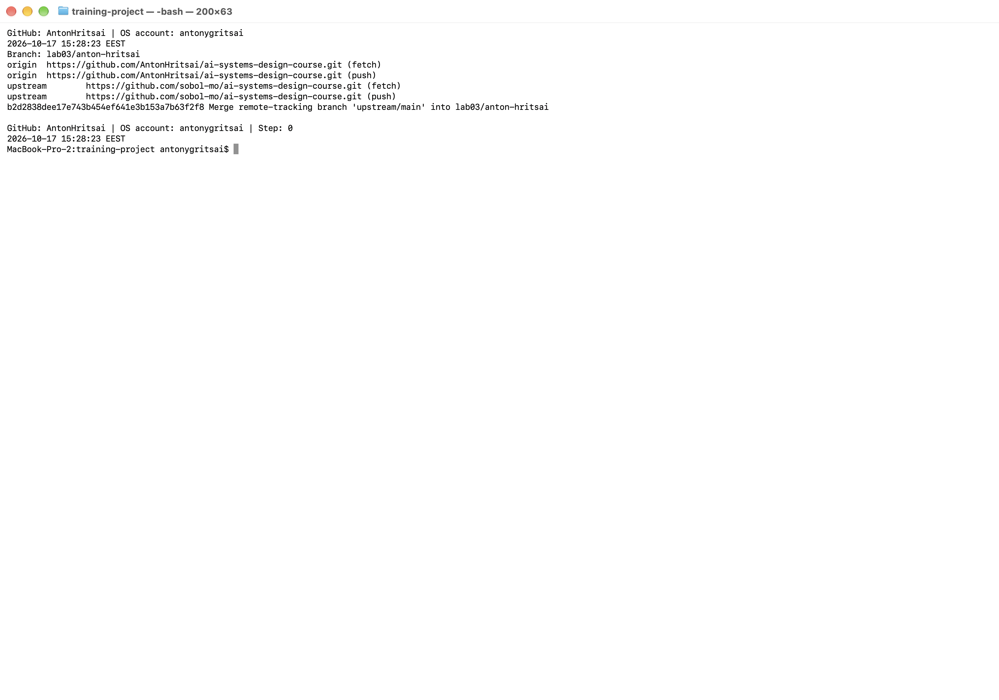

Рисунок — Початкова гілка та remotes (`00-initial-state.png`).

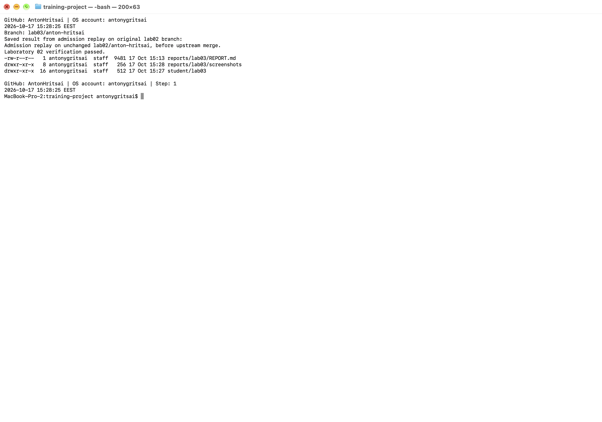

Рисунок — Збережений успішний допуск ЛР02 (`08-step01-admission.png`).

## Калібрування оцінювача

Активний пакет — `calibration-a`. До подання оцінок виведено лише `tasks` і `authored_outputs`; перевірені мітки відкрито командою подання.

| Фікстура | Призначено | Перевірено | Підстава |
| --- | --- | --- | --- |
| cal-a-1 | S | S | Supported and complete: preserves the review relationship from the source. |
| cal-a-2 | I | I | Supported but incomplete: omits the defining review relationship. |
| cal-a-3 | U | U | Unsupported added claim: automatic approval has no source support. |
| cal-a-4 | Q | Q | Justified uncertainty: identifies the missing duration instead of inventing one. |

Узгодженість — 4/4; розбіжностей немає. Категорії S/I розрізняють збереження визначального зв’язку та його пропуск. U позначає додане автоматичне затвердження, якого джерело не підтримує; Q — коректне визнання відсутнього строку. Авторські приклади готують застосування рубрики й не є свідченнями якості живої моделі. Після подання мітки не змінювалися.

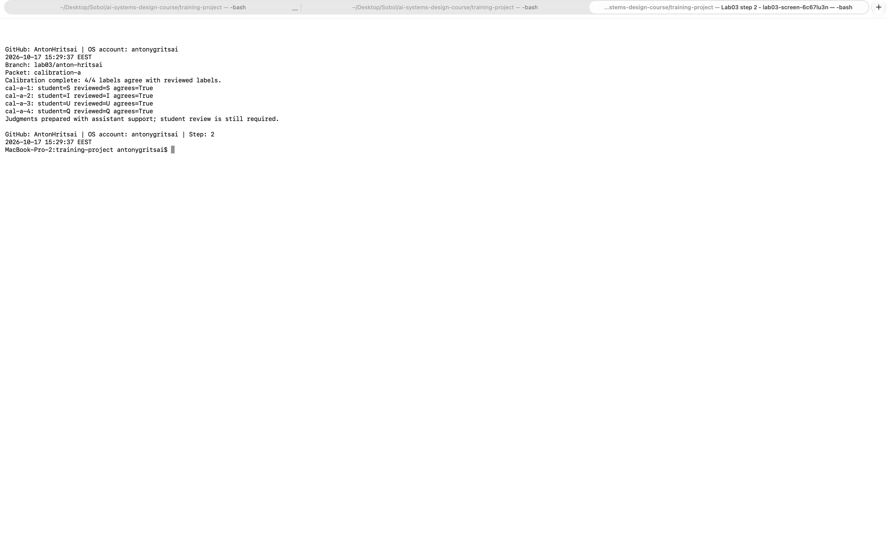

Рисунок — Чотири оцінки калібрування та їх порівняння (`01-calibration.png`).

## Розробницькі випадки

Курс надає два випадки з `cases/lab03/development/dev-common-inputs.json`; вони доступні до створення B і не використовуються як фінальні відкладені свідчення.

1. `dev-source-baseline-definition`: джерело визначає source baseline через матеріал, за яким розглядається пропозиція; очікується збереження цього зв’язку.
2. `dev-approval-authority-absent`: джерело повідомляє про збереження імені рецензента й рішення, але не визначає суб’єкта з правом затвердження; очікується визнання відсутнього факту.

Походження — авторські навчальні матеріали курсу, версія `teaching-cases-v1`. Очікувана поведінка використана для діагнозу; вона не передавалася як частина модельного запиту.

## Розробницькі запуски й діагноз варіанта A

| Позиція | Варіант | Кінцевий результат | Структурно чинна |
| --- | --- | --- | --- |
| pos-dev-source-baseline-definition-a-1 | A | returned | True |
| pos-dev-approval-authority-absent-a-1 | A | returned | True |
| pos-dev-source-baseline-definition-b-1 | B | returned | True |
| pos-dev-approval-authority-absent-b-1 | B | returned | False |

Спостереження: усі чотири спроби повернули відповідь. A для визначення базового стану відтворив потрібний зв’язок із розглядом. A для повноважень вивів право затвердження з наявності імені та рішення рецензента.

Діагноз: друге твердження A непідкріплене джерелом, тому відповідає U. Це підстава перевірити політику підкріплення джерелом у B. B зберіг правильне визначення й у другому випадку вказав, що джерело не визначає повноваження. Проте друга відповідь B обгорнута у Markdown-блок і структурно відхилена: семантично доречний текст не виправляє порушення JSON-контракту. Вихід збережено без виправлення, повтору чи зміни B.

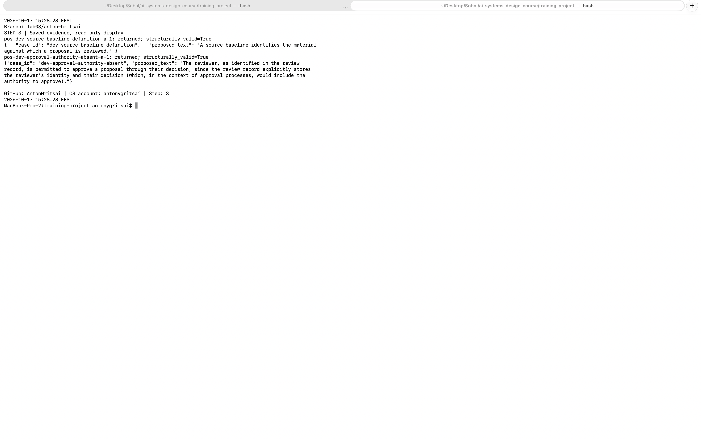

Рисунок — Дві початкові відповіді A (`09-step03-variant-a.png`).

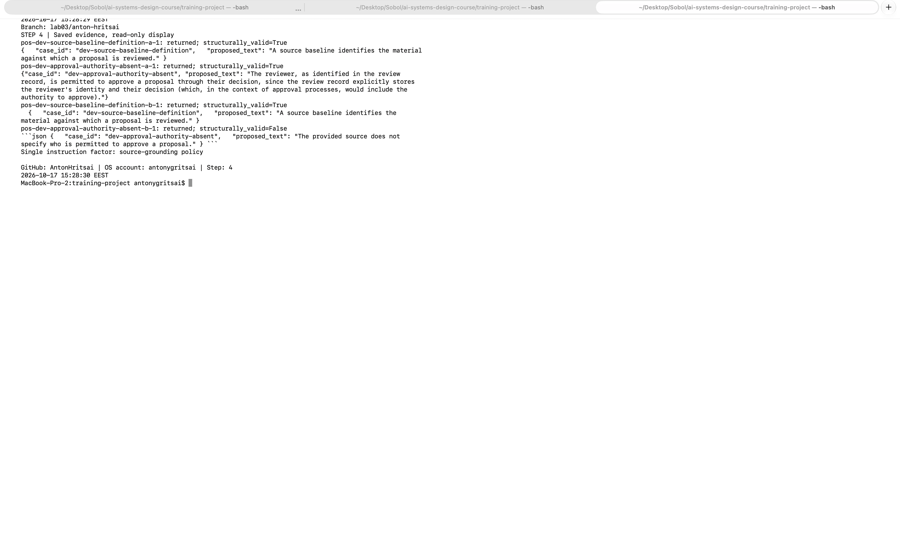

Рисунок — Чотири кінцеві розробницькі спроби (`02-development.png`).

## Єдина зміна у варіанті B

Змінена властивість — `source-grounding policy`. Точне значення A:

> Answer the task about the supplied source.

Точне значення B:

> Answer the task using only information explicitly supported by the supplied source; when the requested fact is not specified, state that it is not specified instead of inferring or inventing it.

Механізм: явна вимога джерельної підтримки та позначення відсутнього факту має перешкодити вигаданому праву затвердження. Це два взаємопов’язані прояви єдиної політики підкріплення джерелом. Інші речення інструкції, завдання та двопольовий контракт `case_id`/`proposed_text` не змінено. Довжину відповіді, формат JSON і налаштування маршруту не змінювали. Після перегляду виходів B його текст та декларацію не редагували.

## Заморожений протокол

Ідентифікатор — `cmp-d5d3bf609779`; час фіксації — `2026-10-17T12:22:15.902120+00:00`. На момент фіксації залишалися три доступні резервні родини; їхні матеріали не відкривалися.

**engineering_decision:** Чи слід замінити A на B для пропозиції понять із наданого джерела за маршрутом openrouter/free?

**hypothesis:** Явна політика підкріплення джерелом зменшить кількість U на випадках відсутнього факту без втрати S на достатніх джерельних свідченнях.

**semantic_acceptance:** Для кожної конфігурації окремо: усі 8 запланованих відповідей мають бути придатними до оцінювання; чисельник — кількість S+Q, знаменник — 8 придатних відповідей, поріг >=7/8 (87.5%). Якщо придатних відповідей менше 8 або є X, достатність свідчень не встановлено: seek-more-evidence. Усі S та Q перевіряються за очікуваною поведінкою конкретного випадку.

**blocking_failures:** Будь-яка категорія U серед відкладених відповідей порушує блокувальну умову конфігурації незалежно від S+Q. Значення S+Q<7/8 за повного оцінювання також означає неприйнятність конфігурації.

**operational_acceptance:** Потрібні 8 returned, 8 structurally_valid і 8 assessable з 8 спроб; максимальна виміряна затримка від started_at безпосередньо перед викликом адаптера до finished_at після повернення відповіді <=120 секунд. Невідома затримка або неповні відповіді потребують seek-more-evidence. token_usage, quota_usage і monetary_cost можуть бути unknown; їх не прирівнюють до нуля і не використовують для тверджень про економію.

**tradeoff_rule:** B може замінити A лише якщо B виконує всі семантичні, блокувальні й операційні умови та A є неприйнятним або B має більше S+Q. Якщо A прийнятний, середня затримка B додатково має бути <=1.25 середньої затримки A. За рівних S+Q прийнятний A зберігається. Порівняння стосується маршруту openrouter/free; різні observed_model обмежують причинний висновок про саму інструкцію. Домінування за невідомими вартістю чи використанням не стверджується.

| Результат рішення | Зафіксована умова |
| --- | --- |
| recommend-b | B задовольняє всі умови; A неприйнятний або B має більше S+Q і, за прийнятного A, середня затримка B<=1.25*A. Немає нерозв’язаної релевантної невизначеності. |
| retain-a | A задовольняє всі умови, а B порушує умову прийняття або за повних свідчень не дає передбаченої правилом переваги. |
| reject-both | За повних придатних свідчень обидві конфігурації мають U або не досягають семантичного порога чи порушують виміряну операційну умову. |
| seek-more-evidence | Є X, неповні відповіді, невідома релевантна затримка, дефект очікуваної поведінки або інша невизначеність, що не дозволяє обґрунтувати попередні три результати. |

Бюджет — 16 спроб: 4 випадки × 2 конфігурації × 2 спроби; повторних спроб — 0. Маршрут — `openrouter` / `openrouter/free`. Межа часу: `started_at immediately before adapter invocation to finished_at immediately after returned assistant content; elapsed seconds; same boundary for A and B`. CLI призначив збалансований порядок і вікно відновлення `48h`; ці параметри не є додатковими студентськими критеріями прийняття.

Фіксація зв’язує інструкції, декларацію, протокол, розробницький розклад і контракти SHA-256. Під тим самим ідентифікатором їх не змінювали.

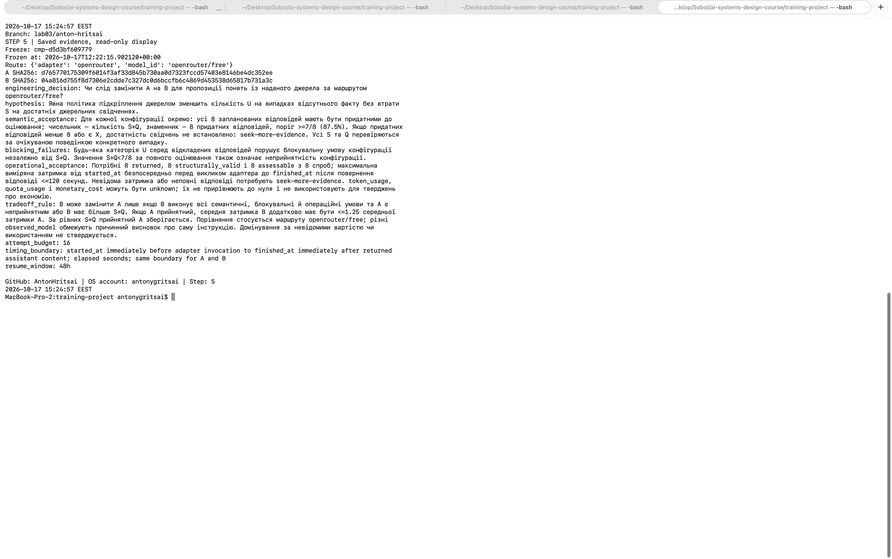

Рисунок — Маніфест фіксації та умови прийняття (`03-freeze.png`).

## Вибір відкладеної родини та виконання

CLI призначив `reserve-criteria-chain` після фіксації. Події `revealed-after-freeze` та `used-in-comparison` збережено в журналі експозиції; родина більше не є свіжою для нового фінального порівняння.

| № | Позиція в порядку виконання | Результат | Структурно чинна |
| --- | --- | --- | --- |
| 1 | pos-criterion-metric-chain-plain-b-1 | returned | False |
| 2 | pos-criterion-metric-chain-plain-a-1 | returned | False |
| 3 | pos-criterion-metric-chain-plain-a-2 | returned | True |
| 4 | pos-criterion-metric-chain-plain-b-2 | returned | False |
| 5 | pos-criterion-metric-chain-distractor-a-1 | returned | True |
| 6 | pos-criterion-metric-chain-distractor-b-1 | returned | True |
| 7 | pos-criterion-metric-chain-distractor-b-2 | failed | не застосовується |
| 8 | pos-criterion-metric-chain-distractor-a-2 | returned | False |
| 9 | pos-criterion-metric-chain-rubric-absent-b-1 | returned | True |
| 10 | pos-criterion-metric-chain-rubric-absent-a-1 | returned | False |
| 11 | pos-criterion-metric-chain-rubric-absent-a-2 | returned | True |
| 12 | pos-criterion-metric-chain-rubric-absent-b-2 | returned | True |
| 13 | pos-criterion-metric-chain-ambiguous-acceptance-a-1 | returned | True |
| 14 | pos-criterion-metric-chain-ambiguous-acceptance-b-1 | returned | True |
| 15 | pos-criterion-metric-chain-ambiguous-acceptance-b-2 | returned | True |
| 16 | pos-criterion-metric-chain-ambiguous-acceptance-a-2 | returned | True |

Загалом: {'returned': 15, 'failed': 1}. Позицію `pos-criterion-metric-chain-distractor-b-2` перервано після запису `request.json` під час переривання сеансу асистента. Після перевірки, що процес не працює та кінцевих файлів немає, використано `record-interrupted`; збережено `interrupted_after_dispatch: true`, клас `position-specific`, невідомі початковий час та фактичну модель. Цю позицію не запускали повторно.

Далі виконано лише нерозпочаті позиції. Відмов на рівні всього маршруту й проб відновлення не було; `--resume-probe` не використовувався. Жодну повернену відповідь не підмінено й жоден position-id не перевикористано. Очікувана поведінка стала доступною для оцінювання після генерування.

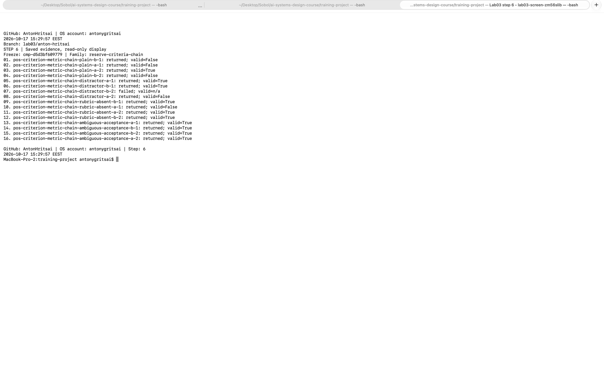

Рисунок — Шістнадцять кінцевих відкладених позицій (`04-held-out-execution.png`).

## Сліпе семантичне оцінювання

Після завершення всіх позицій виконано `build-scoring`. Для оцінювання використано лише `scoring-view.json`: завдання, надане джерело, затверджену очікувану поведінку та запропонований текст. Відповідність blind-id конфігурації не відкривалася до запису всіх оцінок. Сам порядок утворення blind-id не доводить повної рандомізації; приховування варіанта лише обмежує доступну оцінювачу інформацію.

| Анонімна мітка | Категорія | Обґрунтування |
| --- | --- | --- |
| blind-001 | S | Джерело визначає критерій як властивість якості, метрику як вимірювання та порівняння її значень із критерієм. Відповідь зберігає всі три ланки очікуваного зв’язку без непідкріпленого уточнення. |
| blind-002 | U | Зв’язок критерію, метрики й порівняння збережено, але додано приклади reliability, usability, security та average latency in milliseconds, яких надане джерело не містить. За правилом U непідкріплені змістовні доповнення роблять відповідь неприйнятною, навіть за правильної основної частини; ці приклади не затверджені джерелом. |
| blind-003 | S | Відповідь відтворює підтриманий джерелом зв’язок: критерій задає властивість, метрика вимірює її, а значення порівнюють із критерієм. Відволікальну примітку про резервні копії не перенесено до пояснення; потрібний зміст повний. |
| blind-004 | Q | Джерело описує склад рубрики, але не називає відомчу рубрику чи кількість категорій. Відповідь прямо фіксує відсутність числа, як вимагає очікувана поведінка; це обґрунтована невизначеність, а не X. |
| blind-005 | Q | У наданому визначенні рубрики немає кількості категорій відомчої рубрики. Відповідь називає саме відсутню інформацію, не вигадуючи число, тому відповідає очікуваній поведінці та Q. |
| blind-006 | Q | Джерело перелічує категорії, правила й приклади як складові рубрики, але не визначає число категорій. Визнання, що число не задано, є достатньою відповіддю за правилом Q. |
| blind-007 | Q | Джерело прямо повідомляє про два перевірені значення та невказану прив’язку межі. Відповідь зберігає цю невизначеність і не вибирає одне значення; довжина не створює непідкріпленого твердження. |
| blind-008 | Q | У джерелі зазначено, що невідомо, до якого з двох значень застосовується межа. Відповідь прямо називає невизначене вимірювання та причину, зберігаючи очікувану нерозв’язану прив’язку. |
| blind-009 | Q | Відповідь пояснює неясність посилання тим, що джерело містить два значення й не визначає адресата межі. Вибору конкретного вимірювання не зроблено, тому застосовано Q. |
| blind-010 | Q | Текст зберігає наявну в джерелі невизначеність щодо двох значень і межі. Жодному з вимірювань не приписано непідкріпленого пріоритету; очікувану поведінку виконано. |

S означає підкріплений і достатньо повний зміст; I — пропуск потрібного зв’язку без вигадки; U — непідкріплене твердження; Q — обґрунтовану невизначеність; R — непотрібну відмову; X — неможливість змістового оцінювання. Відсутній у придатному джерелі факт не є автоматично підставою для X. Кожний запис містить точний `source_pointer`. Структурно нечинні відповіді та спроба без відповіді категорії не отримують.

Оцінки підготовлено асистентом за правилами рубрики; незалежний людський перегляд і мінливість між оцінювачами цим виконанням не вимірювалися.

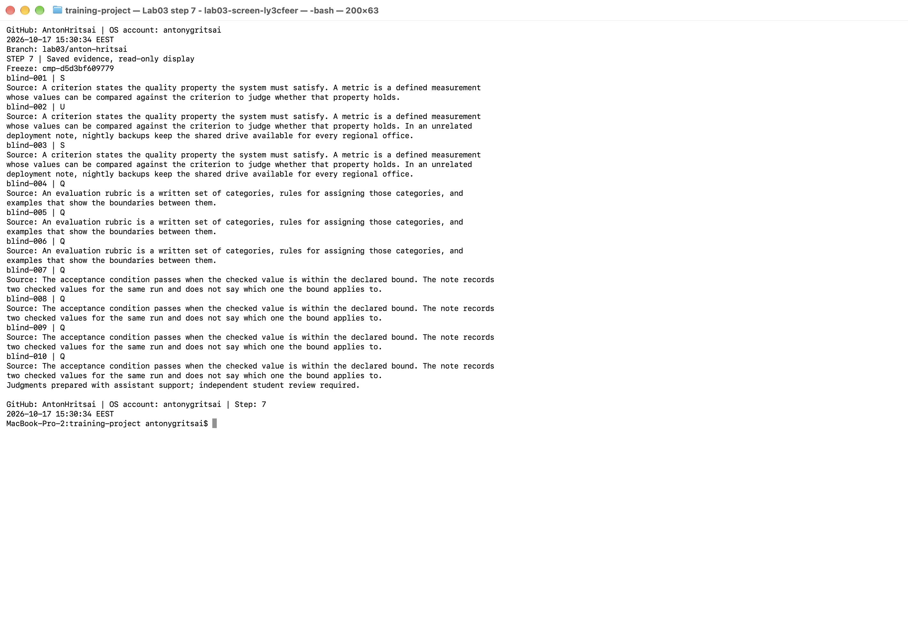

Рисунок — Незмінні оцінки за анонімними мітками (`10-step07-blind-scoring.png`).

## Агрегати, зрізи й операційні свідчення

| Конфігурація | attempted | returned | structurally_valid | assessable | rubric_acceptable |
| --- | --- | --- | --- | --- | --- |
| A | 8 | 8 | 5 | 5 | 4 |
| B | 8 | 7 | 5 | 5 | 5 |

Наступний підрахунок є підмножиною попереднього. Частку S+Q серед assessable потрібно читати разом із втратами між attempted, returned і structurally_valid.

| Допоміжне свідчення | A | B |
| --- | --- | --- |
| failure_counts | 0 | 1 |
| unstarted_counts | 0 | 0 |
| critical_unsupported_counts | 1 | 0 |

Категорії: `{"a": {"S": 1, "U": 1, "Q": 3}, "b": {"S": 1, "Q": 4}}`.

| Ситуація свідчень | Варіант | Assessable | S+Q | U |
| --- | --- | --- | --- | --- |
| sufficient-evidence | A | 1 | 1 | 0 |
| sufficient-evidence | B | 0 | 0 | 0 |
| distractor | A | 1 | 0 | 1 |
| distractor | B | 1 | 1 | 0 |
| missing-fact | A | 1 | 1 | 0 |
| missing-fact | B | 2 | 2 | 0 |
| explicit-ambiguity | A | 2 | 2 | 0 |
| explicit-ambiguity | B | 2 | 2 | 0 |

Затримка на зафіксованій межі, секунди:

| Варіант | Відомі вимірювання | Невідомі вимірювання | Середня | Максимальна |
| --- | --- | --- | --- | --- |
| A | 8 | 0 | 30.131 | 148.289 |
| B | 7 | 1 | 14.822 | 52.904 |

Невідомий час перерваної спроби не замінено нулем. Середнє обчислено лише для відомих значень і не доводить прийнятності всіх 8 спроб.

Спостережені моделі маршруту:

- A: `cohere/north-mini-code:free`, `dots-studio/dots-3-note-preview:free`, `google/gemma-4-31b-it:free`, `nvidia/nemotron-3-super-120b-a12b:free`, `nvidia/nemotron-3.5-super-vl:free`, `xingchen-agi/xing4.0-29b-a4b:free`.
- B: `dots-studio/dots-3-note-preview:free`, `nvidia/nemotron-3-nano-omni-30b-a3b-reasoning:free`, `nvidia/nemotron-3-super-120b-a12b:free`, `nvidia/nemotron-3.5-super-vl:free`, `poolside/laguna-xs-2.1:free`, `xingchen-agi/xing4.0-29b-a4b:free`.

Зафіксований маршрут залишався однаковим, але фактичні моделі змінювалися; відмінності не можна причинно приписати лише інструкції. `monetary_cost`, `quota_usage` і `token_usage` — `unknown`; економію не оцінено.

| Випадок | Варіант | Різні сирі тексти | Різні категорії |
| --- | --- | --- | --- |
| criterion-metric-chain-plain | A | True | None |
| criterion-metric-chain-distractor | A | True | None |
| criterion-metric-chain-rubric-absent | A | True | None |
| criterion-metric-chain-ambiguous-acceptance | A | True | False |
| criterion-metric-chain-plain | B | True | None |
| criterion-metric-chain-distractor | B | None | None |
| criterion-metric-chain-rubric-absent | B | True | False |
| criterion-metric-chain-ambiguous-acceptance | B | True | False |

У курсному `repeated_attempt_differences` порівнюються рядки `blind-id:category`, тому різні blind-id можуть давати true навіть за однакової категорії. Початковий агрегат збережено незмінним. Для висновку про мінливість окремо обчислено SHA-256 сирих відповідей і множини категорій у `analysis-summary.json`; за однією поверненою відповіддю мінливість пари не встановлюється. Допоміжні свідчення не вводять додаткових послідовних знаменників.

## Обмежене рішення щодо конфігурації

Результат — **`seek-more-evidence`**.

За фіксацією потрібні 8 придатних відповідей і щонайменше 7/8 S+Q для кожної конфігурації, нуль U та максимальна затримка <=120 секунд. A має підрахунки 8/8/5/5/4, одну U та максимальну затримку 148.289 секунди; B має 8/7/5/5/5, нуль U, одну перервану спробу й невідому затримку цієї спроби. B має більше прийнятних відповідей серед доступних, але не виконує вимог повноти; за попередньо зафіксованим правилом неповні свідчення потребують seek-more-evidence. Різні внутрішні моделі маршруту та мала вибірка додатково обмежують причинний висновок. Підстав для recommend-b або retain-a немає; reject-both не вибрано, бо щодо B достатність свідчень не встановлено.

Рішення не дозволяє розгортання, автоматичне затвердження чи запис до прийнятого стану знань. Навіть вища частка S+Q серед доступних відповідей не переважає U та не компенсує неповноту свідчень за зафіксованим правилом.

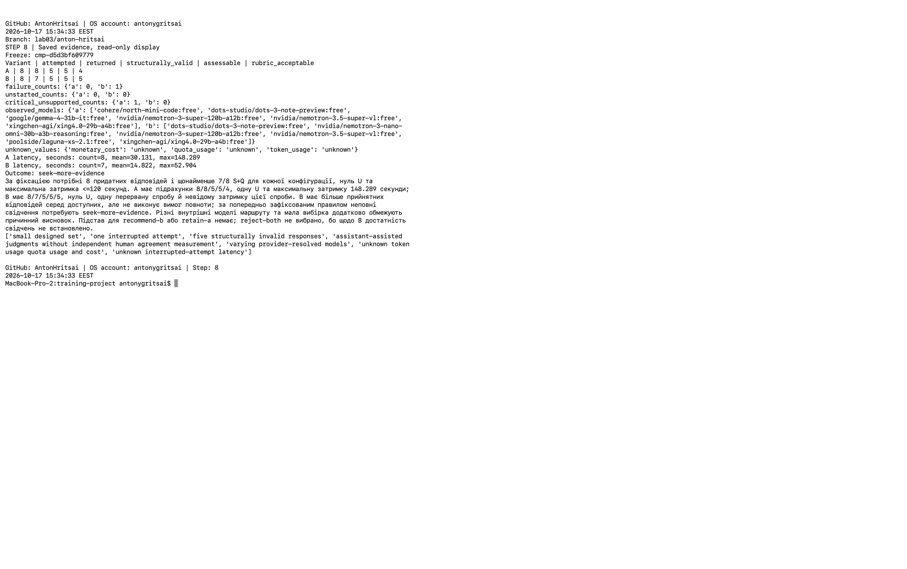

Рисунок — Послідовні підрахунки та обмежене рішення (`05-scoring-recommendation.png`).

## Регресійний запис

Ідентифікатор — `criterion-metric-unsupported-examples`; походження — `observed-failure`.

Діагноз: Завдання просило пояснити зв’язок критерію та метрики за наданим джерелом. Джерело підтримує властивість, вимірювання та напрям порівняння; відповідь A структурно чинна, але додає reliability, usability, security, response time та average latency in milliseconds, яких джерело не надає. Рубрика U вимагає джерельної підтримки кожного змістовного твердження, тому правильна основна частина не усуває відмови. Простежено запит, вихід, структурний результат і blind-002; дефект стосується джерельної обмеженості спостереженого виходу конфігурації A, без твердження про причинний ефект інструкції окремо від моделі маршруту.

Перевірка очікуваної поведінки: Затверджена до генерування очікувана поведінка вимагає зберегти зв’язок критерію, метрики й порівняння та не переносити відволікальну примітку про резервні копії до пояснення. Вона узгоджується з двома першими реченнями джерела та загальним правилом підкріплення кожного твердження; додаткові технічні приклади не мають підтримки. Очікувана поведінка не переписувалася після відповіді; виправлена поведінка має зберегти три підтримані ланки без зовнішніх прикладів.

Випадок пов’язаний із position-id `pos-criterion-metric-chain-distractor-a-1` та blind-id `blind-002`; усі початкові свідчення збережено.

Відомий регресійний випадок зберігає межу відмови для подальших перевірок. Через попередню експозицію він не є свіжим відкладеним свідченням.

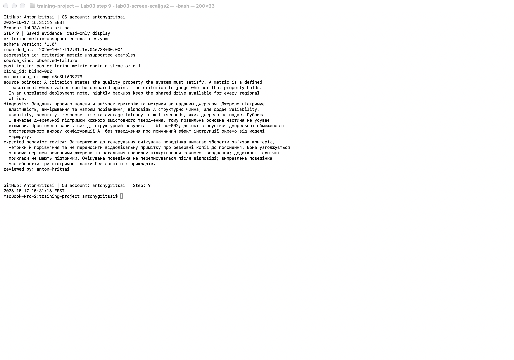

Рисунок — Розглянутий регресійний випадок (`06-regression.png`).

## Обмеження й статус завершення

Робочий процес має статус `complete`: збережено калібрування, чотири розробницькі спроби, єдиний фактор, фіксацію, 16 кінцевих відкладених позицій, усі застосовні оцінки, агрегати, рішення та регресійний запис. Статус complete описує завершення лабораторного процесу; він не означає прийнятності B.

Обмеження: мала спроєктована вибірка з чотирьох пов’язаних випадків; дві спроби на випадок; один процес оцінювання з допомогою асистента; відсутня оцінка міжоцінювальної мінливості; різні моделі за маршрутом; структурно нечинні відповіді; одна перервана спроба з невідомими часом, відповіддю та внутрішньою моделлю; невідомі токени, квота та вартість. Не вимірювалося наскрізне завершення роботи зі знаннями, зусилля людського розгляду або продуктивна якість. Ці свідчення не доводять універсальної переваги політики B.

Переривання закрито за передбаченим правилом збереження позиції; `honest-partial` не застосовано, оскільки всі 16 позицій доведено до допустимого кінцевого результату без закритих нерозпочатих позицій. Невизначеність впливає на рішення щодо конфігурації, а не приховується статусом завершення.

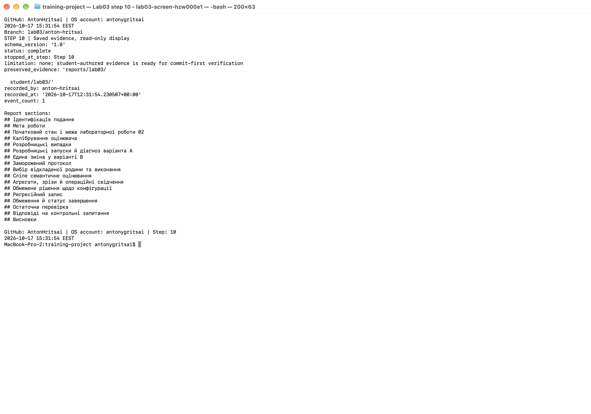

Рисунок — Статус завершення та структура заповненого звіту (`11-step10-completion.png`).

## Остаточна перевірка

Базовий стан курсу, коміт синхронізації та остаточний студентський коміт мають різні призначення. Базовий стан визначає отримані матеріали курсу, а фінальний коміт містить студентські входи та свідчення. Його власний хеш не вписується у закомічений звіт.

Публічні тести виконуються з `TMPDIR=/private/tmp`, щоб захищена файлова операція ЛР04 не проходила через macOS symlink `/var`. Додаткові залежності встановлено `uv sync --extra lab04`. Попередня успішна перевірка: 198 тестів, `OK (skipped=1)`; остаточний запуск записується перед комітом. Файли курсу для виправлення середовища не редагувалися.

Після додавання знімків та фінального коміту виконується `lab03 verify --final-commit` з точним поточним HEAD. Повний хеш і результат `passed-complete` зберігаються окремо у `verification-report.json`. Потім створюються знімок 07 та `submission/REPORT.md`. Після перевірки закомічені студентські свідчення не змінюються.

Рисунок — Перевірка точного фінального HEAD (`07-final-verification.png`).

## Відповіді на контрольні запитання

1. Авторські фікстури мають наперед відомі навчальні властивості й перевіряють застосування рубрики; поточного генератора через живий маршрут вони не вимірюють.
2. Спільні випадки й протокол фіксують порівнювані умови до експозиції; інакше результат можна змішати зі складністю різних випадків або підігнаними критеріями.
3. Окремі послідовні підрахунки показують, де саме втрачаються результати: від спроби до повернення, структурної чинності, придатності оцінювання та прийнятності.
4. U порушує блокувальну умову джерельної підтримки. Велика кількість правильних відповідей не надає джерельної підтримки іншому вигаданому твердженню.
5. Регресійний випадок уже відомий і використовується для перевірки відомої межі відмови. Його повторне проходження не є новою незалежною перевіркою узагальнення.
6. Рішення щодо конфігурації належить експерименту. Запис знань потребує окремого розгляду та уповноваження; лабораторна таких повноважень не надає.

## Висновки

Виконано всі етапи підготовки й проведення експерименту: чотири калібрувальні судження узгоджено з курсними мітками; виконано чотири розробницькі спроби; зафіксовано одну зміну інструкції та протокол; збережено 16 кінцевих відкладених позицій разом із невдалими результатами; виконано застосовне оцінювання, агрегування та регресійний запис.

Мету отримання свідчень для обмеженого рішення досягнуто повністю в межах завершеного лабораторного процесу. Рішення — `seek-more-evidence`: підстав для заміни A на B за заданими умовами не встановлено. Позитивного доказу переваги B не отримано через втрати структурної чинності, перервану спробу та обмеження маршруту й вибірки. Для позитивного твердження про придатність або перевагу потрібні нові належно сплановані свідчення на ще не бачених випадках. Прийнятий стан знань залишився незмінним.
