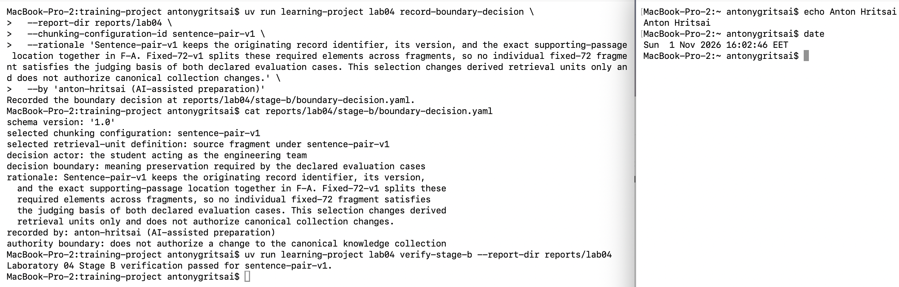
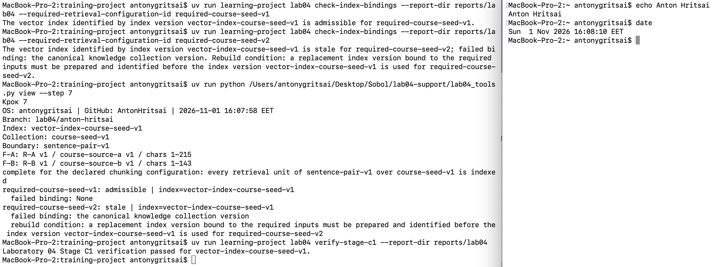
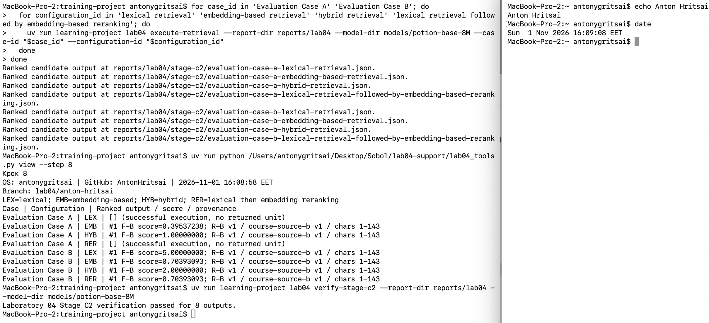
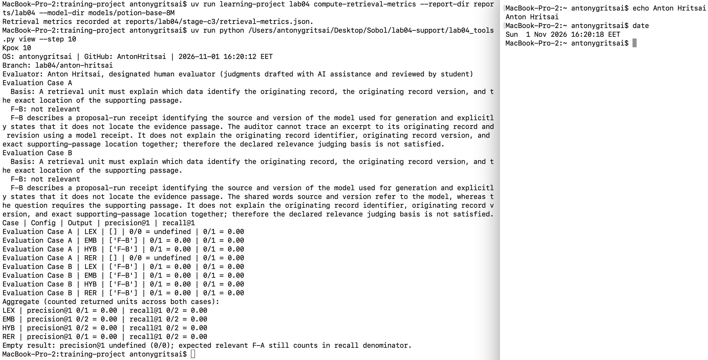
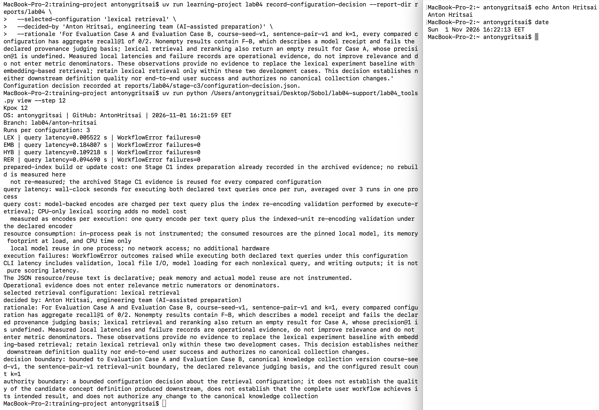

# Лабораторна робота 04

## Ідентифікація

- Прізвище та ім’я студента: Anton Hritsai; обліковий запис GitHub `AntonHritsai`.
- Ідентифікатор студента: `anton-hritsai`.
- URL форка: https://github.com/AntonHritsai/ai-systems-design-course
- Особиста гілка: `lab04/anton-hritsai`
- Статус завершення: `complete`
- Дата формування опису: 01.11.2026; часовий пояс `Europe/Kyiv`.

Повний хеш остаточного коміту та результат перевірки записуються в `verification-report.json` після коміту. Їх не дописують у закомічений вихідний звіт.

Команди, допоміжні засоби огляду, проєкт суджень і текст звіту підготовлено за допомогою асистента. Атрибуція запису оцінювання: `Anton Hritsai, designated human evaluator (judgments drafted with AI assistance and reviewed by student)`. Пакет підготовлено до прив’язування остаточним верифікатором до точного HEAD гілки; результат і повний хеш міститимуться в окремому машинному файлі.

## Мета роботи

Отримати простежувані свідчення для рішення інженерної команди, чи має пошук на основі ембедингів замінити базовий лексичний пошук для двох оголошених випадків над канонічною колекцією `course-seed-v1`. Бажаний стан — узгоджені межі одиниць пошуку, сумісний версійований індекс, перевірені ранжовані виходи та метрики з явними підставами, які дозволяють зробити рішення лише в оголошеній області застосування.

## Хід виконання

На кроці 0 створено окремий робочий каталог `lab04-manual` і особисту гілку від завершеної `lab03/anton-hritsai-manual`; до початку операцій додано актуальні матеріали курсу з `origin/main`. Ініціалізовано звіт і каталог знімків, виконано `uv sync --extra lab04`. Середовище: macOS на Apple Silicon, Python 3.14.0, uv 0.12.15, model2vec 0.10.0. Канонічні записи, код команд, тести та фікстури курсу під час виконання не змінювалися.

Подальші контрольні точки відповідають крокам 1–3, 4–7, 8, 9–10, 11–12 і 13. На всіх дібраних знімках видимі системний обліковий запис та дата. Додаткові проміжні кадри збережено окремо від шести знімків вихідного звіту.

### Вибір межі одиниці інформаційного пошуку

Застосовано дві надані конфігурації до канонічних записів `R-A` і `R-B`. Правило `sentence-pair-v1` об’єднує не більше двох сусідніх речень без перекриття; `fixed-72-v1` обмежує фрагмент 72 символами з розривом на пробілі. Фактично отримані фрагменти та їхні зв’язки походження наведено нижче; діапазони символів відлічуються від одиниці.

| Конфігурація | Одиниця | Походження | Текст фрагмента |
| --- | --- | --- | --- |
| sentence-pair-v1 | F-A | R-A v1 / course-source-a v1 / chars 1-215 | A provenance link binds each evidence passage to its originating record identifier, record version, and exact sentence span. The link lets a reviewer locate the passage used to justify a proposed concept definition. |
| sentence-pair-v1 | F-B | R-B v1 / course-source-b v1 / chars 1-143 | A proposal-run receipt records the source and version of the model used to produce a concept proposal; it does not locate the evidence passage. |
| fixed-72-v1 | F-A-72-1 | R-A v1 / course-source-a v1 / chars 1-71 | A provenance link binds each evidence passage to its originating record |
| fixed-72-v1 | F-A-72-2 | R-A v1 / course-source-a v1 / chars 73-140 | identifier, record version, and exact sentence span. The link lets a |
| fixed-72-v1 | F-A-72-3 | R-A v1 / course-source-a v1 / chars 142-203 | reviewer locate the passage used to justify a proposed concept |
| fixed-72-v1 | F-A-72-4 | R-A v1 / course-source-a v1 / chars 205-215 | definition. |
| fixed-72-v1 | F-B-72-1 | R-B v1 / course-source-b v1 / chars 1-71 | A proposal-run receipt records the source and version of the model used |
| fixed-72-v1 | F-B-72-2 | R-B v1 / course-source-b v1 / chars 73-143 | to produce a concept proposal; it does not locate the evidence passage. |

Колекція має версію `course-seed-v1`. Обидва канонічні записи надано курсом: `student_generated: false`, `student_approved: false`. Кожний фрагмент класифіковано як `derived retrieval-side artifact; not a canonical knowledge collection member`. Фрагменти та індекс є похідними засобами пошуку й не поповнюють канонічну колекцію.

Контракт містить дев’ять оголошених полів. Базовою конфігурацією є `lexical retrieval`, кандидатною — `embedding-based retrieval`; межа спостереження — ранжований кандидатний вихід. Очікувані результати та підстава оцінювання містяться лише в матеріалах оцінювача й відсутні в `operation_input` обох випадків.

Зафіксовано вибір `sentence-pair-v1`. Його підстава: `F-A` в одному фрагменті зберігає ідентифікатор первинного запису, версію запису та точне місце підтвердного уривка. Жодний окремий фрагмент `F-A-72-1`–`F-A-72-4` не містить усіх трьох елементів разом без реконструкції з іншого фрагмента. Це задовольняє підставу релевантності обох оголошених випадків і дозволяє перейти до створення представлень. Машинні свідчення: `stage-b/boundary-comparison.json`, `stage-b/boundary-decision.yaml`; команда `verify-stage-b` завершилася успішно для `sentence-pair-v1`, що підтвердило структурну узгодженість перед продовженням. Рішення про межу не уповноважує змін канонічної колекції.

Рисунок — `01-boundary-selection.png`

### Ембединги та векторний індекс

Отримано оголошену локальну модель `minishlab/potion-base-8M` ревізії `bf8b056651a2c21b8d2565580b8569da283cab23`; походження моделі зафіксовано в `models/potion-base-8M/model-provenance.json`. Для кожної обраної одиниці створено сумісний ембединг: `F-A`, `F-B`. Кожний містить 256 скінченних координат. Версія представлення — `course-static-embed-v1`, простір — `potion-base-8M@bf8b056651a2c21b8d2565580b8569da283cab23/course-static-embed-v1`.

Підготовлено індекс `vector-index-course-seed-v1`, прив’язаний до `course-seed-v1` та `sentence-pair-v1`. Його стан складається з векторів у `stage-c1/retrieval-unit-embeddings.json` та асоціацій у `stage-c1/index-manifest.json`; сам маніфест є записом про індекс. Він зберігає версію колекції, конфігурацію меж, модель і ревізію, версію представлення, розмірність, простір, стабільні ідентифікатори та походження всіх проіндексованих одиниць.

| Потрібна конфігурація | Результат перевірки | Невдала прив’язка |
| --- | --- | --- |
| required-course-seed-v1 | admissible | немає |
| required-course-seed-v2 | stale | the canonical knowledge collection version |

Придатність `required-course-seed-v1` дозволяє виконувати оголошені запити. Для `required-course-seed-v2` індекс визнано застарілим через версію канонічної колекції: перед таким використанням слід підготувати й ідентифікувати новий індекс із потрібними прив’язками. Ця перевірка не перебудовує наявний індекс. Обидва результати належать до тієї самої підготовленої версії. Узгодженість збережено в `binding-check-required-course-seed-v1.json` і `binding-check-required-course-seed-v2.json`; команда `verify-stage-c1` завершилася успішно для `vector-index-course-seed-v1`. Непридатний для v2 індекс не використовувався з конфігурацією v2.

Рисунок — `02-embedding-index.png`

### Порівняння конфігурацій інформаційного пошуку

Виконано `Evaluation Case A` і `Evaluation Case B` за чотирма конфігураціями. Параметри: `k=1`, щонайбільше два лексичні кандидати для переранжування, рівні бали впорядковуються за стабільним ідентифікатором. Для A запитано: «How can an auditor trace an excerpt to its origin and revision?». Для B: «Which source and version identify the supporting passage for a concept proposal?».

Лексична конфігурація рахує різні спільні змістові слова після нормалізації регістру та вилучення службових слів. Векторна конфігурація використовує косинусну подібність запиту до всіх проіндексованих одиниць. Гібридна додає бали двох незалежних ранжувань після ділення на їхні максимуми. Переранжування змінює порядок лише всередині лексичного набору кандидатів.

| Випадок | Конфігурація | Фактичний ранжований вихід |
| --- | --- | --- |
| Evaluation Case A | lexical retrieval | []; виконання успішне, кандидатів немає |
| Evaluation Case A | embedding-based retrieval | F-B, score=0.39537238, R-B v1 / course-source-b v1 / chars 1-143 |
| Evaluation Case A | hybrid retrieval | F-B, score=1.00000000, R-B v1 / course-source-b v1 / chars 1-143 |
| Evaluation Case A | lexical retrieval followed by embedding-based reranking | []; виконання успішне, кандидатів немає |
| Evaluation Case B | lexical retrieval | F-B, score=5.00000000, R-B v1 / course-source-b v1 / chars 1-143 |
| Evaluation Case B | embedding-based retrieval | F-B, score=0.70393093, R-B v1 / course-source-b v1 / chars 1-143 |
| Evaluation Case B | hybrid retrieval | F-B, score=2.00000000, R-B v1 / course-source-b v1 / chars 1-143 |
| Evaluation Case B | lexical retrieval followed by embedding-based reranking | F-B, score=0.70393093, R-B v1 / course-source-b v1 / chars 1-143 |

Порожній масив `[]` означає успішне виконання без повернених одиниць. Він не є відмовою виконання чи судженням про релевантність. Бали характеризують ранжування за конкретними правилами й не дають підстав приписувати механізму загальну перевагу. Машинні виходи — вісім JSON-файлів у `stage-c2/`; перевірка `verify-stage-c2` незалежно відтворила всі вісім і завершилася повідомленням `verification passed for 8 outputs`. Підставою переходу до оцінювання є їхня відповідність оголошеним входам, підготовленим одиницям та правилам пошуку.

Рисунок — `03-retrieval-comparison.png`

### Судження про релевантність і метрики

До кожної унікальної поверненої одиниці в кожному випадку застосовано оголошену підставу: фрагмент має пояснювати, які дані ідентифікують первинний запис, його версію та точне місце підтвердного уривка. Очікуваний для оцінювача результат обох випадків — `F-A`; цей матеріал не передавався операції пошуку.

**Evaluation Case A, F-B: `not relevant`.** Фрагмент описує квитанцію запуску пропозиції, яка фіксує джерело й версію моделі та прямо не визначає місця уривка доказу. За випадком A квитанція запуску не дає аудитору змоги простежити уривок до первинного запису та його редакції. У ньому не пояснено разом ідентифікатор первинного запису, версію цього запису та точне місце підтвердного уривка; отже, оголошену підставу релевантності не задоволено.

**Evaluation Case B, F-B: `not relevant`.** Фрагмент описує квитанцію запуску пропозиції, яка фіксує джерело й версію моделі та прямо не визначає місця уривка доказу. За випадком B спільні слова source та version описують модель, хоча запит стосується підтвердного уривка. У ньому не пояснено разом ідентифікатор первинного запису, версію цього запису та точне місце підтвердного уривка; отже, оголошену підставу релевантності не задоволено.

Першу спробу інтерактивного підтвердження на кроці 9 перервано: наступну вставлену команду прочитано як відповідь замість `ТАК`. Запис оцінок у цій спробі не створено. Крок повторено готовим скриптом із повторним використанням наявного проєкту JSON; після окремого підтвердження студентом оцінки записано успішно. Наявні результати пошуку та судження не перезаписувалися.

Судження записано в `stage-c3/relevance-judgments.json`; вони охоплюють усі фактично повернені одиниці без додаткових ідентифікаторів. Повні первинні тексти обґрунтувань збережено в полях `rationale` цього файлу; вище їх викладено українською. Обґрунтування стосуються змісту фрагментів; числовий бал не використано як мітку релевантності.

| Випадок | Конфігурація | Вихід | precision@1 | recall@1 |
| --- | --- | --- | --- | --- |
| Evaluation Case A | lexical retrieval | [] | 0/0 = undefined | 0/1 = 0.00 |
| Evaluation Case A | embedding-based retrieval | F-B | 0/1 = 0.00 | 0/1 = 0.00 |
| Evaluation Case A | hybrid retrieval | F-B | 0/1 = 0.00 | 0/1 = 0.00 |
| Evaluation Case A | lexical retrieval followed by embedding-based reranking | [] | 0/0 = undefined | 0/1 = 0.00 |
| Evaluation Case B | lexical retrieval | F-B | 0/1 = 0.00 | 0/1 = 0.00 |
| Evaluation Case B | embedding-based retrieval | F-B | 0/1 = 0.00 | 0/1 = 0.00 |
| Evaluation Case B | hybrid retrieval | F-B | 0/1 = 0.00 | 0/1 = 0.00 |
| Evaluation Case B | lexical retrieval followed by embedding-based reranking | F-B | 0/1 = 0.00 | 0/1 = 0.00 |

| Конфігурація | Агрегований precision@1 | Агрегований recall@1 |
| --- | --- | --- |
| lexical retrieval | 0/1 = 0.00 | 0/2 = 0.00 |
| embedding-based retrieval | 0/2 = 0.00 | 0/2 = 0.00 |
| hybrid retrieval | 0/2 = 0.00 | 0/2 = 0.00 |
| lexical retrieval followed by embedding-based reranking | 0/1 = 0.00 | 0/2 = 0.00 |

Для `precision@1` чисельник — релевантні повернені одиниці, знаменник — усі повернені одиниці на першій позиції. За порожнього виходу це `0/0 = undefined`, а не нуль. Для `recall@1` знаменником залишається одна розглянута релевантна одиниця `F-A` на випадок, тому порожній вихід дає `0/1`. При агрегації порожній вихід не збільшує знаменник precision, але його очікувана релевантна одиниця входить до знаменника recall. Арифметику з `stage-c3/retrieval-metrics.json` незалежно переобчислено командою `verify-stage-c3`; успішно перевірено 8 записів метрик; сам верифікатор не створює суджень про зміст. Повне покриття повернених одиниць і явні знаменники дають підставу перейти до операційного порівняння.

Рисунок — `04-relevance-metrics.png`

### Операційні свідчення та обмежене рішення

Вимірювання виконано локально командою `measure-operational-evidence` за 3 запусками на конфігурацію. Один запуск охоплює обидва оголошені текстові запити; у таблиці наведено середні секунди фактично минулого часу. Копіювання й видалення тимчасових свідчень виконуються поза відліком. У відлік входять перевірки, читання локальних файлів, завантаження моделі для кожного нелексичного запиту та запис виходів. CLI не передає попередньо завантажений кодувальник, тому вимірювання не є затримкою чистого обчислення балів або підтвердженням повторного використання одного завантаженого екземпляра моделі.

| Конфігурація | Середня затримка двох запитів, с | Кількість WorkflowError |
| --- | --- | --- |
| lexical retrieval | 0.005522 | 0 |
| embedding-based retrieval | 0.184807 | 0 |
| hybrid retrieval | 0.109218 | 0 |
| lexical retrieval followed by embedding-based reranking | 0.094690 | 0 |

Вартість побудови або оновлення індексу повторно не вимірювалася: використано одну підготовку індексу, засвідчену наявними артефактами. Вартість запитів описується операціями кодування запиту та повторного кодування одиниць під час перевірки індексу; окремий інструментальний лічильник операцій не надається. Опис ресурсів у JSON є декларативним: використано локальні файли моделі без мережевого доступу; пікову пам’ять, завантаження CPU, повторне використання об’єкта моделі та грошову вартість не виміряно. Помилки виконання — лише результати `WorkflowError` у межі виконання двох запитів. Ці обмеження не дозволяють трактувати запис як повний профіль продуктивності або собівартості.

Обрано `lexical retrieval`. Жодна порівнювана конфігурація не повернула розглянуту релевантну одиницю F-A: агрегований recall@1 кожної становить 0/2. Непорожні виходи містять F-B, зміст якого не задовольняє оголошену підставу. Порожні виходи для випадку A не дають визначеного precision@1. Виміряні локальні затримки й записи помилок характеризують виконання та не поліпшують релевантності. Тому свідчення не обґрунтовують заміни базового лексичного пошуку векторною кандидатною конфігурацією; лексичний пошук збережено лише для цих двох розробницьких випадків. Первинне повне обґрунтування міститься в полі `rationale` файлу `stage-c3/configuration-decision.json`.

Межа рішення: лише `Evaluation Case A` та `Evaluation Case B`, канонічна колекція `course-seed-v1`, одиниці за `sentence-pair-v1`, оголошена підстава релевантності та `k=1`. Межа повноважень: рішення стосується конфігурації пошуку; воно не встановлює якості подальшого визначення поняття, не доводить досягнення мети повного користувацького процесу й не уповноважує змін канонічної колекції знань. Машинні свідчення — `stage-c3/operational-evidence.json` і `stage-c3/configuration-decision.json`. Жодне операційне вимірювання не входить до чисельника або знаменника precision чи recall. Метрики та наведені вимірювання є достатньою підставою для рішення в цій вузькій межі.

Рисунок — `05-operational-decision.png`

### Остаточна перевірка

На кроці 13 виконано весь публічний набір: `Ran 254 tests`, результат `OK`, без пропусків; підсумок студентського запуску зафіксовано на знімках кроку 13. Використано команду `TMPDIR=/Users/antonygritsai/Desktop/Sobol/lab04-support/test-tmp LAB04_REAL_MODEL_DIR=models/potion-base-8M uv run python -u -m unittest discover -s tests/public -v`. Прямий шлях тимчасового каталогу усуває несумісність захищеного запису із символічним посиланням `/var` у macOS; змінна моделі вмикає перевірку реальної локальної моделі. Перевірка `verify-stage-c3` підтвердила всі 8 записів метрик без зміни суджень або виходів пошуку.

Завершено український вихідний звіт, перевірено відповідність опису всім 18 машинним артефактам, дібрано п’ять знімків контрольних точок для коміту та збережено шосте точне відносне посилання. Команда `validate-report` перевіряє заголовки, ідентифікацію, статус, посилання та повноту пакета; `git diff --check` перевіряє відсутність помилок пробілів. Ці перевірки разом із перевіреною арифметикою є підставою для фіксації незмінного пакета в особистій гілці.

Остаточний контроль виконується після коміту командою `lab04 verify` з повним поточним `git rev-parse HEAD` у параметрі `--final-commit`. Його фактичний статус і точний хеш зберігаються в окремому `verification-report.json`; критерієм успішного завершення є `outcome: passed` та збіг з поточним HEAD без змін закомічених свідчень. Контрольний знімок `06-final-verification.png` має показувати той самий успішний результат і повний хеш. Це дозволяє перевірити завершення, не дописуючи хеш коміту всередину його власного вмісту.

Після остаточного коміту створюються лише `verification-report.json`, `screenshots/06-final-verification.png` і `submission/REPORT.md`; закомічені свідчення не редагуються. Команда `prepare-report` формує самодостатній Markdown-файл із шістьма вбудованими зображеннями. Для Microsoft Teams передбачено рівно три окремі вкладення: `submission/REPORT.md`, `verification-report.json` і `screenshots/06-final-verification.png`.

Рисунок — `06-final-verification.png`

## Висновки

Застосовано обидві конфігурації розбивки й обрано `sentence-pair-v1`; отримано сумісні 256-вимірні представлення та індекс `vector-index-course-seed-v1`. Перевірки відрізнили придатність для v1 від застарілості для v2. Виконано вісім пошукових запусків, зафіксовано судження над поверненими одиницями, обчислено метрики з явними чисельниками та знаменниками й виміряно операційні свідчення. Прийнято обмежене рішення `lexical retrieval` за фактичними результатами без тверджень про загальну перевагу механізму, якість подальшого генерування чи право змінювати канонічну колекцію.

Мету отримання свідчень для обмеженого інженерного рішення досягнуто повністю: результати пошуку, повне покриття повернених одиниць судженнями, явна арифметика метрик та операційні вимірювання дають змогу оцінити заміну базової конфігурації в оголошеній межі. Результат остаточного контролю фіксується окремим машинним звітом із точним хешем коміту; це відокремлює перевірені експериментальні результати від формування вкладень для подання.
